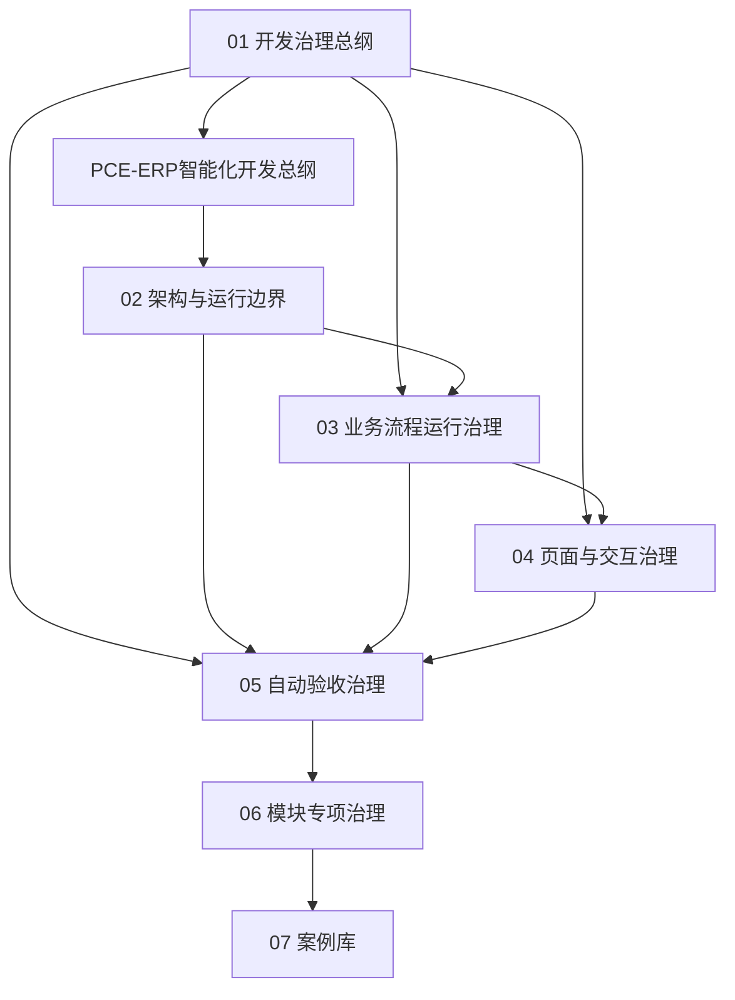

# PCE-ERP治理调用关系图

# 文档信息

- 版本：V1.14.2.8.4.27.2.32
- 用途：定义治理文件的唯一读取顺序、依赖方向和活跃资产注册表
- 适用范围：Codex执行、治理自检和全部PCE-ERP开发任务
- 优先级：高
- 关联规范：PCE-ERP开发治理总纲、五大核心治理规范、模块专项规范、问题案例库
- 维护方式：持续更新

## 1. Codex固定读取顺序

```text
01 开发治理总纲
  ↓
PCE-ERP智能化开发总纲（全部开发任务）
  ↓
02 架构与运行边界规范
  ↓
03 业务流程运行治理规范
  ↓
04 页面与交互开发规范（涉及页面时）
  ↓
05 自动验收与证据治理规范
  ↓
06 对应模块专项规范
  ↓
07 问题案例库（发现问题、回归或案例匹配时）
```

不得从归档文件开始新任务；归档只用于历史追溯。

## 2. 依赖关系



依赖只从高层指向低层或证据层，禁止反向覆盖和循环引用。模块专项可引用五大核心规范；核心规范不得依赖某个模块实现。

## 3. 活跃治理资产注册表

| 类型 | 唯一路径 | 职责 |
|---|---|---|
| 最高入口 | `01-开发治理总纲/PCE-ERP开发治理总纲.md` | 原则、读取顺序、版本和修改边界 |
| 强制专项总纲 | `PCE-ERP智能化开发总纲.md` | 智能化优先、已有能力复用、禁止重复框架和自动化边界 |
| 核心规范 | `02-架构与运行边界/PCE-ERP架构与运行边界规范.md` | Runtime、Provider、Action、Guard、Handoff、状态和持久化 |
| 核心规范 | `03-业务流程运行治理/PCE-ERP业务流程运行治理规范.md` | 节点九要素、PROCESS规则和生命周期 |
| 核心规范 | `04-页面与交互治理/PCE-ERP页面与交互开发规范.md` | 页面、列表、交互、指引和可观测性 |
| 核心规范 | `05-自动验收治理/PCE-ERP自动验收与证据治理规范.md` | 自动/人工验收、证据和失败契约 |
| 模块专项 | `06-模块专项治理/SCM/PCE-ERP-SCM专项治理规范.md` | SCM采购生命周期专项约束 |
| 案例库 | `07-案例库/PCE-ERP问题案例库.md` | 问题、根因、解决方案和回归索引 |
| 迁移报告 | `05-自动验收治理/governance_refactor_report_v114281820.md` | 原资产盘点与迁移证据 |
| 依赖图 | `05-自动验收治理/governance_dependency_map_v114281820.md` | 读取顺序、DAG和资产注册 |

Finance、MES、MRP、APS和CRM目录是模块专项预留槽位；在对应专项规范正式建立前，不构成孤立规范。

## 4. 旧文件解析规则

原有37项治理资产全部保留：36项进入`archive`，问题案例库迁入`07-案例库`。归档Markdown顶部声明当前替代规范；归档JSON使用等价元数据。历史引用按“原文件名 → archive资产 → 当前替代规范”解析，新任务只更新替代规范。

## 5. 无孤立、无失效和无循环标准

1. 所有活跃规范必须登记在本注册表。
2. 所有登记路径必须实际存在。
3. 每个归档资产必须声明替代规范或历史报告归属。
4. 依赖图必须为有向无环图。
5. 五大核心规范只能有一个最高入口；智能化开发总纲不得声明为第二个最高入口。
6. 模块预留空目录不计为规范资产。
