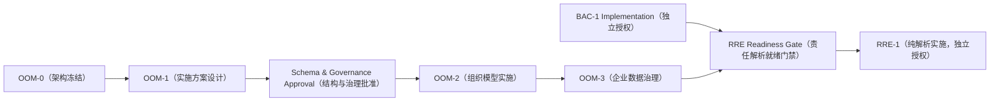
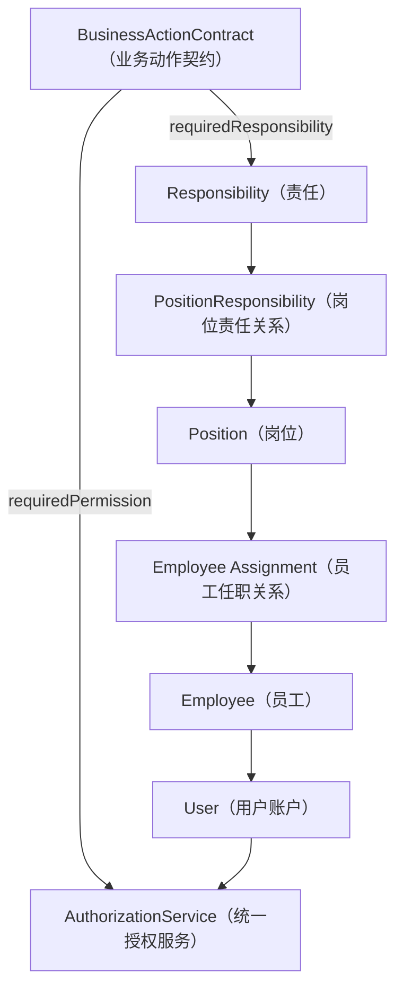

# PCE Organization Operating Model V2（企业组织运行模型 V2）OOM-1 实施方案设计报告

## 0. 文档信息与状态

| 项目 | 内容 |
|---|---|
| 系统 | PCE（ProfitOS / Dev-PCE） |
| 文档类型 | Implementation Design（实施方案设计） |
| 当前阶段 | OOM-1 Implementation Design（企业组织运行模型实施方案设计） |
| 上游基线 | BAC-0、BAC-1 Architecture Design、OOM V2 Architecture Design |
| OOM-1 Implementation Design | COMPLETE（完成） |
| Organization Model Implementation | NOT AUTHORIZED（未授权） |
| RRE-1 | NOT AUTHORIZED（未授权） |
| Workflow Integration | NOT AUTHORIZED（未授权） |

本报告设计 Organization Operating Model V2（企业组织运行模型 V2，以下简称 OOM V2）从架构基线进入实施准备的路线、数据结构决策、页面规划、管理流程、初始化策略、权限边界和验收门禁。本报告不修改代码、数据库、接口、组织数据、权限、工作流或采购业务。

---

## 1. 执行摘要

### 1.1 目标事实链

```text
Business Action Contract（业务动作契约）
  ↓ requiredResponsibility（所需责任编码）
Responsibility（职责/责任定义）
  ↓
PositionResponsibility（岗位责任关系）
  ↓
Position（岗位）
  ↓
Employee Assignment（员工任职关系）
  ↓
Employee（员工）
  ↓
User（用户账户）
  ↓
AuthorizationService（统一授权服务）
```

### 1.2 方案结论

1. 复用现有 `Company`、`OrganizationUnit`、`Department`、`JobFamily`、`JobLevel`、`Position`、`Responsibility`、`PositionResponsibility`、`Employee`、`User`、`Role` 和 `Permission`，不建设 V2 平行表族。
2. OOM-2（组织模型实施）前必须单独批准两项最小 Schema（数据结构）决策：时态 Employee Assignment（员工任职关系），以及 `PositionResponsibility` 的有效期能力。
3. 公司范围默认从 `Position.company` 推导，不在岗位责任关系中重复存储 `company_id`；部门范围默认从岗位当前组织归属读取。
4. Position Family（岗位族）和 Position Level（岗位等级）是岗位的正交分类属性，不直接决定责任、权限或审批人。
5. Responsibility（职责/责任定义）继续由 `system.Responsibility` 独立维护；岗位只能承担既有责任，BAC 只能引用既有责任。
6. 员工变动只改变任职关系，不修改 Business Action（业务动作）、Workflow（工作流）、Responsibility 或 Permission（权限）。
7. 当前 `Employee.position_ref` 可作为迁移前的“当前主岗”事实，但不能满足兼岗、代理和历史时点解析。
8. OOM-1 完成不代表 OOM-2、BAC-1 Implementation（业务动作契约实施）或 RRE-1 获得授权。

```text
OOM-1 Implementation Design = COMPLETE
Current Model Reuse = PASS WITH CONTROLLED EXTENSIONS
Schema Change Authorization = NO
Organization Model Implementation = NOT AUTHORIZED
RRE-1 Ready = NO
```

---

## 2. 真实仓库读取范围、原文与判断依据

### 2.1 已读取文件

| 实际路径 | 文件作用 | 判断用途 |
|---|---|---|
| `D:\Dev-PCE\Source\backend\system\models.py` | 企业组织、岗位、责任、角色与权限模型 | 确认可复用实体、字段和当前约束 |
| `D:\Dev-PCE\Source\backend\pfm\models.py` | 员工档案、员工汇报和部门负责人关系 | 确认员工当前任职能力及汇报关系边界 |
| `D:\Dev-PCE\Source\backend\system\organization_operating.py` | 组织主数据授权、校验、保存和审计服务 | 确认正式写入链与现有管理权限 |
| `D:\Dev-PCE\Source\backend\system\enterprise_organization.py` | 组织模型服务端投影 | 确认页面数据均来自服务端组织事实 |
| `D:\Dev-PCE\Source\backend\system\access_control_views.py` | 组织、用户、角色、权限综合读取 | 确认正式页面消费同一服务端投影 |
| `D:\Dev-PCE\Source\backend\system\responsibility_catalog.py` | 责任目录只读投影 | 确认责任唯一事实来源 |
| `D:\Dev-PCE\Source\frontend\src\meta\pages\AccessControlFoundationPage.vue` | “组织、人员、岗位、账户、角色与权限”正式入口 | 评估现有列表、详情和管理入口 |
| `D:\Dev-PCE\Source\frontend\src\meta\components\OrganizationOperatingAdminDialog.vue` | 组织、岗位、岗位族、岗位等级、职责、员工关系维护 | 评估现有表单和字段边界 |
| `D:\Dev-PCE\Source\frontend\src\meta\components\EnterpriseOrganizationModelView.vue` | 综合组织模型页面 | 评估综合查看与唯一维护入口一致性 |
| `D:\Dev-PCE\Source\frontend\src\router\index.js` | 组织模块路由 | 确认 `/organization` 的正式入口地位 |
| `D:\Dev-PCE\Source\docs\governance\PCE Organization Operating Model V2 与 Business Action Contract 对接设计报告.md` | OOM-0 对接设计基线 | 继承组织事实边界和 RRE 前置条件 |
| `D:\Dev-PCE\Source\docs\governance\PCE Business Action Contract V1 BAC-1架构与契约定义设计报告.md` | BAC-1 契约设计 | 确认 `requiredResponsibility`、`requiredPermission` 和 `scopeDimensions` 依赖 |

### 2.2 Organization（组织）现状原文

来源：`backend/system/models.py:59-155`

```python
class Company(models.Model):
    name = models.CharField("公司名称", max_length=100, unique=True)
    code = models.CharField("公司编码", max_length=20, unique=True)
    is_active = models.BooleanField("是否启用", default=True)

class OrganizationUnit(models.Model):
    class UnitType(models.TextChoices):
        COMPANY = "COMPANY", "公司"
        BUSINESS_UNIT = "BUSINESS_UNIT", "事业部"
        CENTER = "CENTER", "中心"
        DEPARTMENT = "DEPARTMENT", "部门"
        TEAM = "TEAM", "团队/班组"
    parent = models.ForeignKey("self", ...)
    company = models.ForeignKey(Company, ...)
    effective_from = models.DateField(...)
    effective_to = models.DateField(...)

class Department(models.Model):
    parent = models.ForeignKey("self", ...)
    company = models.ForeignKey(Company, ...)
    organization_unit = models.ForeignKey(OrganizationUnit, ...)
    responsible_position = models.ForeignKey("Position", ...)
```

判断：`OrganizationUnit` 已具备统一层级、类型、公司范围和有效期；`Department` 是正式部门业务主档并可挂接组织单元。OOM-2 应治理二者的映射，不能再建第二套组织树。

### 2.3 Position Family（岗位族）、Position Level（岗位等级）与 Position（岗位）原文

来源：`backend/system/models.py:239-343`

```python
class JobFamily(models.Model):
    code = models.CharField("岗位族编码", max_length=50, unique=True)
    name = models.CharField("岗位族名称", max_length=100)
    company = models.ForeignKey(Company, ...)
    is_active = models.BooleanField("是否启用", default=True)

class JobLevel(models.Model):
    code = models.CharField("岗位等级编码", max_length=50)
    company = models.ForeignKey(Company, ...)
    rank = models.PositiveIntegerField("等级顺序", default=1)
    is_active = models.BooleanField("是否启用", default=True)

class Position(models.Model):
    department = models.ForeignKey(Department, ...)
    company = models.ForeignKey(Company, ...)
    job_family = models.ForeignKey(JobFamily, ...)
    job_level = models.ForeignKey(JobLevel, ...)
    parent_position = models.ForeignKey("self", ...)
    default_role = models.ForeignKey("Role", ...)
    effective_from = models.DateField(...)
    effective_to = models.DateField(...)
```

判断：三个模型已经独立存在。`JobFamily` 和 `JobLevel` 均从 `Position` 被引用，二者不是父子关系；`Position.default_role` 不能被解释为正式授权。

### 2.4 Responsibility（职责/责任定义）与岗位责任原文

来源：`backend/system/models.py:394-440`

```python
class Responsibility(models.Model):
    class Status(models.TextChoices):
        DRAFT = "DRAFT", "草稿"
        ACTIVE = "ACTIVE", "生效"
        SUSPENDED = "SUSPENDED", "暂停"
        EXPIRED = "EXPIRED", "失效"
    code = models.CharField("职责编码", max_length=80, unique=True)
    effective_from = models.DateField(...)
    effective_to = models.DateField(...)

class PositionResponsibility(models.Model):
    position = models.ForeignKey(Position, ...)
    responsibility = models.ForeignKey(Responsibility, ...)
    is_primary = models.BooleanField("是否主要职责", default=False)
    active = models.BooleanField("是否启用", default=True)
```

判断：责任已有生命周期和有效期，岗位责任关系只有主责/协助和当前启停状态。它能够支撑当前态关系，但不能完整证明指定历史时点的岗位责任。

### 2.5 Employee（员工）现状原文

来源：`backend/pfm/models.py:6-48`

```python
class Employee(models.Model):
    user = models.OneToOneField('system.User', ...)
    status = models.CharField(...)
    department_ref = models.ForeignKey(
        'system.Department', ... verbose_name='正式部门',
    )
    position_ref = models.ForeignKey(
        'system.Position', ... verbose_name='正式岗位',
    )
```

判断：当前只有一个正式部门和一个正式岗位引用。人员档案与账户已经分离，但任职关系尚未独立，无法表达 `PRIMARY/SECONDARY/ACTING` 和任职有效期。

### 2.6 员工汇报关系原文

来源：`backend/pfm/models.py:94-116`

```python
class EmployeeReportingRelation(models.Model):
    """Formal employee reporting line; separate from Department and Position."""
    employee = models.ForeignKey(Employee, ...)
    manager = models.ForeignKey(Employee, ...)
    relation_type = models.CharField(...)
    effective_from = models.DateField(...)
    effective_to = models.DateField(...)
```

判断：汇报关系具有时态能力，但它只回答直属/职能汇报，不回答员工任职或动作责任，不得被 RRE 用作兜底。

### 2.7 Role（角色）、Permission（权限）与正式授权原文

来源：`backend/system/models.py:351-389,506-540`

```python
class Role(models.Model):
    code = models.CharField("角色编码", max_length=50, unique=True)

class Permission(models.Model):
    code = models.CharField("权限编码", max_length=100, unique=True)

class RolePermission(models.Model):
    role = models.ForeignKey(Role, ...)
    permission = models.ForeignKey(Permission, ...)

class UserRoleScopeAssignment(models.Model):
    user = models.ForeignKey(User, ...)
    role = models.ForeignKey(Role, ...)
    organization = models.ForeignKey(Company, ...)
    department = models.ForeignKey(Department, ...)
```

判断：正式授权链已经存在。岗位、岗位族、岗位等级和责任都不能替代 `UserRoleScopeAssignment → RolePermission → Permission`。

### 2.8 服务端保存与审计原文

来源：`backend/system/organization_operating.py:31-52,216-233,287-291`

```python
PERMISSION_STRUCTURE_MANAGE = "system.organization.structure.manage"
PERMISSION_DEPARTMENT_MANAGE = "system.organization.department.manage"
PERMISSION_POSITION_MANAGE = "system.organization.position.manage"
PERMISSION_RESPONSIBILITY_MANAGE = "system.organization.responsibility.manage"
PERMISSION_REPORTING_MANAGE = "system.organization.reporting.manage"

class OrganizationOperatingService:
    """Explicit Action -> Guard -> Persistence -> Audit service for organization maintenance."""
    decision = AuthorizationService.decide(...)
    ...
    audit = OrganizationOperatingAuditRecord.objects.create(...)
```

判断：OOM-2 应复用现有授权和审计链；本方案不设计第二套组织权限核心或责任专用审计表。

### 2.9 当前正式页面原文

来源：`frontend/src/meta/pages/AccessControlFoundationPage.vue:6-14,214-225,248`

```vue
<h1>组织、人员、岗位、账户、角色与权限</h1>
<span>全部记录来自服务端正式模型；岗位不等于角色，账户不代替员工档案。</span>
<el-alert title="正式关系：公司 → 部门 → 岗位 → 员工 → 登录账户 → 系统角色 → 业务动作权限 → 数据范围" ... />
```

```javascript
{key:'positions', label:'岗位管理', note:'正式 Position 主档；岗位属于组织，不等于系统角色'},
{key:'responsibilities', label:'责任管理', note:'独立 Responsibility 目录；先定义责任，再由岗位选择并承担'},
{key:'employees', label:'员工档案', note:'正式 Employee 档案及部门、岗位、账户关系'},
```

判断：页面语义符合 OOM V2 基线，正式入口应继续保持 `#/organization`。

### 2.10 当前岗位责任选择原文

来源：`frontend/src/meta/components/OrganizationOperatingAdminDialog.vue:62-69`

```vue
<el-tab-pane label="岗位族" name="job-family">...</el-tab-pane>
<el-tab-pane label="岗位等级" name="job-level">...</el-tab-pane>
<el-tab-pane label="职责分配" name="assignment">
  <el-alert title="岗位只能从责任目录选择已有责任；新责任必须在组织页面顶层“责任管理”中独立创建。" ... />
  <small>数据来源：Responsibility API · system.Responsibility</small>
</el-tab-pane>
```

判断：岗位责任分配已遵守责任事实源原则，OOM-2 只需补足有效期、范围证据和冲突预检，不应改回岗位内创建责任。

### 2.11 BAC 依赖原文

来源：`docs/governance/PCE Business Action Contract V1 BAC-1架构与契约定义设计报告.md:408-412,1084-1088`

```text
requiredResponsibility：责任型动作必须引用已有责任编码
requiredPermission：必须引用 Permission Registry
scopeDimensions：描述需要读取的业务范围维度

当前实现状态：
requiredResponsibility = 不存在
objectType = Contract 中不存在
scopeDimensions = 结构化字段不存在
```

判断：OOM-1 可以完成实施方案，但 BAC-1 未实施前，RRE 没有权威动作输入。

---

## 3. OOM 实施总体路线



### 3.1 OOM-0：架构冻结

已完成：事实边界、岗位/责任/角色/权限语义、BAC 对接链和禁止兜底规则。

### 3.2 OOM-1：实施方案设计

本报告完成：目标结构、最小扩展、页面规划、管理职责、初始化、权限、测试、上线与回退设计。

### 3.3 OOM-2：组织模型实施

必须获得新授权后才能进行：

- 批准后的 Schema 和 Migration；
- 服务端模型、校验、投影和写入服务；
- 正式页面维护闭环；
- 自动测试；
- 不创建企业正式初始化数据。

### 3.4 OOM-3：企业数据治理

由管理员人工维护或确认组织、岗位目录、责任承担和员工任职；通过质量门禁后形成 RRE 可消费的数据基线。

### 3.5 RRE-1：纯责任解析

只有 BAC-1 服务端契约和 OOM-3 数据质量同时通过，且获得独立授权后，才允许实现只读解析。

---

## 4. Organization（组织）实施方案

### 4.1 目标层级

```text
Company（公司）
  ↓
OrganizationUnit（组织单元：事业部/中心/部门/团队）
  ↓
Department（部门业务主档）
  ↓
Team（团队/班组语义）
```

### 4.2 事实与管理维度

| 对象 | 定位 | 是否影响责任解析 |
|---|---|---|
| Company | 法人/企业组织范围，是所有组织事实的根 | 是，作为强制隔离范围 |
| OrganizationUnit | 通用企业组织树和父子层级 | 是，用于范围和组织路径证据 |
| Department | 正式部门业务主档，承载部门类型、组织单元映射 | 是，用于部门范围过滤 |
| Team | 最小团队/班组管理维度 | 条件影响；只有 BAC 声明 team 维度时使用 |
| Department.responsible_position | 部门治理负责人岗位 | 否，不自动等于业务动作责任岗位 |
| Department.manager | 旧字符串字段 | 否，不作为正式事实 |

### 4.3 Team（团队/班组）模型治理

当前同时存在：

- `OrganizationUnit.UnitType.TEAM`；
- `Department.DepartmentType.TEAM`；
- 制造结构中的 `system.Team`（关联 Workshop/Process）。

OOM-2 前必须冻结：

1. 通用企业组织团队使用 `OrganizationUnit` 的 TEAM 类型；
2. `system.Team` 只表达车间生产班组，不替代企业组织树；
3. `DepartmentType.TEAM` 作为兼容类型，不得与同一团队重复建档；
4. RRE 默认只消费 Company/Department；只有 BAC `scopeDimensions` 明确包含团队且对象事实可证明时，才消费 Team。

### 4.4 生命周期与校验

- 创建：公司内编码唯一，父组织存在且同公司；
- 修改：禁止形成层级环，变更需原因和 Before/After；
- 停用：存在有效下级、岗位或员工时必须阻断或完成迁移计划；
- 有效期：`effective_to >= effective_from`；
- 历史：不物理删除被引用组织单元；
- 跨公司：父子、部门映射和岗位归属一律拒绝。

---

## 5. Position Family（岗位族）实施方案

### 5.1 定义

Position Family 回答“企业有哪些岗位类别”，例如采购类、生产类、质量类、财务类、研发类和管理类。

### 5.2 模型决策

- 复用 `system.JobFamily`，不新增 `PositionFamilyV2`；
- 与 Position 是一对多关系；
- 与 JobLevel 无直接父子关系；
- 不能根据岗位名称自动生成；
- 不能自动生成 Responsibility、Role 或 Permission。

### 5.3 目录作用域决策

当前 `JobFamily.code` 全局唯一，同时又包含 `company`。OOM-2 前必须在两种方案中签发：

| 方案 | 含义 | 建议 |
|---|---|---|
| 全局编码、公司拥有 | 编码全局唯一，各公司维护自己的条目 | 兼容现状，OOM-2 推荐 |
| 公司内编码唯一 | 不同公司可重复编码 | 需要约束迁移，暂不推荐 |

推荐保持现有全局唯一约束，先以命名空间治理解决多公司冲突，避免扩大 Migration。

### 5.4 生命周期

当前只有 `is_active`。OOM-2 第一阶段建议维持兼容生命周期：ACTIVE（启用）/INACTIVE（停用），不物理删除已被岗位引用的岗位族。生效日期扩展如有必要，应独立授权，不与员工任职扩展捆绑。

### 5.5 管理责任

企业组织管理员维护目录，专业领域负责人提出新增/调整建议；岗位负责人只能选择已有岗位族。

---

## 6. Position Level（岗位等级）实施方案

### 6.1 定义

Position Level 回答“同类型岗位如何体现层级”，例如 P1、P2、P3、P4。

### 6.2 允许用途

- 职业发展路径；
- 薪酬与职级分析；
- 人才盘点；
- 组织结构统计；
- 作为解析 Evidence（证据）的说明字段。

### 6.3 禁止用途

- 自动创建或选择 Responsibility；
- 自动授予 Role/Permission；
- 将更高等级员工自动选为审批人；
- 替代 PositionResponsibility；
- 在多人候选时作为未声明的排序规则。

### 6.4 模型与生命周期

- 复用 `system.JobLevel`；
- 公司内 `code` 唯一，`rank` 只用于展示和分析；
- 当前使用 `is_active`，停用前检查岗位引用；
- 不删除历史被引用等级；
- 不将 JobLevel 绑定为 JobFamily 子节点，除非未来另有能力矩阵设计授权。

---

## 7. Position（岗位）实施方案

### 7.1 目标语义

```text
Position（岗位）
  ├─ belongs to Company / Department / OrganizationUnit
  ├─ classified by JobFamily
  ├─ graded by JobLevel
  ├─ related to Parent Position
  └─ carries Responsibility through PositionResponsibility
```

岗位不是员工、角色、权限或审批人；岗位是稳定的责任承载载体。

### 7.2 必要校验

1. 公司、部门、岗位族、岗位等级必须同公司；
2. 上级岗位必须同公司，且不得形成循环；
3. 有效期合法；
4. 停用前检查有效员工任职和岗位责任；
5. 岗位编码不从人员姓名生成；
6. `default_role` 仅作建议/展示，不能创建 UserRoleScopeAssignment；
7. 岗位职责摘要是说明文字，不是责任事实源。

### 7.3 当前唯一性限制

当前 Position 的 `name`、`code` 均为全局唯一。OOM-2 建议暂时保持兼容约束；是否切换为公司内唯一，应作为独立迁移决策，不与本轮最小扩展捆绑。

### 7.4 停用流程

```text
提出停用
  ↓
检查有效任职 / 岗位责任 / 下级岗位 / 流程兼容引用
  ↓
完成迁移或明确阻断
  ↓
填写原因
  ↓
停用并记录审计
```

---

## 8. Responsibility（职责/责任定义）实施方案

### 8.1 唯一事实源

继续使用 Global Responsibility Catalog（全局责任目录）：

```text
system.Responsibility = 唯一责任事实来源
```

岗位、员工、工作流、BAC、前端按钮和 AI（人工智能）都不能创建正式责任。

### 8.2 生命周期

当前真实状态为：

```text
DRAFT → ACTIVE → SUSPENDED / EXPIRED
SUSPENDED → ACTIVE / EXPIRED
EXPIRED = 终态
```

本方案保持数据库代码 `EXPIRED`，其业务含义覆盖“失效/退役”。若未来必须改名为 `RETIRED`，需独立兼容和 Migration 授权，不能只改页面文字造成状态漂移。

### 8.3 维护职责

| 角色 | 职责 |
|---|---|
| 业务负责人 | 提出责任定义、业务目的和适用场景 |
| 企业组织/责任管理员 | 检查编码、重复、生命周期并执行正式维护 |
| 流程负责人 | 声明流程节点需要引用哪个已有责任，不创建责任 |
| 权限管理员 | 维护 Permission/Role，不决定责任承担岗位 |
| 架构治理负责人 | 审核跨域编码和语义边界 |

### 8.4 发布校验

- 编码符合“业务对象 + 责任目的”；
- 不含岗位、人员或角色名称；
- 有效期合法；
- ACTIVE 前完成业务负责人确认；
- 与现有责任无语义重复；
- 不自动产生权限；
- 变更进入 OrganizationOperatingAuditRecord。

---

## 9. PositionResponsibility（岗位责任关系）实施方案

### 9.1 目标关系

```text
Position（岗位）
  ↓ assumes
Responsibility（职责/责任定义）
```

例如：采购经理岗位承担 `PURCHASE_REQUEST_APPROVAL`（采购申请审批责任）。

### 9.2 当前字段与目标字段

| 语义 | 当前字段 | OOM-2 目标 |
|---|---|---|
| 岗位 | `position_id` | 复用 |
| 责任 | `responsibility_id` | 复用 |
| 主责/协助 | `is_primary` | 兼容映射 PRIMARY/SUPPORTING |
| 启停 | `active` | 复用 |
| 生效日期 | 无 | 建议增加 `effective_from` |
| 失效日期 | 无 | 建议增加 `effective_to` |
| 公司范围 | 无独立字段 | 从 `Position.company` 推导，不重复存储 |
| 部门范围 | 无独立字段 | 默认从 `Position.department` 推导 |
| 修改证据 | 统一审计 | 复用 OrganizationOperatingAuditRecord |

增加有效期属于 OOM-2 的受控 Schema 候选，不是本报告实施授权。

### 9.3 关系规则

1. 一个责任可由多个岗位承担；解析时必须返回 `MULTIPLE_CANDIDATES`，不能按 ID 或等级选择；
2. 一个岗位可承担多个责任；
3. 主责和协助是承担性质，不代表权限；
4. RRE 默认只解析 PRIMARY；是否包含 SUPPORTING 必须由 BAC/解析策略显式声明；
5. 责任必须 ACTIVE 且有效期命中；
6. 岗位必须同公司且有效；
7. 关系有效期不得超出岗位或责任可用期间；
8. 跨公司关系拒绝；
9. 历史关系不物理删除，以失效日期和审计保留。

### 9.4 范围设计

第一阶段不在关系表增加通用 JSON Scope（范围）或重复公司字段。RRE 的实际范围由：

```text
BAC.scopeDimensions
+ Business Object Facts（业务对象事实）
+ Position.company / department
```

共同计算。只有出现无法由岗位组织归属表达的正式场景，才另行设计范围扩展。

---

## 10. Employee Assignment（员工任职关系）实施方案

### 10.1 必要性

员工变动频率高于岗位和责任。若直接修改岗位、责任或流程来适应人员变化，将破坏企业主数据稳定性。因此需要独立任职事实：

```text
Employee（员工）
  ↓ assignment
Position（岗位）
  ↓ carries
Responsibility（责任）
```

### 10.2 推荐最小模型

建议 OOM-2 单独审批 `EmployeePositionAssignment`（员工岗位任职关系；名称待 Schema 评审确认）：

| 字段 | 类型语义 | 规则 |
|---|---|---|
| employee | Employee 引用 | 必填 |
| position | Position 引用 | 必填，同公司 |
| assignment_type | PRIMARY / SECONDARY / ACTING | 受控枚举 |
| effective_from | 生效日期 | 必填或按治理默认 |
| effective_to | 失效日期 | 可空，且不早于开始日 |
| active | 当前有效标志 | 与有效期一致 |
| reason | 修改原因 | 写入服务接收并进入审计 |

不在关系中复制岗位族、岗位等级、责任、角色或权限。

### 10.3 唯一性和冲突规则

- 同一员工同一时点最多一个 PRIMARY 主岗；
- 同一员工可有多个 SECONDARY 兼岗；
- ACTING 代理必须有明确有效期；
- 一个岗位允许多人任职，但 RRE 返回多人候选，不自动选择；
- Employee、Position、Department、Company 必须一致；
- 员工离职/停用后不得产生新有效任职；
- 结束主岗不得自动结束汇报关系或用户授权，必须形成显式治理任务；
- 任职关系不自动授予 Role/Permission。

### 10.4 与现有字段兼容

OOM-2 推荐迁移期规则：

1. `Employee.position_ref` 保留为 Current Primary Position Projection（当前主岗投影）；
2. Employee Assignment 成为任职权威事实后，投影由服务端同步生成，不允许双向独立编辑；
3. 迁移前，现有非空 `position_ref` 只生成“候选主岗清单”，不自动写入；
4. 管理员逐条或受控批次确认后才建立正式任职；
5. 对账通过后再决定旧字段的长期兼容策略。

### 10.5 员工变化原则

入职、调岗、兼岗、代理、离职只修改 Employee/Assignment 事实。禁止因此修改：

- BusinessActionContract；
- Responsibility；
- PositionResponsibility；
- Workflow Runtime；
- Permission；
- ApprovalTask。

---

## 11. User（用户）、Role（角色）、Permission（权限）边界

### 11.1 正式链路

```text
Employee
  ↓ optional one-to-one account link
User
  ↓ UserRoleScopeAssignment
Role
  ↓ RolePermission
Permission
  ↓
AuthorizationService
```

### 11.2 OOM-2 禁止行为

- 岗位创建时自动创建 Role；
- 岗位任职时自动授予 Role；
- 责任分配时自动创建 Permission；
- 使用 `Position.default_role` 作为授权事实；
- 因 RRE 选中员工而自动授权；
- 用拥有权限的人反向推断责任人。

### 11.3 权限复用方案

第一阶段复用现有权限：

| 维护对象 | 现有权限 |
|---|---|
| 组织单元 | `system.organization.structure.manage` |
| 部门 | `system.organization.department.manage` |
| 岗位族/岗位等级/岗位 | `system.organization.position.manage` |
| 责任与岗位责任 | `system.organization.responsibility.manage` |
| 员工档案、正式岗位和汇报关系 | `system.organization.reporting.manage` |
| 流程责任兼容配置 | `system.organization.workflow_responsibility.manage` |

Employee Assignment 第一阶段建议复用 `system.organization.reporting.manage`，因为它延续现有员工正式岗位维护权限。是否拆分新权限必须另行权限治理批准；本轮不修改 Permission 模型或权限数据。

---

## 12. 与 Business Action Contract（业务动作契约）的对接实施设计

### 12.1 最终链路



### 12.2 维护分工

| 事实 | 维护责任 |
|---|---|
| Business Action Contract | BAC 契约管理员/模块负责人，独立发布 |
| Responsibility | 业务负责人提出，责任管理员正式维护 |
| JobFamily / JobLevel | 企业组织管理员维护 |
| Position | 公司组织管理员维护 |
| PositionResponsibility | 组织管理员与业务负责人双重确认 |
| Employee | 人员档案管理员维护 |
| Employee Assignment | 公司组织/人员管理员维护，岗位负责人确认 |
| Role / Permission | 权限管理员维护 |
| Workflow Node 引用 actionCode | 流程管理员维护；不能创建动作或责任 |

### 12.3 变更传播规则

- 责任编码被 BAC 引用后不得直接改码；采用新责任和退役策略；
- 岗位承担关系变化不修改 BAC；
- 员工调岗不修改 BAC、责任或岗位；
- 权限变化不修改责任承担关系；
- 任一变更均不自动创建 Workflow Task（流程任务）。

---

## 13. RRE（责任解析引擎）实施准备

### 13.1 RRE 消费输入

```text
Business Action Contract
  ├─ actionCode
  ├─ objectType
  ├─ requiredResponsibility
  ├─ requiredPermission
  └─ scopeDimensions

Organization Operating Model
  ├─ Company / OrganizationUnit / Department
  ├─ Responsibility
  ├─ PositionResponsibility
  ├─ Position
  ├─ Employee Assignment
  └─ Employee / User
```

### 13.2 RRE 输出

RRE 未来只输出 Resolved Employee（解析员工）或明确状态与 Evidence：

- `RESOLVED`；
- `MULTIPLE_CANDIDATES`；
- `RESPONSIBILITY_UNRESOLVED`；
- `NO_ACTIVE_EMPLOYEE`；
- `RESPONSIBILITY_FOUND_PERMISSION_DENIED`。

### 13.3 RRE 不负责

- 创建组织、岗位、岗位族或岗位等级；
- 创建责任或岗位责任关系；
- 修改员工任职；
- 自动选择多人候选；
- 自动授予角色或权限；
- 自动找主管或管理员；
- 创建 ApprovalTask；
- 推进采购或 Workflow 状态。

### 13.4 RRE 就绪门禁

| 门禁 | 当前状态 |
|---|---|
| BAC 服务端契约已提供所需字段 | NOT READY |
| Responsibility 目录及生命周期可用 | READY |
| PositionResponsibility 当前态可用 | PARTIAL |
| PositionResponsibility 时态能力 | NOT READY |
| Employee Assignment 时态能力 | NOT READY |
| 组织范围一致性检查 | DESIGN COMPLETE |
| OOM-3 企业数据质量通过 | NOT STARTED |
| RRE-1 独立实施授权 | NO |

结论：`RRE-1 Ready = NO`。

---

## 14. 数据初始化与迁移策略

### 14.1 原则

- 不根据岗位名称、部门名称、员工姓名或“经理/主管”关键字自动生成事实；
- 不自动创建 Responsibility；
- 不把现有 Role 映射成 Responsibility；
- 不在 Migration 中植入企业正式主数据；
- 所有正式数据由管理员确认；
- 初始化过程可重复、可对账、可回退。

### 14.2 建议步骤

```text
只读盘点
  ↓
生成数据质量报告
  ↓
管理员确认目标编码与关系
  ↓
沙箱/测试库预演
  ↓
差异对账
  ↓
受控生产导入（另行授权）
  ↓
刷新回读 + 审计核对
```

### 14.3 盘点清单

- Company/OrganizationUnit/Department 是否同公司且无环；
- 部门是否正确映射组织单元；
- JobFamily/JobLevel 编码是否重复或失效；
- Position 的公司、部门、岗位族、岗位等级是否一致；
- PositionResponsibility 是否存在失效责任或岗位；
- Employee 的正式部门与岗位是否一致；
- 一个员工是否存在无法解释的多岗需求；
- 账户是否正确关联 Employee；
- 角色权限是否具有正确组织/部门范围。

### 14.4 Employee Assignment 初始化

1. 从非空 `Employee.position_ref` 生成只读候选清单；
2. 候选类型默认为“待确认 PRIMARY”，而不是直接保存；
3. 管理员确认生效日期、岗位和公司；
4. 兼岗/代理另行人工录入；
5. 冲突记录不导入，进入人工整改；
6. 导入后核对 Assignment 数量、当前主岗投影和审计数量；
7. 失败时停止批次，不回写 BAC、Workflow 或采购数据。

### 14.5 PositionResponsibility 初始化

现有关系保留原 ID。若未来增加有效期：

- 不自动新建关系；
- 现有 active 关系仅生成待确认有效期建议；
- 由管理员确认开始日期；
- inactive 关系保留历史，不自动激活；
- 公司范围从 Position 推导并做一致性校验。

---

## 15. 数据治理与历史追溯

### 15.1 通用变更流程

```text
变更申请
  ↓
业务/组织负责人确认
  ↓
AuthorizationService 权限检查
  ↓
服务端业务校验
  ↓
保存正式事实
  ↓
OrganizationOperatingAuditRecord
  ↓
刷新回读和关联一致性检查
```

### 15.2 创建、修改、停用规则

| 对象 | 创建 | 修改 | 停用/退役 | 历史 |
|---|---|---|---|---|
| OrganizationUnit | 编码、类型、父级、公司 | 禁止跨公司/成环 | 有有效引用时阻断 | 有效期+审计 |
| Department | 公司内唯一、映射组织单元 | 负责人岗位与实际负责人分离 | 迁移岗位/员工后停用 | 有效期+审计 |
| JobFamily | 管理员人工创建 | 不自动改码 | 被岗位引用时不删除 | 启停+审计 |
| JobLevel | 管理员人工创建 | rank 只影响分析 | 被岗位引用时不删除 | 启停+审计 |
| Position | 组织归属和分类一致 | 不因换人改岗位 | 完成任职/责任迁移 | 有效期+审计 |
| Responsibility | 独立目录创建 | 被 BAC 引用后不直接改码 | EXPIRED 终态 | 有效期+审计 |
| PositionResponsibility | 人工选择已有责任 | 调整承担类型/有效期 | 失效而非删除 | 有效期+审计（目标） |
| Employee Assignment | 人工确认任职 | 调岗创建新期间 | 结束任职 | 时态记录+审计（目标） |

### 15.3 删除原则

企业组织事实默认不可物理删除已经被引用或进入审计的记录。纠错也应保留 Before/After 和原因；测试数据清理必须在隔离测试环境中执行。

---

## 16. 管理职责设计（RACI）

| 事实对象 | Responsible（执行维护） | Accountable（最终负责） | Consulted（协商） | 禁止主体 |
|---|---|---|---|---|
| Company/OrganizationUnit | 企业组织管理员 | 企业架构/管理负责人 | 各公司负责人 | 页面自动生成器 |
| Department/Team | 公司组织管理员 | 公司负责人 | 部门负责人 | Workflow |
| JobFamily/JobLevel | 企业组织管理员 | 人力/组织治理负责人 | 专业领域负责人 | AI 自动创建 |
| Position | 公司组织管理员 | 部门/组织负责人 | 人员管理员 | Employee 自动反推 |
| Responsibility | 责任管理员 | 业务负责人 | 流程/架构负责人 | 岗位页、BAC、AI |
| PositionResponsibility | 组织管理员 | 业务负责人 | 岗位负责人 | Permission 管理员单独决定 |
| Employee | 人员档案管理员 | 人力/公司负责人 | 部门负责人 | User 账户自动替代 |
| Employee Assignment | 人员/组织管理员 | 部门或组织负责人 | 岗位负责人 | RRE、Workflow |
| User/Role/Permission | 权限管理员 | 安全/权限负责人 | 业务负责人 | Responsibility 自动授权 |
| BusinessActionContract | 契约管理员 | 模块/架构负责人 | 责任、权限、流程负责人 | Frontend Registry |

关键控制：同一管理员不应无复核地同时定义责任、分配岗位责任并授予权限。实现可按现有权限分离，重要生产变更建议增加人工复核流程，但本阶段不改 Workflow。

---

## 17. 页面功能规划

### 17.1 唯一正式入口

保持：

```text
#/organization
→ 组织、人员、岗位、账户、角色与权限
```

`#/organization-model` 保持综合只读查看和诊断。当前组件存在“只读文案与维护对话框代码并存”的风险，OOM-2 页面实施前必须验证并收敛可达性。

### 17.2 页面规划

| 页面/Tab | 保留能力 | OOM-2 建议增加 | 禁止能力 |
|---|---|---|---|
| 部门管理 | 组织单元、部门、负责人 | 层级环/跨公司预检、引用影响提示 | 写死部门或负责人 |
| 岗位管理 | 岗位、岗位族、等级、上级岗位 | 分类语义说明、停用影响检查 | 岗位自动授权 |
| 岗位族 | 当前目录维护 | 引用数量、停用影响 | 根据岗位名称生成 |
| 岗位等级 | 当前目录维护 | rank 说明、引用数量 | 作为审批优先级 |
| 责任管理 | 独立目录和详情 | BAC 引用只读证据（BAC 实施后） | 岗位内创建责任 |
| 职责分配 | 选择已有责任 | 有效期、PRIMARY/SUPPORTING、冲突预览 | 自动选岗位/员工 |
| 员工档案 | 当前部门/岗位、主管、账户 | 任职记录入口和当前主岗投影 | 用主管替代任职 |
| 任职记录（目标） | 无 | 主岗/兼岗/代理、有效期、历史 | 自动授予角色 |
| 用户/角色/权限 | 正式授权链 | 显示与岗位责任分离说明 | 责任自动转权限 |
| 流程责任 | 当前兼容配置 | BAC actionCode 引用状态（未来） | 自行创建动作或责任 |

### 17.3 服务端事实一致性

所有页面、详情、下拉、诊断和验收报告必须读取同一服务端事实。禁止使用上一页缓存、前端重算或岗位关系反推责任目录。

---

## 18. OOM-2 实施包建议

本节是未来工作包规划，不授权执行。

### Package O2-0：Preflight（实施前检查）

- 冻结数据库备份与摘要策略；
- 确认现有数量和引用；
- 审批 Employee Assignment 与 PositionResponsibility 最小 Schema；
- 确认无平行模型；
- 确认采购与 Workflow 保护基线。

### Package O2-1：Schema（数据结构）

- 仅在授权后增加 Employee Assignment；
- 仅在授权后为 PositionResponsibility 增加有效期；
- 不修改 Responsibility、Permission、Workflow、ApprovalTask；
- Migration 不创建正式业务数据。

### Package O2-2：Service（服务）

- 复用 OrganizationOperatingService；
- 复用 AuthorizationService；
- 增加跨公司、有效期、重叠任职和生命周期校验；
- 所有成功写入记录 OrganizationOperatingAuditRecord；
- 保存后刷新回读。

### Package O2-3：Page（页面）

- 在 `#/organization` 内增加任职记录能力；
- 职责分配增加有效期与范围说明；
- 综合模型页保持只读；
- 不新建第二套组织系统。

### Package O2-4：Automated Verification（自动验证）

- 模型约束；
- 服务端授权 403；
- 生命周期和有效期；
- 跨公司阻断；
- 审计 Before/After；
- 刷新回读；
- 零采购/Workflow/RRE 写入。

### Package O2-5：Human Acceptance（人工验收）

- 管理员维护测试组织和岗位关系；
- 验证任职历史；
- 验证责任与权限分离；
- 验证综合页一致；
- 签发后进入 OOM-3 数据治理。

---

## 19. 验收方案

### 19.1 自动测试设计

| 编号 | 场景 | 预期 |
|---|---|---|
| OOM2-T01 | 同公司组织层级创建/修改 | 保存、审计、回读一致 |
| OOM2-T02 | 组织层级循环 | 拒绝 |
| OOM2-T03 | 跨公司部门/岗位族/等级引用 | 拒绝 |
| OOM2-T04 | 岗位停用但存在有效任职 | 拒绝并说明引用 |
| OOM2-T05 | 责任分配 PRIMARY/SUPPORTING | 保存语义正确 |
| OOM2-T06 | 岗位责任有效期非法 | 拒绝 |
| OOM2-T07 | 员工唯一主岗 | PASS |
| OOM2-T08 | 同时段多个主岗 | 拒绝 |
| OOM2-T09 | 兼岗/代理及有效期 | PASS |
| OOM2-T10 | 任职不产生 Role/Permission | PASS |
| OOM2-T11 | 无权限写操作 | HTTP 403 |
| OOM2-T12 | 审计 Before/After/Reason/Operator/Time | 完整 |
| OOM2-T13 | 刷新后读取同一服务端事实 | 一致 |
| OOM2-T14 | 多岗位承担同一责任 | 保留多人事实，不自动选择 |
| OOM2-T15 | 采购、Workflow、ApprovalTask、RRE 写入 | 全部为 0 |

### 19.2 人工验收清单

- [ ] `#/organization` 是唯一正式维护入口；
- [ ] 岗位族和岗位等级可独立管理，但不能创建责任或权限；
- [ ] 岗位只能选择已有责任；
- [ ] Responsibility API 继续以 `system.Responsibility` 为根事实；
- [ ] Employee Assignment 清楚区分主岗、兼岗、代理；
- [ ] 调岗不修改 BAC、责任或 Workflow；
- [ ] 岗位默认角色不自动授权；
- [ ] 直属/职能主管不作为任职或责任人兜底；
- [ ] 组织综合页与正式入口读取相同事实；
- [ ] 所有修改具有原因、审计和刷新回读；
- [ ] RRE、Workflow 和采购业务未接入。

### 19.3 进入 OOM-3 的门禁

```text
Schema Tests = PASS
Authorization Tests = PASS
Audit Tests = PASS
Readback Tests = PASS
Page Human Acceptance = PASS
Unauthorized Business Writes = 0
Workflow / Purchase / RRE Isolation = PASS
```

---

## 20. 上线与回退策略

### 20.1 上线原则

- Schema、服务、页面、数据治理分批签发；
- 先测试库和空数据能力，再进入企业数据治理；
- 不在 Migration 中自动生成岗位、责任或任职；
- 使用 Feature Flag（功能开关）仅控制新页面能力，不改变现有业务流程；
- RRE 开关保持关闭。

### 20.2 回退

- OOM-2 Schema 必须具有独立回退方案和迁移前备份；
- 新任职能力关闭时，现有 `Employee.position_ref` 继续作为兼容当前主岗读取；
- 不删除已经写入的审计历史；
- 数据质量失败时停止 OOM-3 导入批次，不回滚采购或 Workflow；
- BAC、RRE、ApprovalTask 因未接入无需业务回退。

---

## 21. 风险清单

| 编号 | 风险 | 影响 | 缓解方案 | 优先级 |
|---|---|---|---|---|
| OOM1-R01 | Employee 只有单一 `position_ref` | 无法证明兼岗/代理/历史任职 | 受控 Employee Assignment 扩展 | P0 |
| OOM1-R02 | PositionResponsibility 无有效期 | 历史解析证据不足 | 独立最小字段扩展 | P0 |
| OOM1-R03 | 通用 Team 与制造 Team 语义重叠 | 组织范围重复或冲突 | 冻结通用/制造边界 | P1 |
| OOM1-R04 | 默认角色被当成正式授权 | 绕过 AuthorizationService | 页面说明、服务端零自动授权测试 | P0 |
| OOM1-R05 | 责任状态 `EXPIRED` 与目标文档 `RETIRED` 命名不同 | 生命周期漂移 | 保持现有代码，另行兼容决策 | P1 |
| OOM1-R06 | 岗位族全局唯一且带公司 | 多公司编码冲突 | 第一阶段保持兼容并治理命名空间 | P1 |
| OOM1-R07 | 流程责任自由编码形成第二事实源 | BAC 与流程责任冲突 | BAC 为动作责任唯一入口 | P0 |
| OOM1-R08 | 前端从页面缓存重算组织事实 | 展示与服务端不一致 | 同一服务端事实和刷新回读 | P0 |
| OOM1-R09 | 自动初始化正式责任/任职 | 产生未经确认企业事实 | 只生成候选清单，人工确认 | P0 |
| OOM1-R10 | OOM 完成被误认为 RRE 可实施 | 过早接入业务 | 双门禁：BAC-1 + OOM-3 + 新授权 | P0 |

---

## 22. 下一阶段架构决策清单

进入 OOM-2 授权讨论前，人工必须确认：

- [ ] 复用现有实体，不建立 V2 平行组织/责任表；
- [ ] 批准或否决最小时态 Employee Assignment；
- [ ] 批准或否决 PositionResponsibility 有效期扩展；
- [ ] 公司范围从 Position 推导，不重复存储；
- [ ] JobFamily 继续全局编码/公司拥有模式；
- [ ] JobLevel 不参与责任人自动选择；
- [ ] `EXPIRED` 生命周期代码保持兼容；
- [ ] 通用 Team 与制造 Team 的边界；
- [ ] `Employee.position_ref` 作为当前主岗兼容投影；
- [ ] Employee Assignment 不自动授予角色权限；
- [ ] `#/organization` 为唯一维护入口；
- [ ] OOM-2、BAC-1、RRE-1 分别需要独立授权。

---

## 23. 本轮保护确认

本轮仅使用只读仓库检查并新增本 Markdown（标记语言）报告。未运行 ORM、Migration、业务 API、测试数据生成器、Workflow Runtime 或采购操作。仓库原有其他未提交改动不属于本任务，本轮未修改、清理或归因。

```text
Documentation Changed = YES
Code Changed = NO
Database Changed = NO
Migration Created = NO
API Created = NO
Organization Data Changed = NO
Job Family Data Changed = NO
Job Level Data Changed = NO
Position Data Changed = NO
Responsibility Data Changed = NO
Employee Relation Data Changed = NO
Permission Model Changed = NO
Workflow Runtime Changed = NO
ApprovalTask Changed = NO
Purchase Business Changed = NO
RRE Started = NO
Unauthorized Business Writes = 0
```

---

## 24. 最终状态

OOM-1 已完成从架构到实施准备的设计。未来实施应先建立稳定、可追溯的组织和任职事实，再由 BAC 引用责任，由 RRE 只读解析人员，最后由 AuthorizationService 独立裁决执行权限。员工变化不得迫使业务动作、责任或工作流随人修改。

```text
OOM-1 Implementation Design = COMPLETE
Organization Model Implementation = NOT AUTHORIZED
BAC-1 Implementation = NOT AUTHORIZED
RRE-1 = NOT AUTHORIZED
Workflow Integration = NOT AUTHORIZED
Human Architecture Decision = WAITING
```

完成本报告后停止，等待下一阶段架构决策。
