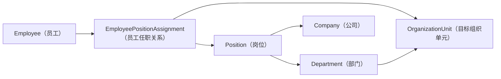
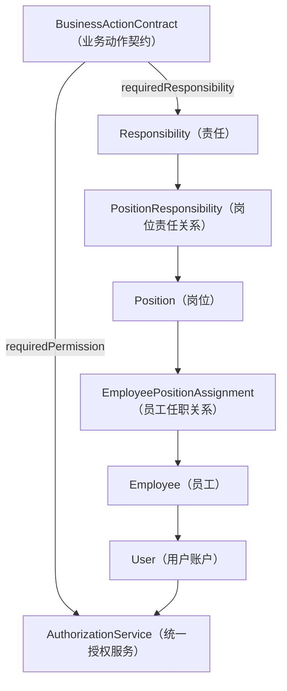

# PCE Organization Operating Model V2（企业组织运行模型 V2）OOM-2 实施设计与 Schema（数据结构）决策报告

## 0. 文档状态

| 项目 | 状态 |
|---|---|
| 文档类型 | Schema & Implementation Design（数据结构与实施设计） |
| 当前阶段 | OOM-2 Schema Decision（组织模型数据结构决策） |
| OOM-2 Schema Design（OOM-2 数据结构设计） | COMPLETE（完成） |
| Organization Model Implementation（组织模型实施） | NOT AUTHORIZED（未授权） |
| Schema Migration（数据结构迁移） | NOT AUTHORIZED（未授权） |
| BAC-1 Implementation（业务动作契约第一阶段实施） | NOT AUTHORIZED（未授权） |
| RRE-1（责任解析引擎第一实施阶段） | NOT AUTHORIZED（未授权） |
| Workflow Integration（流程集成） | NOT AUTHORIZED（未授权） |

本报告冻结 Organization Operating Model V2（企业组织运行模型 V2，以下简称 OOM V2）正式实施前所需的数据结构、时态、历史、治理、页面和验收方案。它是后续授权的设计依据，不是代码、数据库、Migration（数据库迁移）、API（接口）或企业数据实施授权。

---

## 1. 决策摘要

### 1.1 核心决策

| 编号 | 决策 | 结论 |
|---|---|---|
| SD-01 | `Employee.position_ref` 能否作为长期任职事实 | NO；只能作为迁移期 Current Primary Position Projection（当前主岗投影） |
| SD-02 | 是否需要独立 Employee Assignment（员工任职关系） | YES；推荐新增 `pfm.EmployeePositionAssignment` 关系模型，需另行授权 |
| SD-03 | 是否新增平行岗位责任表 | NO；原地演进 `system.PositionResponsibility` |
| SD-04 | 岗位责任是否需要有效期 | YES；增加左闭右开有效时间区间 |
| SD-05 | 是否在岗位责任中复制公司字段 | NO；公司范围从 Position（岗位）推导 |
| SD-06 | 是否保存自由 JSON Scope（范围） | NO；第一阶段由岗位组织归属与 BAC `scopeDimensions` 共同确定 |
| SD-07 | 时态精度 | 新关系使用 UTC DateTime（协调世界时日期时间），区间 `[from, to)` |
| SD-08 | Responsibility（职责/责任定义）终态编码 | 目标语义 `RETIRED`；当前 `EXPIRED` 作为迁移期 Legacy Alias（旧别名） |
| SD-09 | 跨组织任职 | 同公司内允许并显式记录目标组织单元；跨公司 V2 默认拒绝 |
| SD-10 | RRE 是否可自动补全事实 | NO；事实缺失必须返回明确未解析状态 |

### 1.2 目标事实链

```text
BusinessActionContract（业务动作契约）
  ↓ requiredResponsibility（所需责任编码）
system.Responsibility（责任目录）
  ↓
system.PositionResponsibility（岗位责任时态关系）
  ↓
system.Position（岗位）
  ↓
pfm.EmployeePositionAssignment（员工任职时态关系）
  ↓
pfm.Employee（员工）
  ↓
system.User（用户账户）
  ↓
AuthorizationService（统一授权服务）
```

### 1.3 当前结论

```text
OOM-2 Schema Design = COMPLETE
Employee Assignment Schema Decision = PASS
PositionResponsibility Temporal Decision = PASS
Temporal Resolution Design = PASS
Organization Model Implementation = NOT AUTHORIZED
Schema Migration = NOT AUTHORIZED
RRE-1 Ready = NO
```

---

## 2. 真实仓库审查范围、关键原文与判断依据

### 2.1 已读取文件

| 实际路径 | 文件作用 | 审查目的 |
|---|---|---|
| `D:\Dev-PCE\Source\backend\system\models.py` | 公司、组织单元、岗位、岗位族、岗位等级、责任、岗位责任、角色和权限模型 | 确认当前字段、约束和可演进位置 |
| `D:\Dev-PCE\Source\backend\pfm\models.py` | 员工、正式部门/岗位、汇报关系 | 确认任职时态缺口 |
| `D:\Dev-PCE\Source\backend\system\organization_operating.py` | 组织事实保存、权限、校验和审计 | 确认正式写入入口及现有生命周期规则 |
| `D:\Dev-PCE\Source\backend\system\enterprise_organization.py` | 企业组织模型服务端投影 | 确认页面当前读取 `position_ref` 与 active 岗位责任 |
| `D:\Dev-PCE\Source\backend\system\responsibility_catalog.py` | 责任目录投影 | 确认责任和岗位责任唯一事实来源 |
| `D:\Dev-PCE\Source\frontend\src\meta\pages\AccessControlFoundationPage.vue` | 组织、人员、岗位、账户、角色与权限正式页面 | 评估当前维护和回读能力 |
| `D:\Dev-PCE\Source\frontend\src\meta\components\OrganizationOperatingAdminDialog.vue` | 岗位、岗位族、岗位等级、职责、员工关系表单 | 评估 OOM V2 页面匹配度 |
| `D:\Dev-PCE\Source\frontend\src\meta\components\EnterpriseOrganizationModelView.vue` | 综合组织模型视图 | 评估只读展示和流程责任证据 |
| `D:\Dev-PCE\Source\docs\governance\PCE Organization Operating Model V2 OOM-1实施方案设计报告.md` | OOM-1 实施方案基线 | 继承最小扩展和实施门禁 |
| `D:\Dev-PCE\Source\docs\governance\PCE Business Action Contract V1 BAC-1架构与契约定义设计报告.md` | BAC 契约字段设计 | 确认 RRE 所需动作输入 |

### 2.2 Company（公司）、OrganizationUnit（组织单元）与 Department（部门）

来源：`backend/system/models.py:59-155`

```python
class Company(models.Model):
    name = models.CharField("公司名称", max_length=100, unique=True)
    code = models.CharField("公司编码", max_length=20, unique=True)
    is_active = models.BooleanField("是否启用", default=True)

class OrganizationUnit(models.Model):
    class UnitType(models.TextChoices):
        COMPANY = "COMPANY", "公司"
        BUSINESS_UNIT = "BUSINESS_UNIT", "事业部"
        CENTER = "CENTER", "中心"
        DEPARTMENT = "DEPARTMENT", "部门"
        TEAM = "TEAM", "团队/班组"
    parent = models.ForeignKey("self", ...)
    company = models.ForeignKey(Company, ...)
    effective_from = models.DateField(...)
    effective_to = models.DateField(...)

class Department(models.Model):
    company = models.ForeignKey(Company, ...)
    organization_unit = models.ForeignKey(OrganizationUnit, ...)
    responsible_position = models.ForeignKey("Position", ...)
```

判断：组织范围和层级模型已经存在。Employee Assignment 应引用既有 OrganizationUnit，不得创建平行组织实体；Company 范围由组织单元和岗位共同校验。

### 2.3 JobFamily（岗位族）、JobLevel（岗位等级）与 Position（岗位）

来源：`backend/system/models.py:239-343`

```python
class JobFamily(models.Model):
    code = models.CharField("岗位族编码", max_length=50, unique=True)
    company = models.ForeignKey(Company, ...)
    is_active = models.BooleanField(...)

class JobLevel(models.Model):
    code = models.CharField("岗位等级编码", max_length=50)
    company = models.ForeignKey(Company, ...)
    rank = models.PositiveIntegerField("等级顺序", default=1)

class Position(models.Model):
    department = models.ForeignKey(Department, ...)
    company = models.ForeignKey(Company, ...)
    job_family = models.ForeignKey(JobFamily, ...)
    job_level = models.ForeignKey(JobLevel, ...)
    parent_position = models.ForeignKey("self", ...)
    default_role = models.ForeignKey("Role", ...)
    effective_from = models.DateField(...)
    effective_to = models.DateField(...)
```

判断：岗位已有组织、岗位族、岗位等级和有效期。岗位等级 `rank` 只适用于层级展示/分析，不得进入责任候选人排序；`default_role` 不是授权事实。

### 2.4 当前 Responsibility 与 PositionResponsibility

来源：`backend/system/models.py:394-440`

```python
class Responsibility(models.Model):
    class Status(models.TextChoices):
        DRAFT = "DRAFT", "草稿"
        ACTIVE = "ACTIVE", "生效"
        SUSPENDED = "SUSPENDED", "暂停"
        EXPIRED = "EXPIRED", "失效"
    code = models.CharField("职责编码", max_length=80, unique=True)
    effective_from = models.DateField(...)
    effective_to = models.DateField(...)

class PositionResponsibility(models.Model):
    position = models.ForeignKey(Position, ...)
    responsibility = models.ForeignKey(Responsibility, ...)
    is_primary = models.BooleanField("是否主要职责", default=False)
    active = models.BooleanField("是否启用", default=True)
```

当前唯一约束为 `(position, responsibility)`。判断：该约束只允许一条关系，不能保存同一岗位—责任的多个历史有效区间；必须在 OOM-2 未来迁移中受控演进约束。

### 2.5 当前 Employee 任职表达

来源：`backend/pfm/models.py:6-48`

```python
class Employee(models.Model):
    user = models.OneToOneField('system.User', ...)
    status = models.CharField(...)
    department_ref = models.ForeignKey('system.Department', ...)
    position_ref = models.ForeignKey('system.Position', ...)
```

判断：单个 `position_ref` 不能表达一人多岗、代理、借调、历史区间或交接时点。直接覆盖该字段会永久丢失先前任职事实。

### 2.6 员工汇报关系不是任职关系

来源：`backend/pfm/models.py:94-116`

```python
class EmployeeReportingRelation(models.Model):
    """Formal employee reporting line; separate from Department and Position."""
    employee = models.ForeignKey(Employee, ...)
    manager = models.ForeignKey(Employee, ...)
    relation_type = models.CharField(...)
    effective_from = models.DateField(...)
    effective_to = models.DateField(...)
```

判断：即使该模型已有有效期，也不能复用为 Employee Assignment；汇报对象与岗位任职是不同企业事实。

### 2.7 当前责任生命周期服务规则

来源：`backend/system/organization_operating.py:63-77`

```python
RESPONSIBILITY_STATUS_TRANSITIONS = {
    Responsibility.Status.DRAFT: {
        Responsibility.Status.ACTIVE,
        Responsibility.Status.EXPIRED,
    },
    Responsibility.Status.ACTIVE: {
        Responsibility.Status.SUSPENDED,
        Responsibility.Status.EXPIRED,
    },
    Responsibility.Status.SUSPENDED: {
        Responsibility.Status.ACTIVE,
        Responsibility.Status.EXPIRED,
    },
    Responsibility.Status.EXPIRED: set(),
}
```

判断：当前 `EXPIRED` 已是终态。OOM V2 的 `RETIRED` 必须采用显式兼容迁移，不能只在页面改名。

### 2.8 当前岗位责任保存逻辑

来源：`backend/system/organization_operating.py:701-713`

```python
position = Position.objects.get(..., company_id=user.company_id)
responsibility = Responsibility.objects.get(...)
row = PositionResponsibility.objects.select_for_update().filter(
    position=position,
    responsibility=responsibility,
).first()
row.is_primary = bool(payload.get("isPrimary", True))
row.active = _active(payload)
row.save()
```

判断：当前逻辑更新同一行，无法保存多个时段。未来必须改为“新增/关闭有效区间”的时态写入语义，而不是持续覆盖历史行。

### 2.9 当前投影只读取 active 关系和 `position_ref`

来源：`backend/system/enterprise_organization.py:74-100,180-211,263-267`

```python
Prefetch(
    "responsibility_mappings",
    queryset=PositionResponsibility.objects...filter(active=True),
)
...
Employee.objects.select_related(
    "department_ref", "position_ref", "user"
)
...
"positionId": row.position_ref_id,
```

判断：当前投影没有 `as_of` 语义。OOM-2 未来服务必须统一通过 Temporal Reader（时态读取器）读取任职和岗位责任，页面不可自行按日期过滤。

### 2.10 责任目录唯一事实源

来源：`backend/system/responsibility_catalog.py:10-65`

```python
RESPONSIBILITY_FACT_SOURCE = "system.Responsibility"

class ResponsibilityCatalogService:
    """Read-only projection whose root fact is always system.Responsibility."""
    ...
    "relationshipSource": "system.PositionResponsibility",
    "auditSource": "system.OrganizationOperatingAuditRecord",
```

判断：OOM-2 不改变责任唯一事实源；Employee Assignment、Workflow、RRE 和页面都不能反向生成 Responsibility。

### 2.11 当前正式页面原文

来源：`frontend/src/meta/pages/AccessControlFoundationPage.vue:6-14,214-225,248`

```vue
<h1>组织、人员、岗位、账户、角色与权限</h1>
<span>全部记录来自服务端正式模型；岗位不等于角色，账户不代替员工档案。</span>
```

```javascript
{key:'positions', label:'岗位管理', note:'正式 Position 主档；岗位属于组织，不等于系统角色'},
{key:'responsibilities', label:'责任管理', note:'独立 Responsibility 目录；先定义责任，再由岗位选择并承担'},
{key:'employees', label:'员工档案', note:'正式 Employee 档案及部门、岗位、账户关系'},
```

判断：页面入口和语义可复用；需要增加时态任职与岗位责任期间，而不是新建第二套 OOM 页面。

### 2.12 当前职责分配页面原文

来源：`frontend/src/meta/components/OrganizationOperatingAdminDialog.vue:62-69`

```vue
<el-alert title="岗位只能从责任目录选择已有责任；新责任必须在组织页面顶层“责任管理”中独立创建。" ... />
<small>数据来源：Responsibility API · system.Responsibility</small>
```

判断：事实源语义正确。未来增加 `relationType/effectiveFrom/effectiveTo` 时仍必须从 Responsibility API 选择，不允许页面临时创建责任。

### 2.13 综合组织模型页面原文

来源：`frontend/src/meta/components/EnterpriseOrganizationModelView.vue:43,109`

```vue
<p>本页不再写入组织事实。部门、岗位、员工、职责与流程责任统一在“组织与权限基础”维护。</p>
...
<p>流程按岗位责任解析候选人员；本页面不执行审批或状态推进。</p>
```

判断：目标边界正确。综合页应展示指定时点组织事实和 Evidence（证据），不能成为另一保存入口。

---

## 3. 当前模型能力与不足

| 对象 | 当前能力 | 不足 | OOM-2 决策 |
|---|---|---|---|
| Company | 唯一编码、启停 | 无有效期 | 本轮不扩展 |
| OrganizationUnit | 层级、类型、公司、有效期 | 历史读取尚无统一时态服务 | 复用；纳入 Temporal Reader |
| Department | 公司、父级、组织单元、有效期 | 可变组织映射可能影响历史解释 | 通过有效期与审计解释；不建新表 |
| JobFamily | 独立目录、公司、启停 | 无有效期；编码全局唯一 | 本轮不扩展，保持分类维度 |
| JobLevel | 公司、rank、启停 | 无有效期 | 本轮不扩展，不参与审批选择 |
| Position | 组织归属、分类、有效期 | 组织归属变更历史主要依赖审计 | 复用；重大跨组织变更优先新建/关闭关系 |
| Responsibility | 生命周期、有效期 | 当前终态为 EXPIRED，不是 RETIRED | 设计兼容别名与分阶段迁移 |
| PositionResponsibility | 主责标志、启停 | 无有效期、单行覆盖、无法多期间 | 原表时态演进 |
| Employee | 当前部门、当前岗位 | 无多岗、代理、历史 | 新增正式任职关系；旧字段降为投影 |
| EmployeeReportingRelation | 直属/职能汇报、有效期 | 不是任职事实 | 保持独立，不参与责任兜底 |
| Role/Permission | 正式授权链 | 容易被误当责任来源 | 保持分离，不改模型 |

---

## 4. Schema 设计原则

1. Single Source of Truth（唯一事实来源）：同一企业事实只有一个权威模型。
2. Valid Time（有效时间）：记录企业事实何时在业务上有效。
3. Transaction Time（记录时间）：通过审计记录系统何时、由谁、为何保存。
4. Half-open Interval（左闭右开区间）：统一使用 `[effective_from, effective_to)`，交接时点不重叠。
5. No Physical Delete（不物理删除）：已确认并进入引用的关系通过结束区间保留历史。
6. No Inference Write（禁止推断写入）：不根据名称、角色、权限或 AI 推荐自动创建正式事实。
7. Company Isolation（公司隔离）：V2 默认拒绝跨公司任职和岗位责任。
8. Server Validation（服务端校验）：页面校验只改善体验，最终由服务端裁决。
9. Backward Compatibility（向后兼容）：旧字段先降为投影，不能在切换期形成双向事实源。
10. Evidence First（证据优先）：历史解析必须返回使用的 Contract、责任、关系、岗位、任职和时间证据。

---

## 5. Decision EA-1：Employee Assignment（员工任职关系）Schema

### 5.1 模型归属与名称

推荐模型：

```text
Python Model: pfm.EmployeePositionAssignment
Suggested DB Table: employee_position_assignment
```

归属 `pfm`，因为它是 Employee 与 Position 之间的人员任职事实；由 `OrganizationOperatingService` 编排授权、校验和审计。它不是 `EmployeeV2`，也不是第二套员工档案。

### 5.2 关系



`organization_unit_id` 是任职发生时的目标组织范围证据，必须与 Position 的正式组织路径一致；它不能引用另一公司。

### 5.3 冻结字段

| 字段 | 推荐类型 | 必填 | 语义与规则 |
|---|---|---|---|
| `id` / `assignment_id` | BigAutoField | 是 | 稳定关系标识 |
| `employee_id` | FK → `pfm.Employee`, PROTECT | 是 | 任职员工 |
| `position_id` | FK → `system.Position`, PROTECT | 是 | 任职岗位 |
| `organization_unit_id` | FK → `system.OrganizationUnit`, PROTECT | 目标必填 | 目标组织单元；迁移过渡期可暂空但不可供 RRE 使用 |
| `assignment_type` | Enum | 是 | `REGULAR`（正式）、`ACTING`（代理）、`SECONDMENT`（借调） |
| `is_primary` | Boolean | 是 | 是否为员工主岗；与任职性质分字段，避免代理主岗无法表达 |
| `effective_from` | DateTime UTC | 是 | 有效区间起点，包含 |
| `effective_to` | DateTime UTC / Null | 否 | 有效区间终点，不包含；Null 表示开放结束 |
| `status` | Enum | 是 | `DRAFT`、`CONFIRMED`、`CANCELLED` |
| `source` | Enum | 是 | `MANUAL`、`MIGRATED`、`HR_IMPORT`；禁止 `AI_AUTOMATIC` |
| `source_reference` | String / Null | 否 | 外部 HR 批次或人工单据引用，不是事实源 |
| `created_at` | DateTime | 是 | 记录创建时间 |
| `updated_at` | DateTime | 是 | 最近记录更新时间 |

修改原因、操作者和 Before/After 不在关系表重复保存，继续写入 `OrganizationOperatingAuditRecord`。

### 5.4 为什么 `assignment_type` 与 `is_primary` 分开

`assignment_type` 回答“任职性质”，`is_primary` 回答“是否主岗”。例如：

- 正式主岗：`REGULAR + is_primary=true`；
- 正式兼岗：`REGULAR + is_primary=false`；
- 临时代理主岗：`ACTING + is_primary=true`；
- 跨部门借调兼岗：`SECONDMENT + is_primary=false`。

若把 PRIMARY/SECONDARY/ACTING 放在单一字段，将无法表达“代理但同时是当前主岗”等真实场景。

### 5.5 状态与时间的职责分离

```text
DRAFT → CONFIRMED
DRAFT → CANCELLED
CONFIRMED → 不改为 CANCELLED；通过 effective_to 结束
CANCELLED → 终态
```

- `status` 回答该记录是否经过治理确认；
- `effective_from/effective_to` 回答何时有效；
- 没有 `ACTIVE/ENDED` 状态，避免当前状态破坏历史 As Of Time（指定时间点）查询；
- 暂停任职时关闭当前区间；恢复时新建新的 CONFIRMED 区间。

### 5.6 As Of 有效谓词

对指定 UTC 时点 `T`：

```text
status = CONFIRMED
AND effective_from <= T
AND (effective_to IS NULL OR T < effective_to)
```

### 5.7 约束

| 约束 | 实施位置 |
|---|---|
| `effective_to > effective_from` | DB Check + Service |
| Employee/Position/OrganizationUnit 同公司 | Service，事务内校验 |
| OrganizationUnit 与岗位组织路径一致 | Service |
| 同一员工任一时点最多一个确认主岗 | Service 时间重叠检查；支持数据库时使用排斥约束 |
| 同一员工、岗位的 CONFIRMED 区间不得重叠 | Service + 事务锁 |
| ACTING 必须有 `effective_to` | Service / Check |
| CANCELLED 不得被 RRE 读取 | Temporal Reader |
| 员工离职后不得开始新任职 | Service |
| 岗位无效期间不得建立任职 | Service |
| 跨公司任职 | V2 拒绝 |

数据库当前运行形态可能无法跨数据库统一表达“时间区间不重叠”排斥约束，因此必须有服务端事务锁和并发测试，不能只依赖页面检查。

### 5.8 跨组织任职

- 同公司跨 Department/OrganizationUnit：允许，通过目标 Position 与 `organization_unit_id` 明确表达；
- 跨公司：V2 默认拒绝；
- 若未来需要跨法人派遣，应建立独立授权、税务与雇佣边界设计，不得放宽本模型校验。

### 5.9 `Employee.position_ref` 兼容决策

```text
Authoritative Source（权威源）= EmployeePositionAssignment
Compatibility Projection（兼容投影）= Employee.position_ref
```

切换后：

- `position_ref` 只投影指定时点唯一确认主岗；
- 禁止页面同时独立编辑 Assignment 与 `position_ref`；
- 没有唯一主岗时投影为空并返回诊断；
- 旧代码读取可暂时兼容，新代码只读 Assignment；
- 何时移除旧字段需单独决策，本轮不授权。

---

## 6. Decision PR-1：PositionResponsibility（岗位责任关系）Schema

### 6.1 演进策略

复用并原地演进：

```text
system.PositionResponsibility
```

禁止新增 `PositionResponsibilityV2` 或平行映射表。

### 6.2 目标字段

| 字段 | 推荐类型 | 必填 | 语义 |
|---|---|---|---|
| `id` | BigAutoField | 是 | 关系期间标识 |
| `position_id` | FK → Position, PROTECT | 是 | 承担责任岗位 |
| `responsibility_id` | FK → Responsibility, PROTECT | 是 | 被承担责任 |
| `relation_type` | Enum | 是 | `PRIMARY`（主责）/`SUPPORTING`（协助） |
| `effective_from` | DateTime UTC | 是 | 有效起点，包含 |
| `effective_to` | DateTime UTC / Null | 否 | 有效终点，不包含 |
| `status` | Enum | 是 | `DRAFT`、`CONFIRMED`、`CANCELLED` |
| `source` | Enum | 是 | `MANUAL`、`MIGRATED`；不得按名称自动生成 |
| `created_at` | DateTime | 是 | 创建时间 |
| `updated_at` | DateTime | 是 | 更新时间 |

当前 `is_primary` 与 `active` 在迁移阶段作为兼容字段：

```text
is_primary = (relation_type == PRIMARY)
active = 当前时点 status=CONFIRMED 且有效区间命中 的兼容投影
```

最终只允许目标字段成为权威事实；兼容字段的移除需后续独立授权。

### 6.3 公司与范围决策

不增加 `company_id` 和自由 JSON `scope`：

```text
Company Scope = Position.company
Department / Organization Scope = Position.department → OrganizationUnit
Business Scope Dimensions = BAC.scopeDimensions + Business Object Facts
```

理由：在关系表重复公司/部门会产生不一致；自由 JSON 会形成未治理的范围语言。若未来有无法由岗位组织归属表达的场景，应设计受控 Scope Model（范围模型），不得临时塞入 JSON。

### 6.4 唯一性与重叠

当前 `(position, responsibility)` 唯一约束必须在未来迁移中演进，否则无法保存历史区间。

推荐：

- 数据库唯一候选：`(position_id, responsibility_id, effective_from)`；
- 服务端强规则：同一岗位、责任的 CONFIRMED 区间不得重叠；
- 同一时点只能有一种 `relation_type`；变更主责/协助时关闭旧区间并新建区间；
- 同一责任可以由多个岗位承担，这不是数据错误，但 RRE 必须返回多个候选。

### 6.5 As Of 有效谓词

```text
status = CONFIRMED
AND effective_from <= T
AND (effective_to IS NULL OR T < effective_to)
```

并且在 `T` 时点：

- Position 有效；
- Responsibility 有效；
- Position.company 与解析公司一致。

### 6.6 PRIMARY 与 SUPPORTING

- PRIMARY：默认责任解析路径；
- SUPPORTING：协助承担，不自动成为最终执行人；
- 是否将 SUPPORTING 纳入候选必须由 BAC/未来 RRE 策略显式声明；
- 权限不能改变 PRIMARY/SUPPORTING 关系；
- 多个 PRIMARY 必须返回 `MULTIPLE_CANDIDATES`，不能按等级或 ID 选择。

---

## 7. Decision TM-1：Temporal Model（时态模型）

### 7.1 双时间语义

OOM V2 使用两种时间：

| 时间 | 来源 | 回答 |
|---|---|---|
| Valid Time（有效时间） | 事实表 `effective_from/effective_to` | 企业事实何时有效？ |
| Transaction Time（记录时间） | `OrganizationOperatingAuditRecord.created_at` | 系统何时、由谁、为何记录/修改？ |

第一阶段不新增完整 Bitemporal Table（双时态表）。有效区间保存在事实/关系表，记录时间和 Before/After 由现有统一审计提供。

### 7.2 区间标准

统一采用：

```text
[effective_from, effective_to)
```

- 起点包含；
- 终点不包含；
- 结束为空表示开放区间；
- 交接可使用同一时点，无一秒/一天重叠；
- 新关系使用 UTC DateTime；页面按公司时区显示；
- 现有 DateField 模型在读取时转换为公司时区的自然日边界。

### 7.3 示例：采购经理交接

事实：

```text
张三：采购经理
有效区间：[2026-01-01 00:00, 2026-06-01 00:00)

李四：采购经理
有效区间：[2026-06-01 00:00, ∞)
```

查询：

| As Of Time | 解析结果 |
|---|---|
| 2026-03-15 10:00 | 张三 |
| 2026-05-31 23:59:59 | 张三 |
| 2026-06-01 00:00 | 李四 |

解析链：

```text
PURCHASE_REQUEST_APPROVAL
  ↓ PositionResponsibility at T
采购经理岗位
  ↓ EmployeePositionAssignment at T
张三 / 李四
```

### 7.4 历史状态读取

历史查询不能只看当前 `active/is_active/status`。Temporal Reader 必须：

1. 使用有效区间定位关系；
2. 使用审计记录确认状态变更在 T 时点的语义；
3. 对已退役但在 T 时点仍有效的责任/岗位保留历史可读性；
4. 返回使用的关系 ID、区间和审计证据；
5. 不用当前页面缓存重算历史。

### 7.5 统一时态读取器设计

未来建议在服务层提供内部只读能力，而非让各页面/RRE 自行写查询：

```text
OrganizationTemporalFactReader.as_of(
    company,
    responsibility_code,
    as_of_time,
    organization_scope,
)
```

本报告只定义职责，不创建类、API 或代码。

---

## 8. Decision RL-1：Responsibility 生命周期

### 8.1 目标生命周期

```text
DRAFT（草稿）
  → ACTIVE（有效）
  → SUSPENDED（暂停）
  → ACTIVE（恢复）

DRAFT / ACTIVE / SUSPENDED
  → RETIRED（退役，终态）
```

### 8.2 状态语义

| 状态 | 可被新 BAC 引用 | 可供当前 RRE 解析 | 历史可读 |
|---|---|---|---|
| DRAFT | 否 | 否 | 是 |
| ACTIVE | 是 | 是，且有效期命中 | 是 |
| SUSPENDED | 否 | 否；历史时点按当时状态解释 | 是 |
| RETIRED | 否 | 否；退休前历史仍可解释 | 是 |

### 8.3 当前 `EXPIRED` 兼容决策

当前代码和服务使用 `EXPIRED`。目标采用两阶段兼容：

1. Compatibility Phase（兼容阶段）：读取层将 `EXPIRED` 映射为 canonical `RETIRED`，审计保留原值；
2. Migration Phase（迁移阶段）：只有在独立 Migration 授权、引用扫描和回归测试通过后，才把持久化值转换为 `RETIRED`；
3. 禁止只改前端显示而不处理服务端状态机；
4. 历史证据必须能解释旧 `EXPIRED` 值。

### 8.4 创建、审核、生效、停止

- 创建：由责任管理员保存 DRAFT；
- 审核：业务负责人确认名称、编码、业务领域和重复性；
- 生效：切换 ACTIVE，并设置有效开始日期；
- 暂停：SUSPENDED，不自动移除岗位责任历史；
- 退役：设置 RETIRED 和有效终点，不可恢复；
- 删除：禁止物理删除已确认责任；
- BAC：责任退役后禁止新 Contract 发布，但旧 Contract/流程历史仍保留引用解释。

---

## 9. 唯一事实来源冻结

| 企业事实 | 唯一来源 | 禁止来源 |
|---|---|---|
| 组织结构 | `Company/OrganizationUnit/Department` | 页面树缓存、静态数组 |
| 岗位族 | `system.JobFamily` | 岗位名称推断 |
| 岗位等级 | `system.JobLevel` | 角色或审批层级 |
| 岗位 | `system.Position` | 员工或用户账户 |
| 责任目录 | `system.Responsibility` | Workflow、BAC、RRE、AI、岗位页 |
| 岗位责任 | `system.PositionResponsibility` | Permission、Role、流程节点 |
| 员工任职 | `pfm.EmployeePositionAssignment`（目标） | `EmployeeReportingRelation`、Role、页面临时状态 |
| 当前主岗兼容投影 | `Employee.position_ref`（迁移期只读投影） | 手工独立双写 |
| 汇报关系 | `pfm.EmployeeReportingRelation` | 上级岗位、岗位责任 |
| 授权 | `UserRoleScopeAssignment/RolePermission/Permission` | Position、Responsibility |
| 动作契约 | Server Business Action Contract Registry（未来） | Frontend Registry、Workflow 自建动作 |

---

## 10. 与 BAC（业务动作契约）的对接

### 10.1 标准链路



### 10.2 时间与范围输入

BAC 提供：

- `actionCode`；
- `objectType`；
- `requiredResponsibility`；
- `requiredPermission`；
- `scopeDimensions`。

业务对象事实提供：公司、部门、团队等实际范围值。OOM 提供指定时点的岗位责任与员工任职。RRE 不能从 `requiredPermission` 反向寻找责任人。

### 10.3 发布前引用校验

未来 BAC ACTIVE 前必须验证：

- `requiredResponsibility` 存在；
- 责任为可发布状态；
- 责任编码不可由 Contract 自动创建；
- `scopeDimensions` 可由业务对象和 OOM 提供；
- `requiredPermission` 独立存在；
- Contract 不保存 Employee ID 或 Position ID 作为审批人。

---

## 11. 与 RRE（责任解析引擎）的对接准备

### 11.1 RRE 只读输入

```text
BusinessActionContract
+ Organization Temporal Facts（组织时态事实）
+ Business Object Scope（业务对象范围）
+ As Of Time（指定时间点）
```

### 11.2 只读输出

```text
Resolved Employee（解析员工）
+ Position Evidence（岗位证据）
+ Responsibility Evidence（责任证据）
+ Assignment Evidence（任职证据）
+ Resolution Status（解析状态）
+ Authorization Precheck（授权预检，独立结果）
```

### 11.3 禁止行为

RRE 不允许：

- 创建或激活 Responsibility；
- 创建 PositionResponsibility；
- 创建或修改 Employee Assignment；
- 修改岗位、组织单元或员工；
- 用 Role/Permission 找责任人；
- 在多人候选时按 ID、姓名、等级或权限自动选择；
- 找主管或管理员兜底；
- 创建 ApprovalTask；
- 修改采购或 Workflow 状态。

### 11.4 缺失事实结果

| 缺失/冲突 | 必须返回 |
|---|---|
| BAC 未提供责任 | `RESPONSIBILITY_UNRESOLVED` |
| 无有效岗位责任 | `RESPONSIBILITY_UNRESOLVED` |
| 有岗位但无有效任职 | `NO_ACTIVE_EMPLOYEE` |
| 多岗位或多员工 | `MULTIPLE_CANDIDATES` |
| 责任人无权限 | `RESPONSIBILITY_FOUND_PERMISSION_DENIED` |

---

## 12. OOM-2 未来实施包

以下工作包只作为未来授权范围建议，本轮不执行。

### O2-P0：Preflight（实施前检查）

- 数据库备份与 SHA256 摘要；
- 当前模型数量、空值、重复和引用扫描；
- 检查 Employee、PositionResponsibility、Responsibility 当前数据；
- 确认无跨公司引用；
- 记录采购、Workflow、ApprovalTask 和权限保护基线；
- 审批最终 Migration 方案。

### O2-P1：Additive Schema（增量数据结构）

- 新增 `EmployeePositionAssignment` 空表；
- 对 `PositionResponsibility` 增加目标时态字段，初始允许过渡空值；
- 保留旧字段和旧读路径；
- 不创建企业正式数据；
- 不修改 Workflow/Permission/BAC/RRE。

### O2-P2：Migration & Reconciliation（迁移与对账）

- 只生成候选迁移清单；
- 管理员确认任职起点和关系有效期；
- 受控迁移现有数据；
- 双读比对，不允许双向独立写；
- 数量、哈希、引用和审计对账；
- 未确认数据不得成为 RRE 输入。

### O2-P3：Service & Validation（服务与校验）

- 在 OrganizationOperatingService 增加正式保存动作；
- 复用 AuthorizationService；
- 增加时间重叠、公司、组织、状态和引用校验；
- 事务锁防止并发重叠；
- 统一 Temporal Reader；
- 保存成功记录 OrganizationOperatingAuditRecord。

### O2-P4：Page（页面）

- 在 `#/organization` 增加任职记录维护；
- 岗位职责增加关系类型、有效区间和历史；
- 显示当前主岗投影与权威来源；
- 综合组织模型页增加 As Of Time 只读查看；
- 不新增第二套组织维护入口。

### O2-P5：Verification（验证）

- 自动约束、授权、审计、回读、时态边界和并发测试；
- 人工验证调岗、兼岗、代理、历史查询和责任变更；
- 采购、Workflow、ApprovalTask、RRE 零写入证明。

### O2-P6：Authority Cutover（权威切换）

- 只有全部数据确认、双读一致和人工签发后，Employee Assignment 才成为权威任职源；
- `Employee.position_ref` 降级为服务端投影；
- PositionResponsibility 新时态字段成为权威；
- 旧写路径关闭；
- RRE 仍保持关闭，等待 OOM-3 数据治理与独立授权。

---

## 13. 未来 Migration（数据库迁移）设计

### 13.1 必须拆分迁移

不建议把所有变化放入一个不可回退 Migration：

1. M1：新增 EmployeePositionAssignment 结构，不写数据；
2. M2：PositionResponsibility 增加 nullable 时态字段和新索引；
3. M3：经人工确认后执行受控数据迁移/管理命令，不在 Schema Migration 中自动推断；
4. M4：数据完整后收紧非空和约束；
5. M5：切换权威读取；
6. M6：未来单独处理 Responsibility `EXPIRED → RETIRED`；
7. M7：旧兼容字段移除必须另行授权。

### 13.2 禁止的迁移行为

- 按 `Employee.position_ref` 无条件自动生成正式任职；
- 为缺少日期的数据编造 1970-01-01 或系统上线日；
- 将 active 岗位责任自动断言为历史一直有效；
- 自动创建责任、岗位族、岗位等级或岗位；
- 自动把 Role 转成 Responsibility；
- 在迁移中运行 RRE 或 Workflow；
- 创建采购单、审批任务或通知。

### 13.3 回退原则

- Additive Schema 阶段可关闭新能力并保留旧读路径；
- 已确认的时态数据不物理删除，回退仅撤销权威切换；
- 每阶段记录数据库摘要和计数；
- 迁移失败停止当前批次，不修改 BAC、Workflow、Permission 或采购数据。

---

## 14. 初始化与数据治理设计

### 14.1 初始化不是自动生成

OOM-2 的“初始化数据”指经管理员确认的迁移/治理批次，不是代码默认数据或名称推断。

### 14.2 Employee Assignment 候选清单

从以下只读事实生成候选：

- `Employee.position_ref`；
- `Employee.department_ref`；
- Position.company/department/organization_unit；
- Employee 状态和入职/离职日期。

候选必须包含“日期待确认”“组织单元待确认”“主岗待确认”等质量状态。只有管理员确认后才能保存为 CONFIRMED。

### 14.3 PositionResponsibility 候选清单

- 当前 `is_primary=true` 建议映射 PRIMARY，但需人工确认；
- `is_primary=false` 建议映射 SUPPORTING，但需人工确认；
- 当前 active 不代表历史开始日期；
- 有效开始时间必须由制度生效日、审计记录或管理员确认提供；
- 未确认关系继续走旧兼容路径，不供 RRE 使用。

### 14.4 质量门禁

```text
Unknown Effective From = 0
Cross-company Assignment = 0
Overlapping Primary Assignment = 0
Overlapping Position Responsibility = 0
Orphan Position/Responsibility = 0
Unconfirmed RRE Input = 0
Unauthorized Business Writes = 0
```

---

## 15. 保存服务与校验设计

### 15.1 正式写入链

```text
Page（页面）
  ↓
AuthorizationService（统一授权服务）
  ↓
OrganizationOperatingService（组织运作服务）
  ↓ transaction + validation
Persistence（持久化）
  ↓
OrganizationOperatingAuditRecord（组织运作审计记录）
  ↓
Server Readback（服务端回读）
```

### 15.2 权限边界

本轮不新增或修改 Permission 模型。未来第一阶段建议复用：

| 写入 | 权限 |
|---|---|
| Employee Assignment | `system.organization.reporting.manage` |
| PositionResponsibility | `system.organization.responsibility.manage` |
| Position/JobFamily/JobLevel | `system.organization.position.manage` |
| OrganizationUnit | `system.organization.structure.manage` |

如人工认为“任职维护”需要单独权限，必须提交权限治理设计和数据授权，不能在 OOM-2 实施中临时创建 `assignment.admin.v2`。

### 15.3 事务要求

- 写入前锁定同员工相关 CONFIRMED 任职区间；
- 写入前锁定同岗位—责任相关区间；
- 在一个事务内校验重叠并保存；
- 并发冲突返回明确错误，不采用最后写入覆盖；
- 审计与事实保存同事务提交；
- 保存后重新读取服务端权威事实。

### 15.4 错误代码设计

| 错误 | 含义 |
|---|---|
| `INVALID_EFFECTIVE_PERIOD` | 结束不晚于开始或边界非法 |
| `PRIMARY_ASSIGNMENT_OVERLAP` | 主岗期间重叠 |
| `ASSIGNMENT_OVERLAP` | 同员工同岗位任职重叠 |
| `CROSS_COMPANY_ASSIGNMENT` | 跨公司任职 |
| `ORGANIZATION_POSITION_MISMATCH` | 组织单元与岗位组织路径不一致 |
| `POSITION_RESPONSIBILITY_OVERLAP` | 同岗位责任期间重叠 |
| `RESPONSIBILITY_NOT_ACTIVE` | 新关系引用不可用责任 |
| `POSITION_NOT_EFFECTIVE` | 任职/责任期间超出岗位有效期 |
| `REASON_REQUIRED` | 缺少修改原因 |
| `PERMISSION_DENIED` | AuthorizationService 拒绝 |

---

## 16. 页面实施影响

### 16.1 当前页面与 OOM V2 匹配度

| 当前能力 | 匹配度 | 判断 |
|---|---|---|
| `#/organization` 统一维护入口 | PASS | 应继续作为唯一正式维护入口 |
| 岗位独立于角色 | PASS | 页面已明确“岗位不等于角色” |
| 岗位族/岗位等级独立目录 | PASS WITH UX GAP | 功能存在于岗位维护对话框，独立可见性较弱 |
| 岗位有效期 | PASS | 已有开始/结束日期和服务端校验 |
| 独立责任目录 | PASS | Responsibility API / `system.Responsibility` 为根事实 |
| 岗位只能选择已有责任 | PASS | 不允许岗位页创建责任 |
| 岗位责任 PRIMARY/SUPPORTING | PARTIAL | 当前通过 `is_primary` 表达，但无时态区间 |
| 岗位责任历史 | FAIL | 当前唯一行被覆盖，不能保存多个期间 |
| 员工正式岗位 | PARTIAL | 只有 `Employee.position_ref` 当前主岗 |
| 一人多岗/代理/借调 | FAIL | 无正式任职关系模型和历史区间 |
| 直属/职能主管 | PASS | 已独立维护且来源为 Employee |
| 账户、角色、权限分层 | PASS | 正式授权链存在，需继续禁止自动授权 |
| 综合组织模型只读说明 | PASS WITH IMPLEMENTATION RISK | 文案正确，但组件仍含维护对话框代码，后续需验证可达性 |
| As Of Time 历史查看 | FAIL | 当前投影只读取 active/current 事实 |

### 16.2 `#/organization` 目标变化

#### 员工档案

增加“任职记录”区：

- 当前主岗；
- 正式/代理/借调；
- 主岗标志；
- 组织单元；
- 生效/失效时间；
- 状态和来源；
- 历史记录；
- 修改原因。

保留直属主管/职能主管独立区域，并明确“汇报关系不等于任职关系”。

#### 岗位职责

增加：

- PRIMARY/SUPPORTING；
- 生效/失效时间；
- 当前/历史状态；
- 公司与组织范围（只读推导）；
- 时间重叠提示；
- 关联责任详情。

责任下拉仍只读取 Responsibility API。

### 16.3 综合组织模型

增加只读 As Of Time 选择器后，所有树、列表、关系和诊断必须由服务端 Temporal Reader 返回同一快照。页面不得前端过滤全部历史记录来模拟时态查询。

### 16.4 页面禁止事项

- 新建独立 `/employee-assignment-v2` 系统；
- 从岗位页面创建责任；
- 把 JobLevel 作为审批层级；
- 把 Role 作为 Responsibility；
- 修改任职时自动授予权限；
- 页面自行生成历史关系；
- 综合组织模型页保存组织事实。

---

## 17. API 与投影影响设计

本轮不创建 API。未来实现影响为：

| 区域 | 影响 |
|---|---|
| 组织综合投影 | 增加 `asOfTime`、assignment rows、temporal responsibility rows 和 Evidence |
| 员工投影 | `position_ref` 改为当前主岗兼容投影，另返回任职列表 |
| 岗位投影 | 当前责任按 as-of 读取，历史单独返回 |
| 责任详情 | 关联岗位数量必须按指定时点定义，历史关系另列 |
| 保存接口 | 未来新增受治理动作语义，但必须复用统一服务；本报告不定义 URL |
| strictFacts | 增加事实源、快照时间、未确认关系数和冲突数 |

Frontend Projection（前端投影）只能消费服务端结果，不能成为任职或岗位责任事实源。

---

## 18. 权限、流程与业务影响

### 18.1 Permission（权限）

- 模型不变；
- RolePermission 不变；
- UserRoleScopeAssignment 不变；
- 任职不自动授予 Role；
- 责任不自动产生 Permission；
- AuthorizationService 继续最终裁决。

### 18.2 Workflow Runtime（流程运行引擎）

- OOM-2 不修改 Workflow Runtime；
- `ApprovalTask.required_role_code` 继续表示 Role；
- 不写入 Responsibility Code；
- PositionWorkflowResponsibility 不成为 BAC 之外的动作责任事实源；
- 时态组织事实先供只读验证，不能创建任务。

### 18.3 采购业务

- 不接入采购申请或采购订单；
- 不改变审批人；
- 不推进采购状态；
- 不创建 ApprovalTask；
- 不启动 Shadow Mode（影子模式）。

---

## 19. 历史解释与 Evidence 设计

### 19.1 必须保存的证据

未来每次解析结果至少包含：

| 证据 | 内容 |
|---|---|
| Contract Evidence | actionCode、contractVersion、requiredResponsibility |
| Responsibility Evidence | responsibility ID/code、状态、有效期 |
| PositionResponsibility Evidence | relation ID/type、有效区间 |
| Position Evidence | position ID/code、公司、部门、组织单元 |
| Assignment Evidence | assignment ID/type、主岗标志、有效区间 |
| Employee Evidence | employee ID/no |
| Time Evidence | asOfTime、公司时区、解析时间 |
| Authorization Evidence | requiredPermission、ALLOW/DENY；与责任证据分开 |

### 19.2 历史流程保护

责任或人员变化后，历史流程不能按当前组织重新解释。未来 ApprovalTask/Execution（审批任务/执行）接入阶段必须保存当时解析 Evidence 快照；本轮仅设计，不修改任务模型。

### 19.3 更正策略

- 业务事实晚到：可新增带历史有效区间的记录，并记录实际录入时间；
- 错误记录：CANCELLED 并审计，不能无痕删除；
- 重叠冲突：在确认前阻断；
- 已被历史任务引用的证据：不得覆盖。

---

## 20. 验收设计

### 20.1 Schema 自动测试设计

| 编号 | 场景 | 预期 |
|---|---|---|
| OOM2-S01 | 创建 DRAFT 任职 | 不参与当前/历史解析 |
| OOM2-S02 | 确认唯一主岗 | 指定时点可读取 |
| OOM2-S03 | 同员工主岗区间重叠 | 拒绝 |
| OOM2-S04 | 同员工兼岗 | 允许并保留多候选事实 |
| OOM2-S05 | ACTING 无结束时间 | 拒绝 |
| OOM2-S06 | 同公司跨组织任职 | 组织路径一致时允许 |
| OOM2-S07 | 跨公司任职 | 拒绝 |
| OOM2-S08 | Employee.position_ref 投影 | 与指定时点唯一主岗一致 |
| OOM2-S09 | 岗位责任多历史区间 | 保存且不重叠 |
| OOM2-S10 | PRIMARY/SUPPORTING 变更 | 关闭旧区间、新建新区间 |
| OOM2-S11 | 岗位责任重叠 | 拒绝 |
| OOM2-S12 | 责任不可用 | 禁止新确认关系 |
| OOM2-S13 | 无权限写操作 | HTTP 403 |
| OOM2-S14 | 审计 Before/After/Reason/Operator/Time | 完整 |
| OOM2-S15 | 保存后刷新回读 | 同一服务端事实 |
| OOM2-S16 | 并发创建重叠区间 | 至多一笔成功 |
| OOM2-S17 | 无业务写入隔离 | Workflow/采购/RRE 写入均为 0 |

### 20.2 Temporal 自动测试设计

| 编号 | 场景 | 预期 |
|---|---|---|
| OOM2-T01 | 张三 `[2026-01-01, 2026-06-01)`，查询 2026-03 | 张三 |
| OOM2-T02 | 同上，查询 2026-06-01 00:00 | 不再返回张三 |
| OOM2-T03 | 李四从 2026-06-01 开始 | 交接点返回李四 |
| OOM2-T04 | 历史责任已 RETIRED | 退役前时点仍可解释 |
| OOM2-T05 | 当前 SUSPENDED 责任 | 当前不解析，暂停前历史按证据解释 |
| OOM2-T06 | 多岗位同时 PRIMARY | `MULTIPLE_CANDIDATES` |
| OOM2-T07 | 岗位有效但无人任职 | `NO_ACTIVE_EMPLOYEE` |
| OOM2-T08 | 时区自然日边界 | 使用公司时区转换一致 |

### 20.3 人工验收场景

#### H-OOM2-01 任职交接

1. 查看张三采购经理任职区间；
2. 将区间结束于 2026-06-01 00:00；
3. 确认李四从同一时点接任；
4. 查询 2026-03 和 2026-06；
5. 验证分别返回张三和李四；
6. 查看两次变更审计。

#### H-OOM2-02 一人多岗

1. 为员工保留唯一主岗；
2. 增加兼岗；
3. 验证两条任职均可见；
4. 验证系统没有自动授予角色或权限。

#### H-OOM2-03 临时代理

1. 创建 ACTING 任职并填写结束时间；
2. 在区间内查询可见；
3. 区间外不可见；
4. 未填写结束时间必须拒绝。

#### H-OOM2-04 岗位责任变化

1. 查看采购经理岗位原 PRIMARY 责任；
2. 关闭旧区间；
3. 建立新承担区间；
4. 验证历史时点仍返回旧关系；
5. 验证当前只返回新关系。

#### H-OOM2-05 语义隔离

确认：JobLevel 不决定审批人；Role 不等于 Responsibility；主管不作为责任兜底；RRE 未运行；Workflow 和采购未变化。

### 20.4 通过门禁

```text
Schema Constraint Tests = PASS
Temporal Query Tests = PASS
Concurrent Write Tests = PASS
Authorization Tests = PASS
Audit Tests = PASS
Readback Tests = PASS
Human Acceptance = PASS
Unauthorized Business Writes = 0
```

---

## 21. 实施影响分析

| 范围 | 未来影响 | 本轮实际变化 |
|---|---|---|
| Database | 新任职表；岗位责任字段和约束演进；可能的责任状态兼容迁移 | NONE |
| Migration | 分阶段增量、治理确认和收紧约束 | NONE |
| Backend Model | 新任职关系；PositionResponsibility 时态字段 | NONE |
| Service | 时态保存、重叠校验、Temporal Reader | NONE |
| API/Projection | asOfTime、任职和历史责任投影 | NONE |
| Frontend | 任职记录、有效区间、历史查看、As Of 查看 | NONE |
| Permission | 第一阶段复用现有权限；模型不变 | NONE |
| Workflow | 不接入；未来只消费 BAC/RRE 结果 | NONE |
| ApprovalTask | 不变 | NONE |
| Procurement | 不变 | NONE |
| RRE | 未来只读消费，当前不启动 | NONE |

---

## 22. 风险清单

| 编号 | 风险 | 影响 | 控制方案 | 优先级 |
|---|---|---|---|---|
| OOM2-R01 | 直接覆盖 `Employee.position_ref` | 历史任职永久丢失 | 独立时态任职；旧字段降为投影 | P0 |
| OOM2-R02 | Position Level 用于审批选人 | 未配置责任人被隐式选择 | 禁止参与候选排序，自动测试 | P0 |
| OOM2-R03 | Role 被当成 Responsibility | 授权与责任混合 | 独立事实链和页面说明 | P0 |
| OOM2-R04 | 责任变化后历史流程按当前事实重算 | 历史不可解释 | 有效区间、审计和 Evidence 快照 | P0 |
| OOM2-R05 | 组织事实缺失时 RRE 自动推断 | 产生错误责任人 | 返回未解析/多人/无人状态 | P0 |
| OOM2-R06 | 单行 PositionResponsibility 持续覆盖 | 历史责任关系丢失 | 多有效区间原表演进 | P0 |
| OOM2-R07 | `active/status/effective_to` 多重真相 | 历史查询不一致 | 冻结目标字段并分阶段关闭旧写入 | P1 |
| OOM2-R08 | 时区或区间端点不统一 | 交接点出现双人或无人 | UTC + 左闭右开区间 | P0 |
| OOM2-R09 | 并发写入绕过重叠检查 | 产生双主岗/重叠责任 | 事务锁、服务校验、并发测试 | P0 |
| OOM2-R10 | OrganizationUnit 快照与岗位路径不一致 | 范围错误 | 保存时强校验同公司和组织路径 | P0 |
| OOM2-R11 | EXPIRED/RETIRED 只改显示 | 状态机与历史漂移 | 两阶段服务端兼容迁移 | P1 |
| OOM2-R12 | 自动迁移编造生效日期 | 历史事实失真 | 候选清单+人工确认 | P0 |
| OOM2-R13 | 综合页在前端重算历史 | 与服务端事实不一致 | 服务端 Temporal Reader 唯一投影 | P0 |
| OOM2-R14 | 设计完成被误认为实施授权 | 越权修改系统 | 明确所有实施状态 NOT AUTHORIZED | P0 |

---

## 23. 下一阶段人工决策清单

在讨论 OOM-2 Implementation Authorization（OOM-2 实施授权）前，必须逐项签发：

- [ ] 新增 `pfm.EmployeePositionAssignment` 作为正式任职关系；
- [ ] `assignment_type` 使用 REGULAR/ACTING/SECONDMENT；
- [ ] `is_primary` 与任职性质分离；
- [ ] 状态使用 DRAFT/CONFIRMED/CANCELLED；
- [ ] 时间使用 UTC DateTime 左闭右开区间；
- [ ] 同公司跨组织允许，跨公司拒绝；
- [ ] `Employee.position_ref` 降为当前主岗投影；
- [ ] 原地演进 `system.PositionResponsibility`，不建 V2 表；
- [ ] 岗位责任增加 relation_type、有效区间、状态和来源；
- [ ] 公司/部门范围从 Position 推导；
- [ ] 不增加自由 JSON scope；
- [ ] 当前 EXPIRED 采用 RETIRED 兼容别名和独立迁移；
- [ ] 复用 AuthorizationService、OrganizationOperatingService 和统一审计；
- [ ] Migration 分阶段，不自动创建正式数据；
- [ ] BAC-1、RRE-1、Workflow Integration 继续未授权。

---

## 24. 本轮保护结果

本轮只使用只读命令检查真实仓库并新增本 Markdown（标记语言）报告。未运行 ORM、数据库查询/写入、Migration、业务 API、Workflow Runtime、ApprovalTask、采购操作或 RRE。仓库在本轮前已有其他未提交文件，本任务未修改、清理或归因这些既有变更。

```text
Documentation Changed = YES
Code Changed = NO
Database Changed = NO
Migration Created = NO
API Created = NO
Existing Model Changed = NO
Organization Data Changed = NO
Job Family Data Changed = NO
Job Level Data Changed = NO
Position Data Changed = NO
Responsibility Data Changed = NO
Employee Assignment Data Changed = NO
Permission Model Changed = NO
Workflow Runtime Changed = NO
ApprovalTask Changed = NO
Purchase Business Changed = NO
RRE Started = NO
Unauthorized Business Writes = 0
```

---

## 25. 最终状态

OOM-2 已冻结组织责任解析所需的两项关键时态事实：岗位在什么期间承担什么责任，以及员工在什么期间任职于什么岗位。该设计能够回答“指定时点谁负责”，但只有在 Schema、迁移、数据治理、BAC-1 和 RRE-1 分别获得授权并通过验收后，才能进入运行系统。

```text
OOM-2 Schema Design = COMPLETE
Organization Model Implementation = NOT AUTHORIZED
Schema Migration = NOT AUTHORIZED
BAC-1 Implementation = NOT AUTHORIZED
RRE-1 = NOT AUTHORIZED
Workflow Integration = NOT AUTHORIZED
Human Architecture Decision = WAITING
```

完成本报告后停止，等待下一阶段架构决策。
