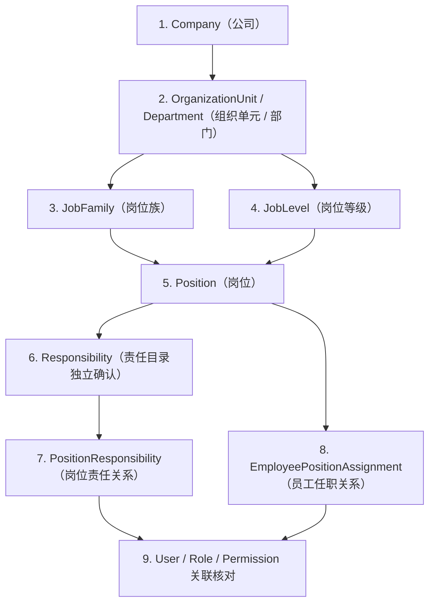
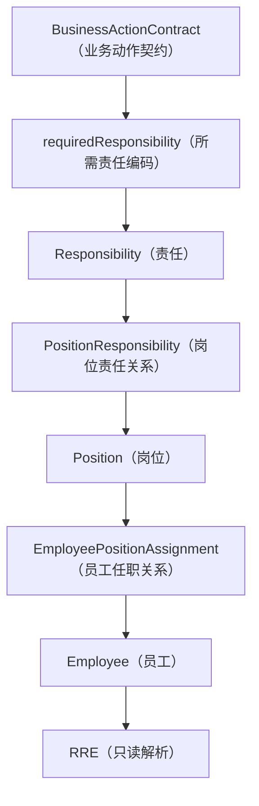

# PCE Organization Operating Model V2（企业组织运行模型 V2）OOM-3 数据治理与初始化方案设计报告

## 0. 文档状态

| 项目 | 状态 |
|---|---|
| 文档类型 | Data Governance & Initialization Design（数据治理与初始化方案设计） |
| 当前阶段 | OOM-3 Design（OOM-3 设计阶段） |
| OOM-3 Data Governance Design（OOM-3 数据治理设计） | COMPLETE（完成） |
| Organization Model Implementation（组织模型实施） | NOT AUTHORIZED（未授权） |
| Schema Migration（数据结构迁移） | NOT AUTHORIZED（未授权） |
| BAC-1 Implementation（业务动作契约第一阶段实施） | NOT AUTHORIZED（未授权） |
| RRE-1（责任解析引擎第一实施阶段） | NOT AUTHORIZED（未授权） |
| Workflow Integration（流程集成） | NOT AUTHORIZED（未授权） |

本报告只设计企业组织事实如何被盘点、确认、导入、审计、验收和持续治理。它不授权修改代码、数据库、API（接口）、组织数据、责任数据、员工数据、权限、Workflow Runtime（流程运行引擎）、ApprovalTask（审批任务）、采购业务或 Responsibility Resolution Engine（责任解析引擎，以下简称 RRE）。

---

## 1. 执行摘要

### 1.1 治理目标

企业组织事实必须达到：

- Accurate（准确）：与企业正式制度和人员任命一致；
- Complete（完整）：RRE 所需链路不存在缺失节点；
- Traceable（可追溯）：能够解释来源、确认人、有效期和变更原因；
- Auditable（可审计）：所有正式写入保留 Before/After、操作者和时间；
- Temporal（时态可信）：能够回答指定时间点的组织事实；
- Governed（受治理）：页面、Workflow、RRE 和 AI（人工智能）不能自行创造企业事实。

### 1.2 治理事实链

```text
Company（公司）
  ↓
OrganizationUnit（组织单元） / Department（部门）
  ↓
Position（岗位）
  ├─ JobFamily（岗位族，分类维度）
  ├─ JobLevel（岗位等级，等级维度）
  └─ PositionResponsibility（岗位责任关系）
       ↓
Responsibility（职责/责任定义）

Employee（员工）
  ↓
EmployeePositionAssignment（员工任职关系，OOM-2 目标）
  ↓
Position（岗位）
```

JobFamily 和 JobLevel 是 Position 的两个正交属性。初始化顺序中它们先于 Position，并不表示“公司 → 岗位族 → 岗位等级”是组织层级。

### 1.3 核心治理结论

1. `system.Responsibility` 继续作为 Responsibility 唯一事实来源。
2. `system.PositionResponsibility` 原地演进为岗位责任时态事实，不建设 V2 平行表。
3. `pfm.EmployeePositionAssignment` 作为未来正式任职事实；当前 `Employee.position_ref` 只生成待确认候选，不自动转换。
4. 初始化不是 Migration 默认数据，而是经过 Data Owner（数据所有者）与 Data Steward（数据管理员）确认的受控批次。
5. 任何缺失有效期、跨公司、重叠、孤儿引用或责任冲突的数据不得进入 RRE Ready Dataset（RRE 就绪数据集）。
6. RRE 只读，不修复、不补全、不创建组织事实。
7. User/Role/Permission（用户/角色/权限）只做关联与授权就绪核对，不根据任职自动授权。

```text
OOM-3 Data Governance Design = COMPLETE
Enterprise Data Import = NOT AUTHORIZED
Organization Model Implementation = NOT AUTHORIZED
Schema Migration = NOT AUTHORIZED
RRE-1 Ready = NO
```

---

## 2. 真实仓库审查与原文依据

### 2.1 已读取文件

| 实际路径 | 文件作用 | 判断用途 |
|---|---|---|
| `D:\Dev-PCE\Source\backend\system\models.py` | 组织、岗位、岗位目录、责任、角色、权限和审计模型 | 确认现有事实与字段边界 |
| `D:\Dev-PCE\Source\backend\pfm\models.py` | 员工档案、当前部门/岗位、汇报关系 | 确认任职初始化来源及限制 |
| `D:\Dev-PCE\Source\backend\system\organization_operating.py` | 正式组织保存、校验、授权和审计 | 确认治理写入闭环 |
| `D:\Dev-PCE\Source\backend\system\enterprise_organization.py` | 企业组织服务端投影 | 确认当前页面读取 current/active 事实 |
| `D:\Dev-PCE\Source\backend\system\responsibility_catalog.py` | 责任目录只读投影 | 确认责任唯一事实来源 |
| `D:\Dev-PCE\Source\frontend\src\meta\pages\AccessControlFoundationPage.vue` | 正式组织与权限页面 | 确认唯一管理入口和服务端回读 |
| `D:\Dev-PCE\Source\frontend\src\meta\components\OrganizationOperatingAdminDialog.vue` | 组织、岗位、职责、员工关系维护表单 | 确认现有页面能力与缺口 |
| `D:\Dev-PCE\Source\frontend\src\meta\components\EnterpriseOrganizationModelView.vue` | 综合组织模型视图 | 确认只读展示边界 |
| `D:\Dev-PCE\Source\docs\governance\PCE Organization Operating Model V2 OOM-2实施设计与Schema决策报告.md` | OOM-2 Schema 决策 | 继承任职和岗位责任时态设计 |

### 2.2 组织模型原文

来源：`backend/system/models.py:59-155`

```python
class Company(models.Model):
    name = models.CharField("公司名称", max_length=100, unique=True)
    code = models.CharField("公司编码", max_length=20, unique=True)
    is_active = models.BooleanField("是否启用", default=True)

class OrganizationUnit(models.Model):
    parent = models.ForeignKey("self", ...)
    company = models.ForeignKey(Company, ...)
    effective_from = models.DateField(...)
    effective_to = models.DateField(...)

class Department(models.Model):
    company = models.ForeignKey(Company, ...)
    organization_unit = models.ForeignKey(OrganizationUnit, ...)
    responsible_position = models.ForeignKey("Position", ...)
```

判断：组织层级、公司隔离和有效期已有基础。治理重点是保证父子同公司、部门映射完整、层级无环，并禁止用旧负责人字符串作为正式责任事实。

### 2.3 岗位目录与岗位原文

来源：`backend/system/models.py:239-343`

```python
class JobFamily(models.Model):
    code = models.CharField("岗位族编码", max_length=50, unique=True)
    company = models.ForeignKey(Company, ...)
    is_active = models.BooleanField(...)

class JobLevel(models.Model):
    code = models.CharField("岗位等级编码", max_length=50)
    company = models.ForeignKey(Company, ...)
    rank = models.PositiveIntegerField("等级顺序", default=1)

class Position(models.Model):
    department = models.ForeignKey(Department, ...)
    company = models.ForeignKey(Company, ...)
    job_family = models.ForeignKey(JobFamily, ...)
    job_level = models.ForeignKey(JobLevel, ...)
    default_role = models.ForeignKey("Role", ...)
    effective_from = models.DateField(...)
    effective_to = models.DateField(...)
```

判断：岗位族和等级已经是独立目录，但当前 Position 外键允许为空。OOM-3 对 Active Position（有效岗位）设定治理门禁：公司、部门、岗位族和岗位等级必须完整且一致。`default_role` 不得形成授权。

### 2.4 责任与岗位责任原文

来源：`backend/system/models.py:394-440`

```python
class Responsibility(models.Model):
    class Status(models.TextChoices):
        DRAFT = "DRAFT", "草稿"
        ACTIVE = "ACTIVE", "生效"
        SUSPENDED = "SUSPENDED", "暂停"
        EXPIRED = "EXPIRED", "失效"
    code = models.CharField("职责编码", max_length=80, unique=True)
    effective_from = models.DateField(...)
    effective_to = models.DateField(...)

class PositionResponsibility(models.Model):
    position = models.ForeignKey(Position, ...)
    responsibility = models.ForeignKey(Responsibility, ...)
    is_primary = models.BooleanField(...)
    active = models.BooleanField(...)
```

判断：责任目录具备生命周期；当前岗位责任缺少有效时间，只有当前态。OOM-3 不实施 OOM-2 Schema，只定义未来数据如何确认和治理。

### 2.5 当前员工岗位原文

来源：`backend/pfm/models.py:6-35`

```python
class Employee(models.Model):
    user = models.OneToOneField('system.User', ...)
    department_ref = models.ForeignKey('system.Department', ...)
    position_ref = models.ForeignKey('system.Position', ...)
```

判断：`position_ref` 只能表达当前单一岗位，不能证明历史、多岗或代理。它只能用于生成初始化候选，不能被直接升级为未经确认的正式任职。

### 2.6 汇报关系边界原文

来源：`backend/pfm/models.py:94-116`

```python
class EmployeeReportingRelation(models.Model):
    """Formal employee reporting line; separate from Department and Position."""
    employee = models.ForeignKey(Employee, ...)
    manager = models.ForeignKey(Employee, ...)
    effective_from = models.DateField(...)
    effective_to = models.DateField(...)
```

判断：直属/职能主管是独立事实，不能作为岗位任职、岗位责任或 RRE 未解析时的兜底。

### 2.7 保存、权限和审计原文

来源：`backend/system/organization_operating.py:40-52,220-233,287-291`

```python
ACTION_PERMISSIONS = {
    "SAVE_ORGANIZATION_UNIT": PERMISSION_STRUCTURE_MANAGE,
    "SAVE_POSITION": PERMISSION_POSITION_MANAGE,
    "SAVE_RESPONSIBILITY": PERMISSION_RESPONSIBILITY_MANAGE,
    "SAVE_POSITION_RESPONSIBILITY": PERMISSION_RESPONSIBILITY_MANAGE,
    "SAVE_EMPLOYEE": PERMISSION_REPORTING_MANAGE,
}
...
decision = AuthorizationService.decide(...)
...
audit = OrganizationOperatingAuditRecord.objects.create(...)
```

并且服务要求修改原因：

```python
if len(reason) < 2:
    raise OrganizationOperatingError("REASON_REQUIRED", "请填写本次修改原因。")
```

判断：正式治理应复用 `AuthorizationService → OrganizationOperatingService → OrganizationOperatingAuditRecord`，不建设第二套保存或审计系统。

### 2.8 当前投影原文

来源：`backend/system/enterprise_organization.py:74-100,180-211,263-267`

```python
queryset=PositionResponsibility.objects...filter(active=True)
...
Employee.objects.select_related("department_ref", "position_ref", "user")
...
"positionId": row.position_ref_id
```

判断：当前投影只表示 current/active 事实，没有 As Of Time（指定时间点）能力。未实施 OOM-2 前不能声称历史任职或责任关系已经可解析。

### 2.9 责任唯一事实源原文

来源：`backend/system/responsibility_catalog.py:10-65`

```python
RESPONSIBILITY_FACT_SOURCE = "system.Responsibility"

class ResponsibilityCatalogService:
    """Read-only projection whose root fact is always system.Responsibility."""
    ...
    "relationshipSource": "system.PositionResponsibility",
    "auditSource": "system.OrganizationOperatingAuditRecord",
```

判断：岗位关系和审计只能提供关系/证据，不能生成责任目录。

### 2.10 当前页面原文

来源：`frontend/src/meta/pages/AccessControlFoundationPage.vue:6-14,214-221,248`

```vue
<h1>组织、人员、岗位、账户、角色与权限</h1>
<span>全部记录来自服务端正式模型；岗位不等于角色，账户不代替员工档案。</span>
```

```javascript
{key:'positions', label:'岗位管理', note:'正式 Position 主档；岗位属于组织，不等于系统角色'},
{key:'responsibilities', label:'责任管理', note:'独立 Responsibility 目录；先定义责任，再由岗位选择并承担'},
```

页面刷新同时读取正式基础和责任目录：

```javascript
Promise.all([
  accessControlApi.foundation(),
  accessControlApi.responsibilities(),
])
```

判断：`#/organization` 应继续作为唯一正式维护入口，所有初始化后验收必须刷新回读服务端事实。

### 2.11 职责和员工页面原文

来源：`frontend/src/meta/components/OrganizationOperatingAdminDialog.vue:62-102`

```vue
<el-alert title="岗位只能从责任目录选择已有责任；新责任必须在组织页面顶层“责任管理”中独立创建。" ... />
<small>数据来源：Responsibility API · system.Responsibility</small>
...
<el-alert title="直属主管和职能主管都必须从正式员工档案选择；岗位、角色、部门和用户账户不能作为人员选项。" ... />
```

判断：现有页面已正确分离责任、岗位、员工、主管和账户，但尚无正式 Employee Assignment 历史管理与批量治理能力。

### 2.12 综合页原文

来源：`frontend/src/meta/components/EnterpriseOrganizationModelView.vue:43,109`

```vue
<p>本页不再写入组织事实。部门、岗位、员工、职责与流程责任统一在“组织与权限基础”维护。</p>
<p>流程按岗位责任解析候选人员；本页面不执行审批或状态推进。</p>
```

判断：综合页只应展示治理质量、指定时点事实和证据，不能保存或修复数据。

---

## 3. 当前数据治理能力与缺口

| 能力 | 当前状态 | 治理判断 |
|---|---|---|
| 服务端正式事实 | 已有 | KEEP（保留） |
| 统一维护入口 | 已有 `#/organization` | KEEP |
| AuthorizationService | 已接入保存链 | KEEP |
| 修改原因与 Before/After 审计 | 已有 | KEEP |
| 独立责任目录 | 已有 | PASS |
| 岗位只能选择已有责任 | 已有 | PASS |
| 保存后服务端回读 | 已有 | PASS |
| 数据所有者/管理员定义 | 未系统化 | GAP（缺口） |
| 初始化模板与批次签发 | 无 | GAP |
| 数据质量评分和阻断级别 | 无 | GAP |
| PositionResponsibility 时态 | 未实施 | GAP |
| Employee Assignment | 未实施 | GAP |
| 历史 As Of 查询 | 未实施 | GAP |
| 多人责任冲突预检 | 无正式门禁 | GAP |
| OOM 到 BAC/RRE 发布门禁 | 无运行实现 | GAP |

---

## 4. OOM 数据治理总体模型

### 4.1 治理角色

| 角色 | 定义 |
|---|---|
| Data Owner（数据所有者） | 对数据业务含义、存在必要性和最终正确性负责 |
| Data Steward（数据管理员） | 执行编码、格式、完整性、重复、有效期和关系检查 |
| Data Custodian（数据保管者） | 维护系统、备份、权限、日志和受控导入能力 |
| Approver（审核者） | 对正式生效或停用作独立确认 |
| Consumer（数据消费者） | BAC、RRE、页面和分析服务，只读消费正式事实 |

### 4.2 治理原则

1. 四眼原则：高影响主数据不得由同一人无复核地提出并生效；
2. 职责分离：责任定义、岗位承担、员工任职和权限授予由不同职责主体治理；
3. 先确认后入库：未确认数据停留在签名导入清单，不进入正式事实表；
4. 不编造历史：找不到可靠生效日期时标记缺失，不使用系统上线日或 1970 年日期；
5. 不物理删除：通过停用、退役或结束有效期保留历史；
6. 不自动授权：任职和责任变化不产生 Role/Permission；
7. 不自动推断：名称、等级、主管和权限都不能推断责任人；
8. 单一事实源：页面、Workflow、RRE、AI 不写企业责任事实。

---

## 5. 主数据维护责任矩阵

| 对象 | Data Owner | Data Steward / 可修改者 | 审核者 | 可停用者 | 禁止主体 |
|---|---|---|---|---|---|
| Company | 企业管理负责人 | 企业组织管理员 | 架构/管理负责人 | 企业组织管理员，经负责人批准 | 业务页面、RRE |
| OrganizationUnit | 公司/企业组织负责人 | 组织管理员 | 上级组织负责人 | 组织管理员，完成引用迁移后 | Workflow、AI |
| Department | 公司组织负责人 | 公司组织管理员 | 部门负责人+组织负责人 | 组织管理员 | 员工反推、旧文本字段 |
| JobFamily | 人力/组织治理负责人 | 企业组织管理员 | 专业领域负责人 | 企业组织管理员 | 岗位名称算法 |
| JobLevel | 人力/组织治理负责人 | 企业组织管理员 | 人力治理负责人 | 企业组织管理员 | 审批逻辑 |
| Position | 部门/组织负责人 | 公司组织管理员 | 部门负责人 | 组织管理员，完成任职/责任迁移后 | Employee、Role |
| Responsibility | 业务领域负责人 | 责任数据管理员 | 业务负责人+架构治理负责人 | 责任管理员，经业务负责人批准 | 页面按钮、Workflow、RRE、AI |
| PositionResponsibility | 业务领域负责人 | 组织/责任管理员 | 岗位负责人+业务负责人 | 组织/责任管理员 | 权限管理员单独决定 |
| Employee | 人力/公司负责人 | 人员档案管理员 | 部门负责人 | 人员档案管理员 | User 账户替代 |
| Employee Assignment | 部门/组织负责人 | 人员/组织管理员 | 岗位负责人或部门负责人 | 人员/组织管理员 | RRE、Workflow |
| User/Role/Permission | 安全/权限负责人 | 权限管理员 | 安全负责人 | 权限管理员 | Responsibility 自动生成 |

Company、组织层级、责任退役、岗位责任主责变更和主岗变更属于 High-impact Change（高影响变更），必须双人确认。

---

## 6. 对象生命周期与治理动作

### 6.1 通用治理流程

```text
提交变更申请
  ↓
Data Steward 完整性/唯一性/引用/时态预检
  ↓
Data Owner 业务审核
  ↓
独立 Approver 确认
  ↓
AuthorizationService 权限裁决
  ↓
OrganizationOperatingService 保存
  ↓
OrganizationOperatingAuditRecord
  ↓
刷新回读 + 质量复检
```

该审批是治理流程设计，不授权修改 Workflow Runtime。OOM-4 第一阶段可采用签名清单和人工复核，不得为了本流程改造 ApprovalTask。

### 6.2 对象生命周期

| 对象 | 创建/草稿 | 生效 | 暂停/停用 | 历史 |
|---|---|---|---|---|
| Company | 管理层批准后建档 | `is_active=true` | 完成全部引用迁移后停用 | 不删除 |
| OrganizationUnit/Department | 在导入清单审核 | 有效期命中且启用 | 先迁移下级/岗位/员工 | 有效期+审计 |
| JobFamily/JobLevel | 管理员建档 | 启用 | 被岗位引用时不得删除 | 启停+审计 |
| Position | 组织归属完整后建档 | 有效期命中且启用 | 先结束任职和责任关系 | 有效期+审计 |
| Responsibility | DRAFT | ACTIVE | SUSPENDED / RETIRED | 全部保留 |
| PositionResponsibility | DRAFT（OOM-2 目标） | CONFIRMED 且有效期命中 | 结束区间/取消草稿 | 多区间+审计 |
| Employee Assignment | DRAFT（OOM-2 目标） | CONFIRMED 且有效期命中 | 结束区间/取消草稿 | 多区间+审计 |

---

## 7. Responsibility（职责/责任定义）治理

### 7.1 定义权

企业需要哪些责任，由 Business Domain Owner（业务领域负责人）提出并最终负责；责任管理员负责编码和目录质量；架构治理负责人审核跨域重复和语义边界。流程负责人只能提出“节点需要已有责任”的需求，不能创建责任。

### 7.2 生命周期

```text
DRAFT（草稿）
  → ACTIVE（有效）
  → SUSPENDED（暂停）
  → ACTIVE（恢复）

DRAFT / ACTIVE / SUSPENDED
  → RETIRED（退役，终态）
```

当前系统持久化值为 `EXPIRED`。按照 OOM-2 决策，它是 `RETIRED` 的迁移期旧别名；在独立 Migration 获得授权前不修改现有状态值。

### 7.3 创建与生效规则

- 编码使用业务对象+责任目的，不包含岗位、人员、角色；
- 编码全局唯一且 ACTIVE 后不可直接改码；
- 名称、业务领域、说明、状态和有效期完整；
- ACTIVE 责任必须有 `effective_from`；
- `effective_to >= effective_from`；
- 重复或近义责任先合并治理，不直接新增；
- 生效前至少业务负责人和责任管理员两方确认；
- BAC 只能引用 ACTIVE 责任，不能创建责任。

### 7.4 明确禁止

- 页面按钮创建责任；
- Position 页面内创建责任；
- Workflow 创建责任；
- RRE 创建责任；
- AI 自动创建、激活、暂停或退役责任；
- 根据“经理”“主管”等岗位名称生成责任；
- 根据 Permission 反向创建责任。

---

## 8. PositionResponsibility（岗位责任关系）治理

### 8.1 权威关系

```text
Position
  ↓ PositionResponsibility
Responsibility
```

公司和组织范围从 Position 的公司、部门和 OrganizationUnit 推导；不在关系中复制公司字段或自由 JSON Scope（范围）。

### 8.2 治理字段

OOM-2 目标字段包括：`relation_type`、`effective_from`、`effective_to`、`status` 和 `source`。本报告不实施这些字段。

### 8.3 PRIMARY / SUPPORTING

- PRIMARY：主责岗位，默认责任解析路径；
- SUPPORTING：协助岗位，不自动成为执行人；
- 同一责任可以跨不同组织范围存在 PRIMARY；
- 同一公司、同一有效组织范围内的多个重叠 PRIMARY 是 Blocking Conflict（阻断冲突），除非 BAC/范围规则能证明范围互斥；
- 多候选事实即使被保存，RRE 也只能返回 `MULTIPLE_CANDIDATES`，不得自动选择。

### 8.4 变更规则

- 主责改协助：结束旧区间，新建新区间；
- 岗位换人：只改 Employee Assignment，不改 PositionResponsibility；
- 责任退役：结束未来岗位责任，但保留历史；
- 岗位停用：先结束有效岗位责任；
- 不允许同一岗位、责任的 CONFIRMED 有效区间重叠；
- 不允许引用不存在、DRAFT、SUSPENDED 或 RETIRED 的责任建立新生效关系。

---

## 9. Employee Assignment（员工任职关系）治理与初始化

### 9.1 OOM-2 目标事实

```text
Employee
  ↓ EmployeePositionAssignment
Position
  ↓
OrganizationUnit / Department / Company
```

目标字段继承 OOM-2：员工、岗位、目标组织单元、任职性质、主岗标志、有效区间、状态、来源。

### 9.2 当前 `position_ref` 转换原则

`Employee.position_ref` 只能生成 Candidate Assignment（候选任职），不能直接形成 CONFIRMED 正式关系。

候选来源优先级：

1. 已签发的任命/调岗记录；
2. 可核验 HR 正式记录；
3. 当前 `position_ref` + 管理员确认；
4. `hire_date` 只有在证明入职即任当前岗位时才可作为开始时间；
5. 无可靠日期时标记 `UNKNOWN_EFFECTIVE_FROM`，不得编造。

### 9.3 当前主岗

- 每个员工任一时点最多一个确认主岗；
- `position_ref` 在权威切换后只是当前主岗投影；
- 没有唯一主岗时投影为空并产生治理异常；
- 调岗必须结束旧主岗区间并创建新主岗区间；
- 员工部门与岗位组织路径必须一致，借调使用明确 assignment type。

### 9.4 多岗位与代理

- 兼岗必须单独确认，不能从角色或权限推断；
- ACTING（代理）必须有明确结束时间；
- 一人可有多个非主岗，但区间和组织范围必须明确；
- 同一岗位多人任职可能是真实情况，但承担责任的岗位若形成多人候选，必须进入 RRE 冲突检查；
- 跨公司任职在 V2 拒绝；同公司跨组织可在目标岗位/组织一致时确认。

### 9.5 历史保留

- 只能导入有可靠来源的历史；
- 当前快照不能反推出过去全部任职；
- 无历史依据时从经确认的生效时点开始，不伪造早期历史；
- 更正错误记录采用取消/新期间和审计，不物理删除。

---

## 10. 初始化依赖与顺序

### 10.1 顺序



Responsibility 不依赖 Position 才能存在；它排在 Position 后只是建议的治理批次顺序，便于业务负责人先看到目标岗位体系。岗位不能创建责任。

### 10.2 每阶段进入条件

| 阶段 | 进入条件 | 退出条件 |
|---|---|---|
| Company | 管理层确认公司清单 | 编码唯一、启停明确 |
| Organization | Company 通过 | 层级无环、同公司、部门映射完整 |
| JobFamily | 公司通过 | 编码、名称、专业归属确认 |
| JobLevel | 公司通过 | 公司内编码唯一、rank 无歧义 |
| Position | 组织、族、等级通过 | 所有有效岗位组织归属完整 |
| Responsibility | 业务责任清单批准 | 编码、生命周期、有效期完整 |
| PositionResponsibility | 岗位和责任通过 | 区间无重叠、主责冲突为 0 |
| Employee Assignment | Employee/Position 通过 | 主岗唯一、日期确认、跨公司为 0 |
| Authorization Reconciliation | 任职和责任通过 | 账户关联/权限缺口被明确记录；不自动授权 |

### 10.3 初始化模板设计

未来建议使用签名 CSV/XLSX/JSON Manifest（清单）作为导入申请，不在本轮创建文件：

| 模板 | 核心列 |
|---|---|
| company | code、name、active、owner、reason |
| organization_unit | company_code、code、name、type、parent_code、effective dates |
| department | company_code、code、name、organization_unit_code、type、effective dates |
| job_family | company_code、code、name、description、active |
| job_level | company_code、code、name、rank、active |
| position | company、department、code、name、family、level、parent、effective dates |
| responsibility | code、name、domain、description、status、effective dates |
| position_responsibility | position_code、responsibility_code、type、effective dates、source |
| employee_assignment | employee_no、position_code、org_unit_code、type、primary、effective dates、source |
| authority_reconciliation | employee_no、username、expected action、observed authority、gap |

每份清单包含 batch_id、版本、生成时间、提交人、审核人、行数、内容 SHA256 和变更原因。

---

## 11. 初始化执行策略（未来）

### 11.1 阶段流程

```text
只读盘点
  ↓
生成候选清单和质量报告
  ↓
Data Steward 修正格式/引用
  ↓
Data Owner 审核业务事实
  ↓
Validate-only Dry Run（仅校验预演）
  ↓
独立批准
  ↓
受控小批次导入
  ↓
服务端刷新回读
  ↓
计数、摘要、审计和关系对账
  ↓
签发数据基线
```

### 11.2 批次要求

- 每批只覆盖一种或紧密依赖的一组对象；
- 批次可重复校验，正式写入具备幂等键；
- 一行失败时根据批准策略全批回滚或明确隔离，禁止静默跳过；
- 正式写入只能调用受治理服务，不直接执行 SQL；
- 导入前后记录对象数量、关系数量和摘要；
- 导入不会创建采购订单、流程任务或权限授予。

### 11.3 不允许的初始化

- Migration 中创建企业主数据；
- 按名称自动生成 JobFamily、JobLevel、Responsibility；
- 将 Position 名称包含“经理”自动设为 PRIMARY；
- 将 Role 转成 Responsibility；
- 将有 Permission 的用户设为责任人；
- 将直属主管设为未配置责任的兜底；
- 从当前 `position_ref` 推断完整历史；
- AI 建议直接写入正式事实。

---

## 12. 数据质量标准

### 12.1 质量维度

| 维度 | 定义 |
|---|---|
| Completeness（完整性） | 必填字段和必需关系齐全 |
| Uniqueness（唯一性） | 编码、关系期间和主岗没有冲突 |
| Referential Integrity（引用完整性） | 所有外键对象存在且可用 |
| Validity（有效性） | 状态、编码、范围、日期符合规则 |
| Temporal Consistency（时间一致性） | 区间合法、不重叠、交接无空洞/双占 |
| Semantic Integrity（语义完整性） | 岗位、责任、角色、权限不混用 |
| Traceability（可追溯性） | 有来源、负责人、原因、审计和批次证据 |
| RRE Determinism（解析确定性） | 指定动作、范围和时点得到唯一候选或明确冲突 |

### 12.2 组织质量规则

- Company code/name 唯一；
- OrganizationUnit 父子同公司且无环；
- 有效 OrganizationUnit 具有合法有效期；
- 有效 Department 必须属于 Company 并映射 OrganizationUnit；
- Department parent 同公司；
- 组织停用前不存在未迁移的有效下级、岗位或员工；
- 通用 TEAM 与制造 Team 不重复建档。

### 12.3 岗位目录与岗位质量规则

- Active Position 必须有公司、部门、JobFamily、JobLevel；
- Position 与部门、岗位族、等级同公司；
- parent_position 同公司且无环；
- Position 有效期合法；
- JobFamily 编码符合已批准的全局编码策略；
- JobLevel 公司内编码唯一，rank 只用于分析；
- `default_role` 不计入授权覆盖率。

### 12.4 Responsibility 质量规则

- code 全局唯一且符合编码规范；
- name、business domain、status 完整；
- ACTIVE 必须有 effective_from；
- effective_to 不早于 effective_from；
- 近义/重复责任必须人工判定；
- RETIRED/EXPIRED 不可恢复；
- 无页面、Workflow、RRE 或 AI 创建来源。

### 12.5 PositionResponsibility 质量规则

- Position 和 Responsibility 存在且有效；
- 关系公司从 Position 推导；
- 同岗位同责任确认区间不重叠；
- 同范围、同责任的多个重叠 PRIMARY 作为阻断冲突；
- SUPPORTING 不自动替代 PRIMARY；
- 有效区间在岗位/责任有效期间内；
- source、审核人、原因完整。

### 12.6 Employee Assignment 质量规则

- Employee、Position、OrganizationUnit 存在；
- 员工和岗位同公司；跨公司为阻断错误；
- organization_unit 与岗位组织路径一致；
- 每个员工任一时点最多一个 PRIMARY；
- 同员工同岗位确认区间不重叠；
- ACTING 必须有结束时间；
- 离职后无新任职；
- effective_from 不得使用未经确认的默认日期；
- source 可追溯；
- 任职不创建角色或权限。

### 12.7 质量严重级别

| 级别 | 含义 | 处理 |
|---|---|---|
| BLOCKER | 会导致跨公司、错误责任人、历史失真或未授权 | 禁止导入/禁止进入 RRE |
| ERROR | 必填、引用、日期或唯一性错误 | 当前批次必须修复 |
| WARNING | 账户/权限缺口、空岗、支持关系不足 | 可保存非 RRE 数据，但不能签发执行就绪 |
| INFO | 说明性治理建议 | 记录并跟踪 |

### 12.8 RRE 就绪硬指标

```text
Cross-company Assignment = 0
Unknown Effective From = 0
Overlapping Primary Assignment = 0
Overlapping Position Responsibility = 0
Orphan Reference = 0
Unconfirmed RRE Input = 0
Unresolved PRIMARY Conflict = 0
Responsibility Fact Source Violations = 0
Unauthorized Business Writes = 0
```

---

## 13. 数据治理审批流程

### 13.1 普通变更

```text
提交人
  ↓
Data Steward 校验
  ↓
Data Owner 审核
  ↓
组织管理员保存
  ↓
审计 + 回读
```

### 13.2 高影响变更

适用于：公司/组织重组、岗位停用、责任激活或退役、PRIMARY 岗位责任变更、员工主岗变更。

```text
业务提出
  ↓
Data Steward 影响分析
  ↓
Data Owner 批准
  ↓
独立组织/架构审核者复核
  ↓
管理员在授权范围内保存
  ↓
审计、回读、质量检查
```

两位确认者必须是不同用户。是否需要不同角色由未来治理实施设计决定；本轮不修改权限或 Workflow。

### 13.3 紧急更正

- 仅纠正明显错误，不用于绕过正常审批；
- 必须记录影响、原因、批准人和更正区间；
- 不覆盖历史证据；
- 事后在规定时间内复核；
- 不允许 RRE 自动发起更正。

---

## 14. BAC / RRE 对接治理

### 14.1 链路



### 14.2 Contract 发布治理

BAC ACTIVE 前必须检查：

- requiredResponsibility 存在且可用；
- 责任编码未被页面/Workflow 临时创建；
- 适用公司/组织范围存在 PRIMARY 岗位责任；
- 岗位责任和任职覆盖目标生效时间；
- requiredPermission 独立存在；
- 数据质量基线版本可引用。

### 14.3 RRE 数据快照

RRE 每次只读解析应记录/返回：

- OOM 数据基线版本；
- asOfTime；
- Responsibility ID/code；
- PositionResponsibility ID/有效区间；
- Position ID/code/组织范围；
- Employee Assignment ID/有效区间；
- Employee ID/no；
- 冲突或缺失状态；
- Authorization 预检作为独立证据。

### 14.4 RRE 禁止修复

当组织事实不完整时，RRE 必须返回 `RESPONSIBILITY_UNRESOLVED`、`NO_ACTIVE_EMPLOYEE` 或 `MULTIPLE_CANDIDATES`。它不能创建责任、修改岗位责任、补任职、找管理员、找主管或按权限选人。

---

## 15. 数据迁移、备份与回退设计

### 15.1 迁移阶段

1. Read-only Inventory（只读盘点）；
2. 数据库备份、SHA256 和数量基线；
3. OOM-2 Additive Schema（增量结构，另行授权）；
4. 生成候选清单，不写正式数据；
5. 人工确认有效期、来源、关系性质；
6. Validate-only 预演；
7. 小范围试点导入；
8. 服务端回读与双读对账；
9. 全量受控批次；
10. 权威源切换；
11. 人工签发数据基线；
12. RRE 仍保持关闭，等待独立授权。

### 15.2 备份要求

- 迁移前数据库完整备份；
- 记录文件大小、SHA256、表计数和关键关系计数；
- 导入清单保留原始版本和批准版本；
- 审计记录和批准证据单独校验；
- 备份恢复演练通过后才允许生产导入。

### 15.3 回退

- Schema 增量阶段关闭新功能并继续旧读路径；
- 数据批次失败时事务回滚；
- 已确认历史不物理删除，回退权威切换而非删除证据；
- `Employee.position_ref` 在切换前继续兼容读取；
- 不回退或修改 BAC、Workflow、Permission、ApprovalTask 和采购数据；
- 回退后重新计算质量报告，确认未留下双重事实源。

---

## 16. 页面治理方案

### 16.1 当前匹配度

| 页面能力 | 状态 | 结论 |
|---|---|---|
| `#/organization` 唯一入口 | 已有 | PASS |
| 服务端正式事实标识 | 已有 | PASS |
| 岗位族/等级维护 | 已有 | PASS，独立可见性可增强 |
| 独立责任目录 | 已有 | PASS |
| 岗位选择已有责任 | 已有 | PASS |
| 修改原因/审计/回读 | 已有 | PASS |
| Employee Assignment 历史 | 无 | 需 OOM-2 实施后增加 |
| 岗位责任有效期间 | 无 | 需 OOM-2 实施后增加 |
| 批量导入预检 | 无 | OOM-4 设计候选 |
| 数据质量仪表盘 | 无 | OOM-4 设计候选 |
| As Of Time 查看 | 无 | OOM-4 设计候选 |

### 16.2 未来页面能力

- “数据治理”只读总览：完整率、冲突数、待确认数、基线版本；
- 导入预检：上传清单、只校验、不写入、下载错误报告；
- 批次审批摘要：对象数、差异、负责人、摘要；
- 岗位职责历史：PRIMARY/SUPPORTING 和有效区间；
- 员工任职历史：正式、代理、借调、主岗；
- As Of Time 综合组织视图；
- BAC/RRE 就绪检查只读结果。

页面不得自行计算或修复正式事实，所有质量结论来自服务端同一事实投影。

---

## 17. 验收方案

### 17.1 自动验证设计

| 编号 | 场景 | 预期 |
|---|---|---|
| OOM3-Q01 | Company/OrganizationUnit 跨公司父子 | 阻断 |
| OOM3-Q02 | 组织层级循环 | 阻断 |
| OOM3-Q03 | Active Position 缺岗位族/等级/部门 | 阻断 RRE 基线 |
| OOM3-Q04 | Responsibility 重复编码 | 阻断 |
| OOM3-Q05 | ACTIVE Responsibility 无有效期起点 | 阻断 |
| OOM3-Q06 | 岗位责任区间重叠 | 阻断 |
| OOM3-Q07 | 同范围多个 PRIMARY | 冲突，禁止 RRE Ready |
| OOM3-Q08 | 员工主岗区间重叠 | 阻断 |
| OOM3-Q09 | 跨公司任职 | 阻断 |
| OOM3-Q10 | ACTING 无结束时间 | 阻断 |
| OOM3-Q11 | 候选清单缺来源/确认人 | 阻断导入 |
| OOM3-Q12 | Validate-only | 数据库写入为 0 |
| OOM3-Q13 | 重复提交同一批准批次 | 幂等，不重复创建 |
| OOM3-Q14 | 无权限提交/导入 | HTTP 403 |
| OOM3-Q15 | 正式保存 | 审计与刷新回读一致 |
| OOM3-Q16 | 任职导入 | 不产生 Role/Permission |
| OOM3-Q17 | 责任导入 | 不产生 BAC/Workflow/RRE 写入 |

### 17.2 人工验收

#### H-OOM3-01 组织基线

查看公司、组织单元、部门和岗位路径，确认无跨公司、无环、无缺失归属。

#### H-OOM3-02 责任治理

由业务负责人确认责任语义，由责任管理员确认编码和有效期；确认岗位页不能创建责任。

#### H-OOM3-03 岗位责任

验证 PRIMARY/SUPPORTING、有效期间、公司/组织范围和历史记录；同范围多人主责必须显示冲突。

#### H-OOM3-04 员工任职

验证从 `position_ref` 生成的只是候选；人工确认主岗日期；兼岗和代理必须独立维护；刷新后历史仍存在。

#### H-OOM3-05 调岗历史

在交接前时点返回原员工，在交接后时点返回新员工；当前员工变化不修改责任、BAC 或 Workflow。

#### H-OOM3-06 权限隔离

确认任职和岗位责任变更不自动创建 Role/Permission；无权限用户不能保存。

#### H-OOM3-07 回退

在隔离环境验证失败批次可回退，计数和摘要恢复，审计和批准证据仍可查。

### 17.3 验收通过条件

```text
Data Owner Sign-off = PASS
Data Steward Validation = PASS
Completeness Rules = PASS
Uniqueness Rules = PASS
Temporal Rules = PASS
Cross-company Violations = 0
Audit & Readback = PASS
Rollback Drill = PASS
RRE / Workflow / Purchase Isolation = PASS
Unauthorized Business Writes = 0
```

---

## 18. OOM-4 前置条件

未来进入 OOM-4 Implementation Readiness（实施就绪）前必须全部满足：

### 18.1 架构与授权

- OOM-2 Schema 决策人工批准；
- OOM-3 治理设计人工批准；
- Employee Assignment 和 PositionResponsibility 最终字段签发；
- OOM-4 具有明确、单独的实施授权；
- BAC-1、RRE-1、Workflow 仍按各自授权门禁管理。

### 18.2 治理责任

- 每类主数据 Data Owner、Data Steward 和 Approver 已实名确认；
- 高影响变更双人控制获批；
- Responsibility 定义权归属明确；
- 权限管理员与责任管理员职责分离。

### 18.3 数据与模板

- 初始化模板字段、编码规则和版本冻结；
- 当前数据只读盘点完成；
- 所有未知日期、重复编码、孤儿引用和跨公司问题有整改方案；
- 不自动生成正式责任或任职的原则签发；
- 试点公司/组织范围明确。

### 18.4 技术准备

- 分阶段 Migration 方案评审通过；
- 备份、SHA256、恢复演练方案通过；
- Validate-only、幂等、并发、审计和回读测试设计通过；
- 回退与权威源切换方案通过；
- 采购、Workflow、ApprovalTask、Permission 和 RRE 隔离门禁明确。

### 18.5 质量门禁

- P0/BLOCKER 规则全部可自动检测；
- RRE 就绪硬指标定义冻结；
- 质量报告由服务端事实生成；
- 未确认数据不会进入正式解析输入；
- 人工验收清单批准。

如任一条件未满足：

```text
OOM-4 Ready = NO
Implementation Authorization = NO
```

---

## 19. 风险清单

| 编号 | 风险 | 影响 | 控制 | 优先级 |
|---|---|---|---|---|
| OOM3-R01 | 将当前 `position_ref` 当完整历史 | 伪造/丢失任职历史 | 只生成候选，人工确认 | P0 |
| OOM3-R02 | Migration 自动创建企业数据 | 未经批准事实进入生产 | Schema 与数据批次分离 | P0 |
| OOM3-R03 | Responsibility 定义权不清 | 责任重复或被技术人员决定 | 业务 Owner + 责任 Steward | P0 |
| OOM3-R04 | 同范围多个 PRIMARY 未治理 | RRE 多候选 | 阻断 RRE Ready | P0 |
| OOM3-R05 | JobLevel 被当审批层级 | 隐式选人 | 质量规则和语义验收 | P0 |
| OOM3-R06 | Role 被当 Responsibility | 授权与责任混合 | 管理职责分离 | P0 |
| OOM3-R07 | 责任退役覆盖历史 | 历史流程无法解释 | 有效期、审计、Evidence | P0 |
| OOM3-R08 | RRE 修复数据 | 引擎产生企业事实 | 只读接口和零写入测试 | P0 |
| OOM3-R09 | 导入批次非幂等 | 重复事实 | 批次 ID、摘要和幂等检查 | P1 |
| OOM3-R10 | 前端自行修复/重算 | 服务端与页面漂移 | 单一服务端事实 | P0 |
| OOM3-R11 | 跨公司关系漏检 | 数据隔离失效 | 服务端阻断和质量扫描 | P0 |
| OOM3-R12 | OOM-3 设计被误当实施授权 | 越权修改 | 最终状态持续 NOT AUTHORIZED | P0 |

---

## 20. 本轮保护结果

本轮仅使用只读命令检查仓库并新增本 Markdown（标记语言）报告。未运行 ORM、数据库查询/写入、Migration、API、数据导入、Workflow Runtime、ApprovalTask、采购动作或 RRE。仓库原有其他未提交变更不属于本任务，本轮未修改、清理或归因。

```text
Documentation Changed = YES
Code Changed = NO
Database Changed = NO
Migration Created = NO
API Created = NO
Organization Data Changed = NO
Job Family Data Changed = NO
Job Level Data Changed = NO
Position Data Changed = NO
Responsibility Data Changed = NO
Employee Data Changed = NO
Employee Assignment Data Changed = NO
Permission Model Changed = NO
Workflow Runtime Changed = NO
ApprovalTask Changed = NO
Purchase Business Changed = NO
RRE Started = NO
Unauthorized Business Writes = 0
```

---

## 21. 最终状态

OOM-3 已把“企业事实如何进入系统”从技术导入问题转化为可治理流程：业务所有者定义事实，数据管理员校验，独立审核者确认，授权服务裁决，组织服务保存，统一审计记录，质量门禁决定是否可被 BAC/RRE 消费。任何引擎和页面都不能替代企业作出责任与任职决定。

```text
OOM-3 Data Governance Design = COMPLETE
Organization Model Implementation = NOT AUTHORIZED
Schema Migration = NOT AUTHORIZED
Enterprise Data Import = NOT AUTHORIZED
BAC-1 Implementation = NOT AUTHORIZED
RRE-1 = NOT AUTHORIZED
Workflow Integration = NOT AUTHORIZED
OOM-4 Ready = NO
Human Architecture Decision = WAITING
```

完成本报告后停止，等待下一阶段架构决策。
