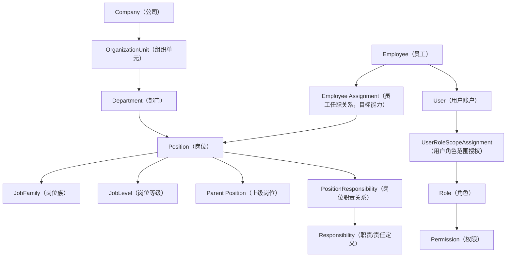
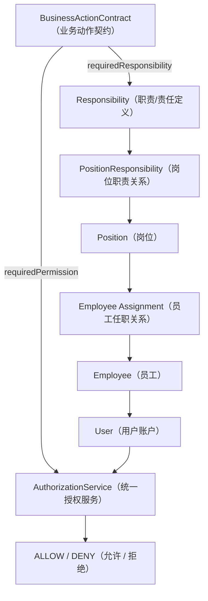

# PCE Organization Operating Model V2（企业组织运行模型 V2）与 Business Action Contract V1（业务动作契约 V1）对接设计报告

## 0. 文档状态

| 项目 | 状态 |
|---|---|
| 文档类型 | Architecture & Integration Design（架构与对接设计） |
| 设计阶段 | OOM-0 Architecture Design（企业组织运行模型 V2 架构设计阶段） |
| Organization Operating Model V2 Design（企业组织运行模型 V2 设计） | COMPLETE（完成） |
| Organization Model Implementation（组织模型实施） | NOT AUTHORIZED（未授权） |
| BAC-1 Implementation（业务动作契约第一阶段实施） | NOT AUTHORIZED（未授权） |
| RRE-1（责任解析引擎第一实施阶段） | NOT AUTHORIZED（未授权） |
| Workflow Integration（流程集成） | NOT AUTHORIZED（未授权） |

本报告只冻结 Organization Operating Model V2（企业组织运行模型 V2，以下简称 OOM V2）与 Business Action Contract V1（业务动作契约 V1，以下简称 BAC V1）的语义关系、事实来源、页面边界和后续实施门禁。报告不授权代码、数据库、接口、流程或业务数据变更。

---

## 1. 设计目标与结论摘要

### 1.1 目标

OOM V2 必须为 BAC V1 和 Responsibility Resolution Engine（责任解析引擎，以下简称 RRE）提供可证明、可按组织范围解释的责任承载事实：

```text
BusinessActionContract（业务动作契约）
  └─ requiredResponsibility（所需责任编码）
       ↓ 引用，不创建
Responsibility（职责/责任定义）
       ↓ 由岗位承担
PositionResponsibility（岗位职责关系）
       ↓
Position（岗位）
       ↓ 通过正式任职关系
Employee（员工）
       ↓ 通过账户与授权关系
User（用户账户）
       ↓
AuthorizationService（统一授权服务）
```

### 1.2 总体结论

1. 当前 `system.Responsibility` 已经是独立责任目录事实源；BAC 只能引用其编码，不能生成责任。
2. 当前 `system.PositionResponsibility` 可以表达“岗位承担责任”，满足单一当前状态的基础解析需要。
3. 当前 `pfm.Employee.position_ref` 只能表达员工的一个当前正式岗位，尚不能严谨表达多岗位、代理任职及历史时点任职。
4. Job Family（岗位族）和 Job Level（岗位等级）已经存在，但它们是 Position（岗位）的两个正交分类维度，不构成“岗位族 → 岗位等级 → 岗位”的事实链，也不得自动产生责任或权限。
5. `Position.default_role` 只是岗位上的默认角色提示字段，不是正式授权事实；正式授权必须读取 `UserRoleScopeAssignment → Role → RolePermission → Permission`。
6. EmployeeReportingRelation（员工汇报关系）只表达直属/职能汇报，不得作为 RRE 找不到责任人时的主管兜底。
7. 当前 `PositionWorkflowResponsibility` 可以保留为流程责任配置/证据，但不得成为 BAC 之外的第二套“动作需要什么责任”事实源。
8. OOM V2 的目标运行链可成立，但在 BAC-1 服务端契约实施、任职时态决策和 RRE-1 获得独立授权前，不得接入真实流程。

结论：

```text
OOM V2 Architecture Design = PASS
Current Base Model Reuse = CONDITIONAL PASS
Temporal Employee Assignment Readiness = FAIL
BAC Runtime Dependency = NOT PRESENT
RRE-1 Ready = NO
Implementation Authorized = NO
```

---

## 2. 已读取的真实仓库依据

### 2.1 文件清单与用途

| 实际读取路径 | 文件用途 | 本报告判断依据 |
|---|---|---|
| `D:\Dev-PCE\Source\backend\system\models.py` | 公司、组织单元、部门、岗位族、岗位等级、岗位、角色、权限、责任及岗位责任模型 | 确认当前组织、责任、授权数据结构及约束 |
| `D:\Dev-PCE\Source\backend\pfm\models.py` | 员工档案与员工汇报关系 | 确认员工当前岗位表达能力及汇报关系边界 |
| `D:\Dev-PCE\Source\backend\system\organization_operating.py` | 组织主数据写入、授权与审计服务 | 确认组织维护遵循授权、服务和审计闭环 |
| `D:\Dev-PCE\Source\backend\system\responsibility_catalog.py` | 独立责任目录只读投影 | 确认 `system.Responsibility` 是责任目录根事实 |
| `D:\Dev-PCE\Source\backend\workflow_runtime\action_permissions.py` | 当前服务端动作权限策略和校验器 | 确认当前只有动作—权限策略，尚无完整 BAC 字段 |
| `D:\Dev-PCE\Source\frontend\src\meta\pages\AccessControlFoundationPage.vue` | `#/organization` 组织与权限正式维护入口 | 确认页面分层、责任目录、服务端回读和语义提示 |
| `D:\Dev-PCE\Source\frontend\src\meta\components\OrganizationOperatingAdminDialog.vue` | 岗位、岗位族、岗位等级、职责分配、流程责任维护 | 确认岗位管理页能力及责任选择来源 |
| `D:\Dev-PCE\Source\frontend\src\meta\components\OrganizationOperatingCatalogForm.vue` | 岗位族、岗位等级、责任目录维护表单 | 确认当前目录表单复用方式 |
| `D:\Dev-PCE\Source\frontend\src\meta\components\EnterpriseOrganizationModelView.vue` | 综合组织模型展示及现存维护代码 | 确认综合模型展示、流程责任证据和入口一致性风险 |
| `D:\Dev-PCE\Source\frontend\src\router\index.js` | 组织与综合组织模型路由 | 确认 `/organization` 与 `/organization-model` 的入口关系 |
| `D:\Dev-PCE\Source\docs\governance\PCE Business Action Contract V1 BAC-0架构签发报告.md` | BAC-0 架构基线 | 确认服务端契约是动作唯一事实源 |
| `D:\Dev-PCE\Source\docs\governance\PCE Business Action Contract V1 BAC-1架构与契约定义设计报告.md` | BAC-1 契约模型设计 | 确认 `requiredResponsibility`、`requiredPermission` 与 RRE 前置条件 |

### 2.2 关键原文片段与判断

#### 2.2.1 Position（岗位）的分类与上级关系

来源：`backend/system/models.py:280-330`

```python
class Position(models.Model):
    name = models.CharField("岗位名称", max_length=100, unique=True)
    code = models.CharField("岗位编码", max_length=20, unique=True)
    ...
    job_family = models.ForeignKey(
        JobFamily, ... verbose_name="岗位族",
    )
    job_level = models.ForeignKey(
        JobLevel, ... verbose_name="岗位等级",
    )
    parent_position = models.ForeignKey(
        "self", ... verbose_name="上级岗位",
    )
    default_role = models.ForeignKey(
        "Role", ... verbose_name="默认系统角色",
    )
```

判断：岗位族、岗位等级、上级岗位和默认角色是岗位上的不同字段。代码没有建立 `JobFamily → JobLevel` 的父子关系，因此不得把二者画成强制线性层级；`default_role` 也不得替代正式用户角色授权。

#### 2.2.2 Responsibility（职责/责任定义）及岗位承担关系

来源：`backend/system/models.py:394-475`

```python
class Responsibility(models.Model):
    class Status(models.TextChoices):
        DRAFT = "DRAFT", "草稿"
        ACTIVE = "ACTIVE", "生效"
        SUSPENDED = "SUSPENDED", "暂停"
        EXPIRED = "EXPIRED", "失效"

class PositionResponsibility(models.Model):
    position = models.ForeignKey(Position, ...)
    responsibility = models.ForeignKey(Responsibility, ...)
    is_primary = models.BooleanField("是否主责", default=True)
    active = models.BooleanField("是否有效", default=True)

class PositionWorkflowResponsibility(models.Model):
    position = models.ForeignKey(Position, ...)
    responsibility = models.ForeignKey(
        Responsibility, ..., null=True, blank=True,
    )
    workflow_code = models.CharField("流程编码", max_length=80)
    node_code = models.CharField("节点编码", max_length=80)
```

判断：当前模型已经分离责任定义、岗位责任和流程责任。但流程责任中的 `responsibility` 可空，`workflow_code/node_code` 为自由编码，尚未与 BAC 的权威 `actionCode` 形成受治理引用。

#### 2.2.3 Employee（员工）当前任职能力

来源：`backend/pfm/models.py:6-35`

```python
class Employee(models.Model):
    user = models.OneToOneField('system.User', ...)
    ...
    department_ref = models.ForeignKey(
        'system.Department', ... verbose_name='正式部门',
    )
    position_ref = models.ForeignKey(
        'system.Position', ... verbose_name='正式岗位',
    )
```

判断：当前 Employee 只有一个 `position_ref`，可以作为“当前主岗位”的 V1 事实，但不能完整证明代理岗位、兼岗、多人任职历史或指定解析时点的任职状态。

#### 2.2.4 EmployeeReportingRelation（员工汇报关系）边界

来源：`backend/pfm/models.py:94-110`

```python
class EmployeeReportingRelation(models.Model):
    """Formal employee reporting line; separate from Department and Position."""
    ...
    relation_type = models.CharField(
        max_length=20, choices=RelationType.choices,
        default=RelationType.DIRECT,
    )
```

判断：代码注释已明确汇报关系与部门、岗位分离。RRE 不得把直属主管或职能主管当作未解析责任的默认替代人。

#### 2.2.5 独立责任目录事实源

来源：`backend/system/responsibility_catalog.py:10-38`

```python
RESPONSIBILITY_FACT_SOURCE = "system.Responsibility"

class ResponsibilityCatalogService:
    """Read-only projection whose root fact is always system.Responsibility."""
    ...
    return {
        "factSource": RESPONSIBILITY_FACT_SOURCE,
        "relationshipSource": "system.PositionResponsibility",
```

判断：责任目录的根事实已经明确；岗位关系与审计只能提供关系/证据，不能反向生成责任目录。

#### 2.2.6 写入链的 Authorization（授权）与 Audit（审计）

来源：`backend/system/organization_operating.py:216-233,287-291`

```python
class OrganizationOperatingService:
    """Explicit Action -> Guard -> Persistence -> Audit service for organization maintenance."""
    ...
    decision = AuthorizationService.decide(...)
    ...
    audit = OrganizationOperatingAuditRecord.objects.create(...)
```

判断：现有组织主数据维护已经具备统一授权和统一审计入口。OOM V2 后续实施不得绕过此链，也不得创建第二套责任审计或授权服务。

#### 2.2.7 `#/organization` 的正式语义

来源：`frontend/src/meta/pages/AccessControlFoundationPage.vue:6-14,139,215-218,248`

```vue
<h1>组织、人员、岗位、账户、角色与权限</h1>
<span>全部记录来自服务端正式模型；岗位不等于角色，账户不代替员工档案。</span>
...
<el-alert title="事实来源：Responsibility API · system.Responsibility；岗位关系与审计只作为详情证据，不生成责任目录。" ... />
```

```javascript
{key:'positions', label:'岗位管理', note:'正式 Position 主档；岗位属于组织，不等于系统角色'},
{key:'responsibilities', label:'责任管理', note:'独立 Responsibility 目录；先定义责任，再由岗位选择并承担'},
...
const [response,catalogResponse] = await Promise.all([
  accessControlApi.foundation(),
  accessControlApi.responsibilities(),
])
```

判断：正式页面已体现服务端回读、岗位/角色分离和独立责任目录。OOM V2 应沿用该入口，而不是新建平行组织管理系统。

#### 2.2.8 岗位职责选择来源

来源：`frontend/src/meta/components/OrganizationOperatingAdminDialog.vue:62-69`

```vue
<el-tab-pane label="岗位族" name="job-family">...</el-tab-pane>
<el-tab-pane label="岗位等级" name="job-level">...</el-tab-pane>
<el-tab-pane label="职责分配" name="assignment">
  <el-alert title="岗位只能从责任目录选择已有责任；新责任必须在组织页面顶层“责任管理”中独立创建。" ... />
  ...
  <small>数据来源：Responsibility API · system.Responsibility</small>
</el-tab-pane>
<el-tab-pane label="流程责任" name="workflow">...</el-tab-pane>
```

判断：当前岗位页面的责任选择语义正确；未来只需增加 BAC 引用与冲突诊断，不得恢复“在岗位中创建责任”。

#### 2.2.9 当前 Action Permission Policy（动作权限策略）

来源：`backend/workflow_runtime/action_permissions.py:421-426,742-744`

```python
@dataclass(frozen=True)
class ActionPermissionPolicy:
    actionCode: str
    moduleCode: str
    requiredPermission: str
    role: tuple
    organizationScope: str

policy = POLICIES.get((module_code, action_code))
```

判断：当前服务端存在动作—权限策略，但没有 `requiredResponsibility`、`objectType` 和结构化 `scopeDimensions`。它尚不是 BAC-1 所设计的完整 Server Business Action Contract（服务端业务动作契约）。

#### 2.2.10 BAC-1 已冻结的依赖边界

来源：`docs/governance/PCE Business Action Contract V1 BAC-1架构与契约定义设计报告.md:408-409,1084-1088,1195-1197`

```text
requiredResponsibility：责任型动作必须引用已有责任编码
requiredPermission：必须引用 Permission Registry

当前实现状态：
requiredResponsibility = 不存在
objectType = Contract 中不存在
scopeDimensions = 结构化字段不存在
```

判断：OOM V2 可以设计与 BAC 的对接结构，但当前不能声称 RRE 已具备运行前提。

---

## 3. 当前组织模型事实与限制

### 3.1 当前事实模型

```text
Company（公司）
  └─ OrganizationUnit（组织单元）
       └─ Department（部门）
            └─ Position（岗位）
                 ├─ parent_position（上级岗位）
                 ├─ JobFamily（岗位族，分类维度）
                 ├─ JobLevel（岗位等级，等级维度）
                 ├─ PositionResponsibility（岗位职责关系）
                 └─ PositionWorkflowResponsibility（岗位流程责任配置）

Employee（员工）
  ├─ department_ref（当前正式部门）
  ├─ position_ref（当前正式岗位）
  ├─ EmployeeReportingRelation（汇报关系）
  └─ User（用户账户）
       └─ UserRoleScopeAssignment（用户角色范围授权）
            └─ Role（角色）
                 └─ RolePermission（角色权限关系）
                      └─ Permission（权限）
```

### 3.2 已具备的能力

| 能力 | 当前事实源 | 状态 |
|---|---|---|
| 公司与组织层级 | `Company`、`OrganizationUnit`、`Department` | AVAILABLE（可用） |
| 岗位层级 | `Position.parent_position` | AVAILABLE（可用） |
| 岗位族 | `JobFamily`、`Position.job_family` | AVAILABLE（可用） |
| 岗位等级 | `JobLevel`、`Position.job_level` | AVAILABLE（可用） |
| 责任目录 | `Responsibility` | AVAILABLE（可用） |
| 岗位承担责任 | `PositionResponsibility` | AVAILABLE（当前态可用） |
| 当前员工岗位 | `Employee.position_ref` | LIMITED（有限可用） |
| 员工汇报关系 | `EmployeeReportingRelation` | AVAILABLE（仅汇报语义） |
| 用户角色与范围 | `UserRoleScopeAssignment` | AVAILABLE（授权事实） |
| 角色权限 | `RolePermission` | AVAILABLE（授权事实） |
| 组织变更审计 | `OrganizationOperatingAuditRecord` | AVAILABLE（可用） |

### 3.3 结构限制

| 位置 | 限制 | 对 BAC/RRE 的影响 | 本轮建议 |
|---|---|---|---|
| `Employee.position_ref` | 单一当前岗位，无任职类型和任职有效期 | 无法严谨处理兼岗、代理、历史解析时点 | OOM-1 单独决策时态任职模型；本轮不建表 |
| `PositionResponsibility` | 无有效期、优先级和版本 | 只能可靠表达当前激活关系，历史点位依赖审计还原 | 后续独立 Schema 评审，不在本轮扩展 |
| `PositionWorkflowResponsibility` | 责任可空，流程/节点为自由编码 | 可能形成 BAC 之外的第二责任入口 | 未来收敛为 BAC 引用后的辅助配置/证据 |
| `Position.default_role` | 岗位上存在默认角色字段 | 容易被误解为自动授权 | 页面固定说明“建议值，不是授权事实” |
| `JobFamily.code` | 全局唯一且同时关联公司 | 多公司编码治理语义不一致 | OOM-1 决策全局目录或公司级目录 |
| `Position.name/code` | 当前全局唯一 | 多公司同名/同编码岗位扩展受限 | 仅记录，需独立兼容评审 |
| 综合组织模型页 | 文案称只读，但组件仍含维护对话框代码 | 可能造成入口边界混淆 | 后续页面治理确认可达性；本轮不改页面 |

---

## 4. OOM V2 四层语义边界

### 4.1 Organization（组织）

回答：业务事实发生在哪个公司、组织单元和部门范围内？

组织提供范围，不提供权限，也不直接指定审批人。

### 4.2 Position Family（岗位族）

回答：岗位属于哪一类专业/职能序列？例如采购、供应链、财务。

规则：

- 岗位族是岗位分类，不是责任；
- 岗位族不能自动生成责任；
- 岗位族不能自动授予权限；
- 岗位族默认不参与候选人的自动排序或选择。

### 4.3 Position Level（岗位等级）

回答：岗位处于什么组织等级或能力层次？

规则：

- 岗位等级是岗位属性，不是审批级别的隐式代码；
- 不得用“等级更高”自动替代责任人；
- 如未来确需金额阈值与等级约束，必须由明确的范围规则或 Contract 规则表达，不能靠名称/数字推断。

### 4.4 Position（岗位）

回答：组织中哪个正式职位承载责任？

岗位是责任承载者，不是员工、角色、权限或审批任务。

### 4.5 Responsibility（职责/责任定义）

回答：企业业务中谁应该承担什么责任？

责任独立于岗位名称、人员姓名、角色和权限。BAC 只能引用 Active Responsibility（有效责任），不能创建或修改责任。

### 4.6 Employee（员工）与 Employee Assignment（员工任职关系）

回答：在指定解析时点，哪个有效员工实际任职于承担责任的岗位？

当前仓库只有 `Employee.position_ref`。OOM V2 目标语义需要显式任职关系，建议未来最小字段为：

| 字段 | 说明 |
|---|---|
| employee | 员工 |
| position | 岗位 |
| assignmentType | `PRIMARY`（主岗）、`SECONDARY`（兼岗）、`ACTING`（代理） |
| effectiveFrom / effectiveTo | 任职有效期间 |
| status | 任职状态 |
| reason / audit | 变更原因与审计证据 |

这只是 OOM-1 的候选设计，不代表批准新增模型、Migration（数据库迁移）或数据。

### 4.7 User（用户账户）、Role（角色）与 Permission（权限）

回答：责任候选员工通过哪个账户执行，以及该账户是否被允许执行动作？

```text
Employee（员工）
  ↓ 账户关联
User（用户账户）
  ↓ 正式授权
UserRoleScopeAssignment（用户角色范围授权）
  ↓
Role（角色）
  ↓
RolePermission（角色权限关系）
  ↓
Permission（权限）
```

禁止从 `Position.default_role` 自动授予 Role；禁止把 Role 当成 Responsibility；禁止把 Permission 当成责任候选来源。

---

## 5. 目标数据关系设计

### 5.1 组织与岗位关系图



说明：图中的岗位族与岗位等级均从岗位分叉，表示正交属性；它们之间没有父子箭头。

### 5.2 唯一事实来源矩阵

| 事实 | 唯一权威来源 | 禁止替代来源 |
|---|---|---|
| 业务动作契约 | Server Business Action Contract Registry（服务端业务动作契约注册中心，未来） | 前端按钮、前端 Registry、Workflow 自建动作 |
| 责任定义 | `system.Responsibility` | 岗位名称、角色、权限、页面临时状态 |
| 岗位承担责任 | `system.PositionResponsibility` | `Position.default_role`、员工主管关系 |
| 当前/历史任职 | 当前 `pfm.Employee.position_ref`；未来经批准的 Employee Assignment | 用户角色、员工姓名、页面缓存 |
| 汇报关系 | `pfm.EmployeeReportingRelation` | 岗位上级、角色关系 |
| 正式授权 | `UserRoleScopeAssignment`、`RolePermission`、`Permission` | 岗位、岗位族、责任 |
| 组织维护审计 | `OrganizationOperatingAuditRecord` | 前端日志、浏览器缓存 |

---

## 6. Responsibility Code（责任编码）的全球维护与引用

### 6.1 维护方式

- 责任目录继续采用 Global Responsibility Catalog（全局责任目录）模式；
- 唯一事实源为 `system.Responsibility`；
- 正式维护入口保持 `#/organization?tab=responsibilities`；
- 写入继续经过 `AuthorizationService → OrganizationOperatingService → OrganizationOperatingAuditRecord`；
- 不按公司复制同名责任，不由岗位、员工、工作流或 BAC 自动生成。

### 6.2 BAC 引用规则

```text
BusinessActionContract.requiredResponsibility
  = Responsibility.code 的受治理引用
```

激活 BAC 前至少检查：

1. 责任编码存在；
2. 责任状态可供引用；
3. 当前日期处于责任有效期；
4. 责任不是由岗位名称或前端临时值推断；
5. Contract 版本保存该引用的证据快照。

### 6.3 生命周期独立

BAC 的 `DRAFT/ACTIVE/SUSPENDED/RETIRED` 与责任的 `DRAFT/ACTIVE/SUSPENDED/EXPIRED` 是两个独立生命周期。责任失效不自动修改已发布 Contract；系统应阻止新发布或新解析，并保留历史 Contract/Evidence（契约/证据）可读性。

---

## 7. BAC V1 与 OOM V2 的对接链

### 7.1 标准链路



### 7.2 解析输入

OOM V2 提供给未来 RRE 的组织侧输入至少包括：

| 输入 | 来源 |
|---|---|
| `actionCode` | BAC |
| `objectType` | BAC |
| `requiredResponsibility` | BAC 引用的责任编码 |
| `requiredPermission` | BAC 引用的权限编码，仅用于后续授权预检 |
| `scopeDimensions` | BAC 定义的公司/部门/对象范围维度 |
| company / department | 服务端业务对象事实与组织主数据 |
| resolutionTime | 服务端解析时点 |
| active responsibility mappings | `PositionResponsibility` |
| active assignments | 当前 `Employee.position_ref`，未来时态任职关系 |

### 7.3 解析输出与 Evidence（解析证据）

RRE 应返回责任候选与来源证据，不直接执行：

```text
actionCode
contractVersion
responsibilityCode
positionId / positionCode
employeeId / employeeNo
companyId / departmentId
positionResponsibilityId
employeeAssignmentId（未来）
resolutionTime
resolutionStatus
authorizationPrecheck（独立结果）
```

`JobFamily`、`JobLevel` 可以进入解释性 Evidence，但不能在没有明确规则的情况下决定胜出候选人。

---

## 8. PositionWorkflowResponsibility（岗位流程责任关系）的目标定位

### 8.1 当前定位

当前模型表达：某岗位在某 `workflow_code/node_code` 上，以 OWNER（负责）、APPROVER（审批）、REVIEWER（审核）或 EXECUTOR（执行）方式承担某责任。

### 8.2 BAC 建立后的权威顺序

```text
Workflow Node（流程节点）
  ↓ 引用 actionCode
BusinessActionContract（业务动作契约）
  ↓ requiredResponsibility
Responsibility（职责/责任定义）
  ↓
PositionResponsibility（岗位职责关系）
  ↓
Position / Employee（岗位 / 员工）
```

### 8.3 未来允许角色

`PositionWorkflowResponsibility` 只能选择以下一种受治理定位，需在 OOM-1 作出正式决策：

- 作为流程节点的岗位 Ownership（归属）补充配置和 Evidence；或
- 作为由 BAC 与岗位责任生成的只读兼容投影；或
- 经迁移后退役。

无论采用哪一种，均不得：

- 覆盖 BAC 的 `requiredResponsibility`；
- 通过自由文本流程代码创建 Business Action；
- 直接指定 Employee；
- 把 Responsibility Code 写入 `ApprovalTask.required_role_code`；
- 在本轮触发 Workflow Runtime 或 ApprovalTask 变更。

---

## 9. 页面能力评估

### 9.1 正式维护入口 `#/organization`

| 能力 | 当前状态 | V2 判断 |
|---|---|---|
| 部门管理 | 已有服务端事实与正式维护入口 | KEEP（保留） |
| 岗位管理 | 已显示部门、岗位族、岗位等级、上级岗位、默认角色 | KEEP；增加语义提示即可 |
| 岗位族管理 | 位于岗位编辑对话框 Tab | FUNCTIONAL BUT LOW VISIBILITY（功能存在但可见性弱） |
| 岗位等级管理 | 位于岗位编辑对话框 Tab | FUNCTIONAL BUT LOW VISIBILITY（功能存在但可见性弱） |
| 独立责任目录 | 顶层“责任管理”Tab，读取 Responsibility API | PASS |
| 岗位职责分配 | 只能选择服务端已有责任 | PASS |
| 流程责任配置 | 已有岗位、责任、流程、节点和类型字段 | LEGACY/TRANSITIONAL（兼容过渡能力） |
| 员工当前部门/岗位 | 已展示并维护正式引用 | PASS FOR CURRENT STATE（当前态通过） |
| 员工多岗/代理/历史任职 | 无 | GAP（缺口） |
| 用户、角色、权限 | 已分层展示 | PASS；不得与责任合并 |
| 审计和修改原因 | 统一组织运作审计 | PASS |

### 9.2 综合查看入口 `#/organization-model`

关键原文：`frontend/src/meta/components/EnterpriseOrganizationModelView.vue:43`

```vue
<p>本页不再写入组织事实。部门、岗位、员工、职责与流程责任统一在“组织与权限基础”维护。</p>
```

同时，同一组件仍存在岗位族、岗位等级、汇报关系和流程责任的维护对话框代码（约 `:187-220`）。这形成“页面声明只读、组件仍含写入能力”的可达性风险。

V2 规则：

- `#/organization` 是唯一正式维护入口；
- `#/organization-model` 只展示同一服务端事实、关系图与诊断；
- 后续实施前应验证综合页是否仍可触发写入，若可触发则单独整改；
- 本轮不删除或修改相关代码。

### 9.3 V2 页面建议（设计，不实施）

1. 岗位页固定说明：岗位族、岗位等级是岗位分类；默认角色不代表正式授权。
2. 责任分配页显示：责任事实来源、责任状态、有效期和关联岗位冲突提示。
3. 流程责任页未来显示 BAC `actionCode` 引用状态，不允许自由创建动作事实。
4. 员工页未来增加任职记录视图，区分主岗、兼岗、代理及有效期。
5. 责任详情显示被哪些 BAC 引用，但该引用只能由服务端 Contract Projection（契约投影）提供。
6. 所有列表和详情继续复用同一服务端事实，不用上一页缓存或前端重算补齐。

---

## 10. 解析规则与禁止兜底

### 10.1 基础过滤顺序

未来 RRE 只读解析建议按以下顺序：

1. 读取 Active BusinessActionContract（有效业务动作契约）；
2. 校验 `requiredResponsibility` 指向有效责任；
3. 读取同公司/部门范围内有效 `PositionResponsibility`；
4. 读取有效岗位；
5. 读取解析时点有效任职员工；
6. 对候选员工账户调用 AuthorizationService 进行独立权限预检；
7. 返回状态和 Evidence，不执行任务或业务写入。

### 10.2 标准结果

| 场景 | 结果 |
|---|---|
| 唯一有效岗位、唯一有效员工 | `RESOLVED`（解析成功） |
| 多岗位或多员工 | `MULTIPLE_CANDIDATES`（多个候选人） |
| 无岗位责任关系 | `RESPONSIBILITY_UNRESOLVED`（责任未解析） |
| 岗位存在但无有效任职员工 | `NO_ACTIVE_EMPLOYEE`（无有效员工） |
| 找到责任人但权限不足 | `RESPONSIBILITY_FOUND_PERMISSION_DENIED`（责任存在但权限不足） |

### 10.3 禁止规则

禁止使用以下任何隐式兜底：

- 按员工、岗位或数据库 ID 排序选第一人；
- 选择拥有权限的人作为责任人；
- 选择管理员、超级管理员或旧审批人；
- 根据岗位名称中的“经理”“主管”推断责任；
- 使用 `Position.default_role` 自动授权；
- 使用 `Department.responsible_position` 替代动作责任；
- 使用 EmployeeReportingRelation 自动找直属主管；
- 使用 Job Level 更高者自动胜出；
- 从前端页面缓存、静态数组或按钮配置生成候选人。

---

## 11. 与 AuthorizationService（统一授权服务）的融合边界

责任解析与权限判断必须串联但分离：

```text
RRE：谁应该负责？
  ↓ 返回 Employee 候选
BAC.requiredPermission：需要什么权限？
  ↓
AuthorizationService：当前候选账户在组织/部门/对象范围内是否允许？
  ↓
ALLOW / DENY
```

即使 `actionCode` 与 `requiredPermission` 在某些动作上字符串相同，也必须保留两个字段和两种证据。前者是业务动作身份，后者是执行能力要求。

---

## 12. Workflow Runtime（流程运行引擎）集成边界

### 12.1 当前保持不变

- `ApprovalTask.required_role_code` 继续表示 Role（角色）；
- 不得写入 Responsibility Code；
- 当前固定角色审批兼容逻辑不在本轮修改；
- 当前流程不读取尚未实施的 BAC 或 RRE。

### 12.2 未来目标

```text
Workflow Node
  ↓ actionCode
Server Business Action Contract
  ├─ requiredResponsibility → RRE → Employee
  └─ requiredPermission → AuthorizationService
  ↓ 唯一候选且授权允许
Task Creation（未来且需独立授权）
```

Workflow Runtime 只能消费已发布 Contract，不能自行创建动作、责任或权限，也不能从页面按钮直接取得审批人。

---

## 13. 数据治理规则

### 13.1 编码与作用域

- Company、Department、Position、JobFamily、JobLevel、Responsibility 使用服务端编码；
- Responsibility Code 保持全局稳定；
- BAC 的 `actionCode` 采用全局命名空间；
- 多公司范围必须通过 Contract 的 `scopeDimensions` 和业务对象事实解析，禁止写死 `company_id=1`；
- 岗位族/等级若继续公司级目录，需要在 OOM-1 冻结全局或公司级编码策略。

### 13.2 生命周期一致性

解析时必须同时检查：

- Contract 为 ACTIVE；
- Responsibility 为 ACTIVE 且有效期命中；
- PositionResponsibility 为 active；
- Position 为 active 且有效期命中；
- Employee 为在职/有效；
- Employee Assignment 在解析时点有效（未来）；
- User 与授权关系有效。

任意一层无效都必须给出明确未解析/拒绝原因，不能静默跳过后找管理员。

### 13.3 审计与历史

- 组织事实变更继续进入 `OrganizationOperatingAuditRecord`；
- BAC 发布与变更由未来 BAC 审计机制负责；
- RRE Evidence 记录引用 ID、编码、版本和解析时点；
- 历史结果不得因责任、岗位或员工后续变更而被重算覆盖。

---

## 14. 实施路线与阶段门禁

### OOM-0：架构基线

本报告完成以下冻结：

- 四层语义和唯一事实来源；
- 岗位族/岗位等级的正交分类边界；
- BAC → Responsibility → Position → Employee 链；
- 责任与授权分离；
- 流程责任兼容定位；
- 当前结构缺口和禁止兜底。

状态：COMPLETE（完成）。

### OOM-1：结构决策（仅在新授权后）

需要人工决策：

1. 是否建立时态 Employee Assignment；
2. PositionResponsibility 是否增加有效期/版本；
3. JobFamily 编码是全局还是公司级；
4. Position 编码唯一性是否转为公司范围；
5. PositionWorkflowResponsibility 的最终角色；
6. 综合组织模型页是否彻底只读。

输出应为 Schema Decision（数据结构决策）和兼容方案；未经授权不得 Migration。

### BAC-1 Implementation：服务端契约实施（需独立授权）

最低完成条件：

- Server Business Action Contract 成为唯一动作事实源；
- 正式提供 `actionCode/objectType/requiredResponsibility/requiredPermission/scopeDimensions`；
- `requiredResponsibility` 引用责任目录并通过发布校验；
- Frontend Registry 降为展示投影；
- Workflow 仍未切换。

### OOM-2：组织数据质量与维护闭环（需独立授权）

- 管理员人工确认岗位族、岗位等级、岗位责任和员工任职；
- 检查缺失任职、多人任职、跨公司引用和失效关系；
- 不依据名称自动补数据；
- 建立只读一致性报告。

### RRE-1：Pure Resolution Engine（纯责任解析引擎，需独立授权）

只有 BAC-1 服务端契约、组织数据质量和任职语义满足门禁后，才允许实现纯函数/隔离测试。RRE-1 仍不得创建 ApprovalTask、推进采购状态或通知员工。

### Workflow Integration：流程集成（未来独立阶段）

必须在 RRE 只读验证、Shadow Mode（影子模式）和人工签发之后讨论。本报告不授权该阶段。

---

## 15. 风险清单

| 编号 | 风险 | 影响 | 建议 | 优先级 |
|---|---|---|---|---|
| OOM-R01 | 单一 `Employee.position_ref` 无法表达时态/兼岗 | 历史或多人解析不可信 | OOM-1 决策 Employee Assignment | P0 |
| OOM-R02 | `PositionWorkflowResponsibility` 可能与 BAC 重复定义责任 | 出现两套责任事实 | 冻结 BAC 为动作责任唯一来源 | P0 |
| OOM-R03 | `Position.default_role` 被误用为正式授权 | 绕过授权模型 | 固定页面说明并只读诊断 | P0 |
| OOM-R04 | `PositionResponsibility` 无有效期 | 历史点位证据不足 | 独立 Schema 评审 | P1 |
| OOM-R05 | 岗位族编码全局唯一但带公司 | 多公司目录治理冲突 | OOM-1 冻结目录作用域 | P1 |
| OOM-R06 | 综合模型页只读文案与维护代码并存 | 管理入口不唯一 | 验证可达性并后续整改 | P1 |
| OOM-R07 | 按岗位等级或主管关系兜底 | 产生未经配置的责任人 | RRE 明确拒绝并返回冲突/未解析 | P0 |
| OOM-R08 | BAC 当前未实施 | RRE 无权威动作输入 | RRE-1 保持阻断 | P0 |

---

## 16. 人工架构审核清单

- [ ] 确认 JobFamily 与 JobLevel 是 Position 的两个分类维度，不是责任链。
- [ ] 确认 Responsibility 继续由 `system.Responsibility` 独立维护。
- [ ] 确认 BAC 只能引用责任，不能创建责任。
- [ ] 确认 PositionResponsibility 是岗位承担责任的当前权威关系。
- [ ] 确认 EmployeeReportingRelation 不作为责任解析兜底。
- [ ] 确认 `Position.default_role` 不产生用户授权。
- [ ] 确认正式授权只通过 User/Role/Permission/AuthorizationService。
- [ ] 确认未来 Workflow Node 只引用 BAC `actionCode`。
- [ ] 确认 Responsibility Code 不写入 `required_role_code`。
- [ ] 确认 Employee Assignment 时态化需要 OOM-1 独立决策和授权。
- [ ] 确认当前不授权 BAC-1 Implementation、RRE-1 或 Workflow Integration。

---

## 17. 本轮保护结果

本轮执行仅通过只读命令检查仓库并新增本 Markdown（标记语言）报告。未调用业务接口、ORM 写入、数据库迁移、工作流或采购动作。仓库在本轮开始前已存在大量其他未提交变更；本轮不修改、不清理、不归因这些既有变更。

```text
Documentation Changed = YES
Code Changed = NO
Database Changed = NO
Migration Created = NO
API Created = NO
Organization Data Changed = NO
Position Data Changed = NO
Job Family Data Changed = NO
Job Level Data Changed = NO
Responsibility Data Changed = NO
Permission Model Changed = NO
Workflow Runtime Changed = NO
ApprovalTask Changed = NO
Purchase Business Changed = NO
RRE Started = NO
Unauthorized Business Writes = 0
```

---

## 18. 最终状态

OOM V2 的架构目标不是让岗位、角色或页面决定审批人，而是为 BAC 和未来 RRE 提供可验证的企业组织事实。BAC 定义动作需要的责任与权限；OOM V2 证明责任由哪个岗位承担、当前由哪个员工任职；AuthorizationService 最终判断候选账户能否执行。三个职责必须分离。

```text
Organization Operating Model V2 Design = COMPLETE
Organization Model Implementation = NOT AUTHORIZED
BAC-1 Implementation = NOT AUTHORIZED
RRE-1 = NOT AUTHORIZED
Workflow Integration = NOT AUTHORIZED
Human Architecture Review = PENDING
```

完成本报告后停止，等待人工架构审核。
