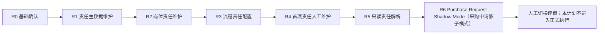
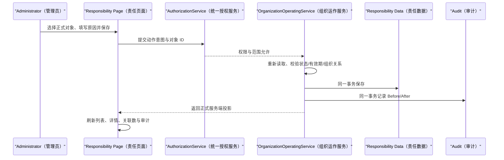

# PCE Responsibility Master Data（责任主数据）V1 实施计划设计报告

报告日期：2026-08-17  
任务类型：Implementation Plan Design（实施计划设计）  
架构状态：Human Architecture Approval（人工架构批准）已完成  
当前状态：PLAN COMPLETE / IMPLEMENTATION NOT STARTED（计划完成/尚未实施）

---

## 1. 计划目标与边界

本计划把已批准的 Responsibility Master Data（责任主数据）架构拆分为可验证、可回退的实施阶段，最终使管理员能够维护：

```text
Responsibility（职责/责任定义）
→ PositionResponsibility（岗位职责关系）
→ PositionWorkflowResponsibility（岗位流程责任关系）
```

维护完成只代表责任事实已经建立，不代表 Workflow Runtime（流程运行引擎）已经消费责任，不创建 ApprovalTask（审批任务），也不推进采购审批。

本轮仅输出实施阶段、页面设计、数据维护流程、权限方案、测试方案、上线策略和回退方案。禁止修改代码、数据库、Migration（数据库迁移）、Permission（权限）体系、采购状态及任何正式业务数据。

---

## 2. 已完整读取的依据

### 2.1 责任设计

- `docs/governance/PCE Responsibility Master Data V1设计报告.md`
- `docs/governance/PCE责任解析引擎V1设计报告.md`
- `docs/governance/PCE责任解析引擎V1实施前架构审核与设计确认报告.md`

### 2.2 Organization（组织）设计

- `docs/governance/PCE企业组织运作模型V1-数据驱动架构审计报告.md`
- `docs/governance/PCE企业组织运作模型V1-正式管理员入口统一与维护闭环整改报告.md`
- `docs/governance/PCE企业组织运作模型V1-员工直属主管维护闭环报告.md`

### 2.3 Permission（权限）设计

- `docs/standards/PCE-BUSINESS-ACTION-PERMISSION-V1.0.md`
- `docs/governance/PCE公共组织身份权限核心V1-最终人工验收与封板报告.md`

这些材料共同确认：责任解决“谁应该负责”，权限解决“能不能执行”，AuthorizationService（统一授权服务）作最终裁决；唯一正式组织维护入口是 `#/organization`；正式组织写入必须进入 OrganizationOperatingService（组织运作服务）和 OrganizationOperatingAuditRecord（组织运作审计记录）。

---

## 3. 当前架构状态

### 3.1 已具备能力

| 能力 | 当前事实 |
|---|---|
| Responsibility 基础模型 | 已有 code、name、description、category、is_active |
| PositionResponsibility 基础关系 | 已有 Position、Responsibility、is_primary、active |
| PositionWorkflowResponsibility 基础关系 | 已有 workflow、node、Position、Responsibility、Ownership Type（责任类型）、有效期和 active |
| 管理动作 | 已有 `SAVE_RESPONSIBILITY`、`SAVE_POSITION_RESPONSIBILITY`、`SAVE_WORKFLOW_RESPONSIBILITY` |
| 维护权限 | 已有两项正式权限，并已接入 AuthorizationService |
| 服务端写链 | 已有 OrganizationOperatingService、事务、原因和刷新回读 |
| 审计 | 已有 OrganizationOperatingAuditRecord 的 Before（修改前）/After（修改后）快照 |
| 正式入口 | `#/organization` 已统一组织、岗位、员工、角色和权限维护 |

### 3.2 当前缺口

| 对象 | 缺口 | 影响 |
|---|---|---|
| Responsibility | 只有 is_active，没有 Draft（草稿）、Active（生效）、Suspended（暂停）、Expired（失效）和有效期 | 无法完整执行已批准生命周期 |
| Responsibility.category | 自由文本 | Business Domain（业务领域）不能受治理 |
| PositionResponsibility | 无 Priority（优先级）和 Effective Period（有效期间） | 无法表达计划中的排序、诊断和时点有效性 |
| PositionWorkflowResponsibility | Responsibility 外键允许空 | 新的正式流程责任可能缺少责任语义 |
| 页面 | 现有维护表单偏紧凑，缺少企业列表、详情、关联数量和生命周期动作 | 管理员难以完成主数据治理 |
| 责任数据 | 三类责任数据均为 0 | 当前不能执行真实责任解析或 Shadow 对比 |
| Runtime 消费 | Workflow Runtime 仍未消费岗位流程责任 | 维护能力与流程执行保持隔离，符合本计划边界 |

### 3.3 R0 Schema（数据结构）结论

当前模型不足以完整实现已批准设计，未来实施需要最小扩展既有模型，但禁止新增 V2 表。

建议的未来增量：

| 既有对象 | 增量 | 决策 |
|---|---|---|
| Responsibility | `status`、`effective_from`、`effective_to` | 必需 |
| Responsibility.category | 受控承载 `business_domain` | 复用，不新增同义字段 |
| Responsibility.is_active | 兼容投影：`status=ACTIVE` 时为 true | 暂时保留，不作为独立事实 |
| PositionResponsibility | `priority`、`effective_from`、`effective_to` | 必需 |
| PositionResponsibility.is_primary | true=`PRIMARY`（主责），false=`SUPPORTING`（协助） | 复用，不新增重复类型字段 |
| PositionWorkflowResponsibility.responsibility | 新写入强制非空；是否数据库改为 NOT NULL（非空）由迁移专项确认 | 必需门禁 |

不增加 Responsibility 的 Company（公司）字段。继续使用“全局稳定责任目录＋公司内岗位承担关系”。

未来 Migration 必须满足：

1. 只扩展既有表；
2. 不创建 ResponsibilityV2 或平行关系表；
3. 不插入任何正式 Responsibility 数据；
4. 新责任默认 `DRAFT`，不得默认 ACTIVE；
5. 迁移前后 PurchaseOrder（采购订单）和 SupplierMaterialPrice（供应商物料价格）数量不变；
6. 必须另获代码与数据库实施授权，本报告不构成授权。

---

## 4. 总体实施阶段



| 阶段 | 目标 | 业务写入边界 | 阶段结束门禁 |
|---|---|---|---|
| R0 | 确认 Schema、权限、入口和模型差距 | 0 | 人工签发实施范围 |
| R1 | 建立 Responsibility 正式维护闭环 | 仅经授权责任主数据 | 生命周期、403、审计和回读通过 |
| R2 | 建立 PositionResponsibility 维护闭环 | 仅经授权岗位职责关系 | PRIMARY/SUPPORTING、有效期和冲突检查通过 |
| R3 | 建立 PositionWorkflowResponsibility 维护闭环 | 仅配置关系 | 不创建 ApprovalTask、不推进流程 |
| R4 | 人工维护首项采购申请审批责任 | 仅人工确认的单项责任及关系 | 数据、审计与唯一性人工签发 |
| R5 | 运行只读责任解析 | 0 | RM-T01～RM-T12 通过 |
| R6 | 与旧采购审批做影子比较 | 0 个审批任务/采购状态写入 | 差异清单和人工评审完成 |

R0～R4 建立责任事实；R5 才允许解析；R6 只观察。任何阶段失败都不得跨阶段继续。

---

## 5. Phase R0：基础确认

### 5.1 目标

R0 只确认现状与实施方案，不修改任何资产。

必须确认：

- Responsibility 仍为唯一责任定义模型；
- PositionResponsibility 仍为唯一岗位职责关系；
- PositionWorkflowResponsibility 仍为唯一流程责任配置；
- `category` 尚未承载其他正式语义；
- 三类责任表当前数据数量及引用情况；
- 两项现有权限与角色分配情况；
- `#/organization` 为唯一正式维护入口；
- Workflow/Node 的正式代码来源；
- 未来 Migration 的备份、默认值、反向方案和零数据初始化原则。

### 5.2 输出

R0 应生成独立实施确认清单：

```text
Schema Extension Required = YES
New Responsibility Model Required = NO
New Permission Required = NO
Formal Responsibility Seed Required = NO
Workflow Runtime Change Required = NO（R0-R4）
ApprovalTask Change Required = NO（R0-R6）
```

### 5.3 停止条件

若发现 category 已被正式使用、存在未报告责任数据、存在第二套责任写入口、权限码不一致或正式 workflow/node code 不明确，R0 立即停止并重新提交架构差异，不进入 R1。

---

## 6. Phase R1：Responsibility（职责/责任定义）维护能力

### 6.1 正式页面位置

唯一入口：

```text
#/organization
→ 岗位管理
→ 责任管理
```

建议内部定位：

```text
#/organization?tab=positions&section=responsibilities
```

不新增 `/responsibility-admin` 独立系统。`#/organization-model` 只做综合查看、关系诊断和审计，不提供第二条写链。

页面应复用 PceEnterpriseListTable（企业级列表组件）、PceEnterpriseAdvancedFilter（企业高级筛选组件）和 PceBusinessStatus（业务状态组件），遵守企业级列表单一横向滚动所有权。

### 6.2 列表设计

固定左侧：选择框、序号、责任编码、责任名称。主要列：

| 字段 | 展示规则 |
|---|---|
| 责任编码 | 稳定 code，ACTIVE 后不可编辑 |
| 责任名称 | 中文业务名称 |
| 业务领域 | 服务端 `businessDomainLabel`，不显示内部状态码给普通管理员 |
| 状态 | 草稿/生效/暂停/失效，由服务端 statusLabel 提供 |
| 生效日期 | 日期；未设置显示“待维护” |
| 失效日期 | 日期或“长期有效” |
| 关联岗位数量 | 服务端聚合，点击进入关系详情 |
| 关联流程数量 | 服务端聚合，不由前端计数 |
| 最近修改时间 | 服务端事实 |
| 操作 | 固定右侧；查看、编辑、激活、暂停、失效 |

快捷搜索：责任编码、责任名称、说明。高级筛选至少包含业务领域、状态和生效日期范围，并为字段声明正确 `filterType`。

### 6.3 详情设计

详情抽屉或弹窗显示：

- Responsibility Code（责任编码）；
- Responsibility Name（责任名称）；
- Description（说明）；
- Business Domain；
- Status（状态）；
- Effective From（生效日期）和 Effective To（失效日期）；
- 使用范围说明：全局责任定义，公司差异由岗位关系表达；
- 关联岗位列表及数量；
- 关联流程列表及数量；
- 最近 OrganizationOperatingAuditRecord；
- “责任不等于权限、不自动产生审批人”的固定业务说明。

### 6.4 维护动作

| 动作 | 前置状态 | 结果 | 禁止行为 |
|---|---|---|---|
| 新建 | 无 | 创建 DRAFT | 不得默认 ACTIVE |
| 编辑 | DRAFT | 可编辑所有业务字段 | 不自动生成编码 |
| 编辑说明/名称 | ACTIVE | 只允许非改义澄清 | 不得修改 code |
| 激活 | DRAFT | ACTIVE | 缺说明、领域或生效日期时拒绝 |
| 暂停 | ACTIVE | SUSPENDED | 不删除关系和历史 |
| 恢复 | SUSPENDED | ACTIVE | 必须仍处于有效期且填写原因 |
| 失效 | ACTIVE/SUSPENDED/DRAFT | EXPIRED | 不允许再次激活 |

不提供 Delete（删除）按钮和删除 API。失败保存不得产生成功审计。

---

## 7. Phase R2：PositionResponsibility（岗位职责关系）维护

### 7.1 页面位置

```text
#/organization
→ 岗位管理
→ 选择岗位
→ 岗位责任
```

管理员先选择正式 Position（岗位），再从 ACTIVE 且有效的 Responsibility 列表中分配责任。候选列表显示“责任名称 · 责任编码 · 业务领域”，不得按岗位名称推荐并自动选中。

### 7.2 表单

| 字段 | 规则 |
|---|---|
| Position ID（岗位） | 服务端正式岗位；显示编码、名称、部门、公司 |
| Responsibility ID（责任） | 仅有效责任；主体是 Responsibility |
| Responsibility Type（责任类型） | `PRIMARY`（主责）或 `SUPPORTING`（协助） |
| Priority（优先级） | 正整数，仅用于展示和治理诊断 |
| Effective From | 必填，且在岗位/责任有效期内 |
| Effective To | 可空，不早于开始日期 |
| 状态 | 启用/停用 |
| Reason（修改原因） | 必填 |

示例只用于说明：

```text
采购经理岗位
→ PRIMARY
→ PURCHASE_REQUEST_APPROVAL（采购申请审批责任）
```

岗位名称不进入责任编码，也不触发自动责任生成。

### 7.3 业务规则

1. `is_primary=true` 对应 PRIMARY，false 对应 SUPPORTING；
2. 默认解析只消费 PRIMARY；SUPPORTING 不自动升级为主责任；
3. priority 不参与自动选人；
4. 同一岗位与责任只允许一个逻辑关系；
5. 关系有效期必须被 Position 和 Responsibility 有效期覆盖；
6. Position 必须属于操作者授权 Company/Department（部门）范围；
7. 停用保留关系和审计，不物理删除；
8. 多个有效 PRIMARY 路径必须暴露冲突，不允许保存后静默选择一个人。

---

## 8. Phase R3：PositionWorkflowResponsibility（岗位流程责任关系）维护

### 8.1 页面与入口

正式写入口仍属于组织与岗位治理：

```text
#/organization
→ 岗位管理
→ 流程责任配置
```

流程管理页面可提供“维护流程责任”导航，但只能跳转或嵌入同一受控组件、调用同一服务，不建立第二套保存方法。

### 8.2 配置字段

| 字段 | 规则 |
|---|---|
| Workflow Code（流程编码） | 从正式流程定义选择，不接受自由猜测 |
| Node Code（节点编码） | 从所选流程的正式节点选择 |
| Responsibility | 必填，且为 ACTIVE/有效 |
| Position | 必须已有同一有效 PositionResponsibility |
| Ownership Type（责任类型） | `OWNER`（负责）/`APPROVER`（审批）/`REVIEWER`（审核）/`EXECUTOR`（执行） |
| Effective From/To | 有效期间 |
| 状态 | 启用/停用 |
| Reason | 必填 |

### 8.3 强制提示

页面固定显示：

> 此处只配置岗位在流程节点中的责任，不创建审批任务、不指定当前审批人、不推进流程状态，也不授予权限。

保存成功后只刷新责任配置和审计。必须验证 ApprovalTask 新增数为 0、Purchase Request 状态变化数为 0。

---

## 9. Phase R4：第一批责任数据方案

### 9.1 范围

第一批只设计并人工维护：

```text
PURCHASE_REQUEST_APPROVAL
（采购申请审批责任）
```

明确暂缓：

```text
PURCHASE_ORDER_APPROVAL
SUPPLIER_REVIEW
PAYMENT_APPROVAL
QUALITY_DISPOSITION_APPROVAL
```

### 9.2 责任卡片

| 字段 | 建议值/规则 |
|---|---|
| code | `PURCHASE_REQUEST_APPROVAL` |
| name | 采购申请审批责任 |
| business domain | `PROCUREMENT` |
| description | 对采购申请的业务必要性、范围、预算和合规性作审批决定；不包含采购订单、供应商或付款审批 |
| 初始状态 | DRAFT |
| effective from | 由管理员在正式生效审核时选择 |
| effective to | 默认空，表示未预设结束日期 |

该卡片不是 seed（初始化数据）指令。管理员必须在页面人工创建、复核和激活。

### 9.3 人工维护顺序

```text
责任目录维护人创建 DRAFT
→ 组织治理审核人复核并激活
→ 公司组织/业务管理员选择正式 Position 建立 PRIMARY 关系
→ 流程管理员选择正式 workflow/node 建立 APPROVER 关系
→ 审计复核人检查全部 Before/After
→ 只读责任解析验证
→ Shadow Mode 对照
```

Workflow Code 和 Node Code 必须在 R0 从正式 Registry（注册中心）确认；未确认时不得用报告示例或页面自由文本创建关系。

---

## 10. 数据维护责任与职责分离

不新增硬编码 Role（角色）名称。以下是治理职责，由管理员通过现有 Role、Permission 和 Scope（数据范围）配置实现。

| 治理职责 | 维护对象 | 权限 | 范围 |
|---|---|---|---|
| 责任目录维护人 | 新建 DRAFT、维护名称/说明/领域 | `system.organization.responsibility.manage` | ALL 或组织级 |
| 责任生效审核人 | 激活、暂停、失效全局责任 | 同上 | ALL 或经批准组织级；建议与创建人不同 |
| 公司组织/业务管理员 | PositionResponsibility | 同上 | 仅授权 Company/Department |
| 流程管理员 | PositionWorkflowResponsibility | `system.organization.workflow_responsibility.manage` | 授权组织与流程 |
| 审计复核人 | 查看审计、冲突和差异 | 现有只读组织/Profile 权限 | 只读 |

控制原则：

1. 不给普通业务执行人责任主数据写权限；
2. 全局目录修改人与公司岗位关系维护人原则上分离；
3. 流程责任配置使用独立的现有流程责任权限；
4. 首项责任的创建人与激活人建议不同，并由审计记录证明；
5. `superadmin` 只作紧急治理和验收身份，不作为日常单人全链维护方式；
6. 不通过新增重复 Permission 实现职责分离，而通过既有权限的 Role/Scope 分配实现。

---

## 11. Permission（权限）方案

### 11.1 必须复用

```text
system.organization.responsibility.manage
（组织责任维护权限）

system.organization.workflow_responsibility.manage
（组织流程责任维护权限）
```

动作对应：

| Business Action（业务动作） | Required Permission（所需权限） |
|---|---|
| `SAVE_RESPONSIBILITY` | `system.organization.responsibility.manage` |
| `SAVE_POSITION_RESPONSIBILITY` | `system.organization.responsibility.manage` |
| `SAVE_WORKFLOW_RESPONSIBILITY` | `system.organization.workflow_responsibility.manage` |

禁止新增 `responsibility.admin.v2`、`responsibility.permission.manage` 或其它同义权限。

### 11.2 服务端验证顺序

```text
页面提交保存意图
→ 服务端读取当前 User（用户账户）
→ AuthorizationService 校验 Permission + Scope
→ OrganizationOperatingService 重新读取正式对象
→ 状态、有效期、Company、Department 与关系校验
→ transaction.atomic（数据库原子事务）
→ 保存主数据与审计
→ 重新读取同一服务端事实
→ 页面刷新显示
```

无权限用户必须得到 HTTP 403；按钮隐藏或禁用不能代替后端拒绝。

---

## 12. Audit（审计）方案

所有成功修改复用 OrganizationOperatingAuditRecord，不新建责任审计表。

必须记录：

- Before；
- After；
- Operator（操作者）；
- Reason；
- Time（时间）；
- action code；
- target type / ID / label；
- Company/组织范围。

快照要求：

| 对象 | 必须快照 |
|---|---|
| Responsibility | code、name、description、business domain、status、有效期 |
| PositionResponsibility | Position ID/code、Responsibility ID/code、PRIMARY/SUPPORTING、priority、有效期、active |
| PositionWorkflowResponsibility | workflow、node、Responsibility、Position、ownership type、有效期、active |

暂停、恢复、失效必须显示明确状态迁移。失败事务、无权限请求和只读预览不生成成功审计。

---

## 13. 数据维护闭环



页面不得从本地缓存补齐状态、关联岗位数、关联流程数或审计；API、页面、诊断与验收报告必须复用同一服务端事实。

---

## 14. 第一阶段测试方案

### 14.1 必测项目

| 编号 | 场景 | 操作 | 预期 |
|---|---|---|---|
| RM-T01 | 创建责任与编码唯一 | 创建 DRAFT，再创建相同 code | 首次成功；重复 code 拒绝 |
| RM-T02 | 生命周期 | DRAFT → ACTIVE | 字段完整时成功；非法跳转拒绝；审计完整 |
| RM-T03 | 岗位责任绑定 | 为 Position 分配 PRIMARY Responsibility | 保存、刷新和服务端回读一致 |
| RM-T04 | 多人责任冲突 | 同一解析范围配置多个有效 PRIMARY 岗位/员工 | `MULTIPLE_CANDIDATES`（多个责任候选人） |
| RM-T05 | 无责任 | 不配置有效责任路径 | `RESPONSIBILITY_UNRESOLVED`（责任未解析） |
| RM-T06 | 权限隔离 | 无维护权限用户直接调用写 API | HTTP 403，零主数据与审计写入 |

### 14.2 扩展测试

| 编号 | 场景 | 预期 |
|---|---|---|
| RM-T07 | 暂停与失效 | 暂停后不进入候选；EXPIRED 不可恢复 |
| RM-T08 | 有效期 | 未来、过期和结束早于开始分别正确处理 |
| RM-T09 | SUPPORTING | 不作为默认主责任候选，不自动升级 |
| RM-T10 | Priority | 不用于多人自动选人 |
| RM-T11 | 流程责任保存 | 配置回读成功；ApprovalTask 新增 0；采购状态变化 0 |
| RM-T12 | 审计与刷新 | 每次成功写入都有 Before/After/Operator/Reason/Time，整页刷新一致 |
| RM-T13 | 跨公司/越范围 | 服务端拒绝跨 Company 或未授权 Department |
| RM-T14 | 禁止硬删除 | 页面无删除动作，直接调用删除端点拒绝 |
| RM-T15 | 禁止自动生成 | 岗位/部门/员工名称变化不创建责任数据 |
| RM-T16 | 采购保护 | PurchaseOrder=218、SupplierMaterialPrice=28 |

### 14.3 测试分层

1. 模型与状态机单元测试；
2. OrganizationOperatingService 集成测试；
3. AuthorizationService 403 与 Scope 测试；
4. 正式 API 保存—刷新—回读测试；
5. 页面字段、列表、筛选、状态和审计测试；
6. 浏览器人工验收；
7. 数据库哈希与采购保护计数。

自动测试只在隔离测试数据库创建样例责任，不得污染真实开发库。

---

## 15. Purchase Request（采购申请）Shadow Mode（影子模式）

### 15.1 目标

Shadow 只比较，不改变旧采购流程：

```text
旧路径：采购申请 → 旧审批逻辑 → 旧审批人/角色文本

新路径：采购申请
      → Responsibility Resolution Engine（责任解析引擎）
      → PURCHASE_REQUEST_APPROVAL
      → Position
      → Employee（员工）
      → AuthorizationService 权限预检
      → 只读解析结果
```

### 15.2 触发设计

旧采购申请成功提交并完成事务后，通过 after-commit observer（事务提交后观察器）执行只读解析。影子异常、超时或日志失败不得回滚旧提交。

输入必须由服务端读取：业务对象 ID/版本、Company、Department、目标审批 Business Action、workflow/node、Required Responsibility、解析时点和旧审批结果。

### 15.3 比较输出

```text
shadow_run_id
purchase_request_id / version
legacy_approver_id_or_text
resolved_employee_id / name snapshot
resolved_position_id
required_responsibility
permission_decision
comparison_status
difference_reason
evidence
duration_ms
business_write_count = 0
```

差异原因至少包括：

- `MATCH_EMPLOYEE`：旧、新稳定 Employee 一致；
- `LEGACY_TEXT_ONLY`：旧值只有“采购经理”等文本，不能判定一致；
- `NEW_UNRESOLVED`：新链无责任人；
- `NEW_MULTIPLE_CANDIDATES`：新链多人；
- `NEW_PERMISSION_DENIED`：唯一责任人权限不足；
- `ASSIGNEE_MISMATCH`：旧、新稳定人员不同；
- `SCOPE_MISMATCH`：公司或部门范围不同；
- `SHADOW_TECHNICAL_ERROR`：影子技术异常。

### 15.4 绝对禁止

- 创建、修改或关闭 ApprovalTask；
- 修改采购申请状态、当前节点或审批人；
- 调用审批动作；
- 修改 Responsibility、PositionResponsibility 或 Permission；
- 因新结果不同而替换旧审批人；
- 把岗位文案相同误判为 Employee 相同。

---

## 16. 上线策略

### 16.1 发布顺序

```text
Release 0：R0 事实确认与数据库备份
Release 1：经独立授权执行 additive schema migration（增量结构迁移），不 seed 数据
Release 2：责任目录页面与生命周期服务，默认功能开关关闭
Release 3：岗位责任页面与服务端校验
Release 4：流程责任配置页面；Runtime 消费保持关闭
Release 5：人工维护首项 DRAFT，复核后激活并建立关系
Release 6：只读解析与隔离验收
Release 7：Shadow 开关小范围启用
```

本计划不包含 Enforce Mode（正式执行模式）。Shadow 之后必须重新进行人工架构和业务审核。

### 16.2 发布门禁

每个 Release 必须满足：

- 前一阶段自动与人工验收通过；
- 数据库备份和哈希已记录；
- 无未解释的多候选或跨公司关系；
- 无权限写入 HTTP 403；
- 审计与刷新回读一致；
- ApprovalTask 数量不因 R0～R6 增加；
- PurchaseOrder 和 SupplierMaterialPrice 保护计数不变；
- 不绕过既有 SCM Static Gate（供应链静态门禁）。

### 16.3 Feature Mode（功能模式）

维护能力与解析能力分开开关：

```text
responsibility_master_data.maintenance = OFF / ON
responsibility_resolution.read_only = OFF / ON
responsibility_resolution.purchase_request.shadow = OFF / SHADOW
```

开关属于服务端受治理配置，页面参数和 localStorage（浏览器本地存储）不能启用。

---

## 17. 回退方案

### 17.1 维护能力回退

- 页面开关 ON → OFF，立即停止新维护；
- 保留已写责任及审计，不物理删除；
- 错误责任从 ACTIVE → SUSPENDED，调查后恢复或 EXPIRED；
- 错误岗位/流程关系置 inactive 或设置失效日期；
- 增量 Schema 保留，不执行破坏性降级，除非独立数据库回退评审批准；
- 历史 code、ID 和审计不得重写。

### 17.2 Shadow 回退

```text
SHADOW ON
→ 发现责任错误 / 多人冲突 / 权限问题 / 技术异常
→ SHADOW OFF
→ 旧审批逻辑继续唯一生效
```

Shadow 不写业务对象，因此关闭不需要回滚 Purchase Request、ApprovalTask 或审批状态。

### 17.3 不允许的回退

- 删除错误责任记录；
- 把多个候选按 priority 或 ID 自动压成一个；
- 找管理员或有权限用户代替；
- 修改历史审批任务以匹配新责任；
- 在同一请求内 unresolved 后静默调用旧逻辑兜底；
- 为恢复运行绕过 AuthorizationService。

---

## 18. 风险清单

| 优先级 | 风险 | 影响 | 控制 |
|---|---|---|---|
| P0 | 当前三类责任数据均为 0 | 无真实解析基础 | R4 只人工维护一项，不自动 seed |
| P0 | status 与 is_active 双事实 | 状态不一致 | is_active 降为兼容投影，服务端单向维护 |
| P0 | category 已有未知语义 | business domain 冲突 | R0 完整扫描；发现即停止 |
| P0 | 多个 PRIMARY 岗位/员工 | 无唯一责任人 | 显式 MULTIPLE_CANDIDATES，阻断 |
| P0 | 流程责任误被当成任务 | 意外推进审批 | 页面提示、写后断言 ApprovalTask=0 |
| P0 | 旧审批只有岗位文本 | 无法准确比较 | LEGACY_TEXT_ONLY，不伪造 MATCH |
| P1 | 全局责任被部门管理员改义 | 影响所有公司 | 全局定义只允许 ALL/治理范围 |
| P1 | priority 被用于自动选人 | 隐性硬编码 | 仅展示和诊断，测试 RM-T10 |
| P1 | 两套页面形成两条写链 | 事实分叉 | 唯一入口与同一服务；综合页只读 |
| P1 | 自动生成正式责任 | 错误企业事实 | 禁止 seed、名称推断和 AI 自动写入 |
| P1 | Shadow 增加旧请求延迟 | 影响采购提交 | after-commit、超时、熔断、非阻塞 |
| P1 | 责任自动产生权限 | 绕过权限核心 | AuthorizationService 最终裁决 |
| P2 | 未来模块一次性扩张 | 难以验收与回退 | 每种责任独立数据和业务验收 |

---

## 19. 未来扩展边界

在采购申请责任通过后，未来可以独立设计：

- Supplier Review Responsibility（供应商审核责任）；
- Payment Approval Responsibility（付款审批责任）；
- Quality Responsibility（质量责任）；
- Production Responsibility（生产责任）；
- Purchase Order Approval Responsibility（采购订单审批责任）。

每项扩展必须复用同一 Responsibility、PositionResponsibility、PositionWorkflowResponsibility 和 AuthorizationService，不新增模块私有责任表。本轮不实施任何上述责任。

---

## 20. 保护基线

计划设计前后只读复核：

```text
Database SHA256 Before = 9FC2A4B19716E84EB10F397BF94736CC69FFC6D1472C6FFB1849DD3A20036619
Database SHA256 After  = 9FC2A4B19716E84EB10F397BF94736CC69FFC6D1472C6FFB1849DD3A20036619
PurchaseOrder Before / After = 218 / 218
SupplierMaterialPrice Before / After = 28 / 28
Responsibility Before / After = 0 / 0
PositionResponsibility Before / After = 0 / 0
PositionWorkflowResponsibility Before / After = 0 / 0
```

本轮只读取文档、源码、数据库哈希和计数，并新增本实施计划报告。没有执行 Migration、创建责任、修改权限、运行审批或写入业务数据。数据库哈希和全部保护计数前后完全一致。

最终签发：

```text
PurchaseOrder（采购订单）= 218
SupplierMaterialPrice（供应商物料价格）= 28
Unauthorized Business Writes（未授权业务写入）= 0
```

---

## 21. 最终实施计划状态

```text
Responsibility Master Data Architecture Approval = CONFIRMED
Implementation Plan = PASS
Phase R0-R4 = DESIGNED
Read-only Resolution Phase = DESIGNED / NOT IMPLEMENTED
Purchase Request Shadow Mode = DESIGNED / NOT IMPLEMENTED
Responsibility Data Created = NO
Code Changed = NO
Database Changed = NO
Migration Created = NO
Workflow Runtime Changed = NO
ApprovalTask Changed = NO
Permission Changed = NO
Purchase Approval Changed = NO
Business Data Changed = NO
Human Implementation Plan Review = WAITING
```

实施原则：先建立责任主数据维护能力，再运行责任解析；先让企业定义责任，再让系统计算责任。

本轮到此停止，等待人工审核。
