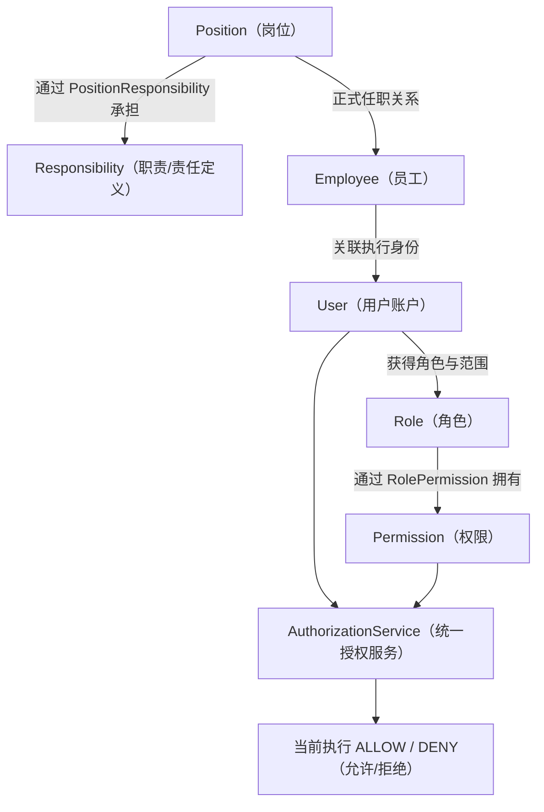

# PCE Responsibility Master Data（责任主数据）V1——岗位、责任、角色、权限语义边界确认报告

报告日期：2026-08-17  
任务类型：Architecture Semantic Confirmation（架构语义确认）  
当前状态：DESIGN COMPLETE / HUMAN ARCHITECTURE CONFIRMATION WAITING（设计完成/等待人工架构确认）

---

## 1. 报告目标

本报告正式确认 Position（岗位）、Responsibility（职责/责任定义）、Role（角色）与 Permission（权限）的语义边界，消除“责任是不是角色”“责任是不是权限”“岗位是不是审批人”等歧义。

核心结论：

> 岗位是组织事实，责任是业务事实，角色是授权集合，权限是执行能力。四者相互关联但绝不等同。

正式分工：

| 对象 | 回答的问题 | 不回答的问题 |
|---|---|---|
| Position（岗位） | 企业组织中设置了什么职位席位？ | 当前动作由谁执行、能否执行 |
| Responsibility（职责/责任定义） | 企业业务中应由谁承担什么稳定责任？ | 当前账户是否获准执行系统动作 |
| Role（角色） | 系统账户具有什么权限集合？ | 企业中哪个岗位或员工应该负责 |
| Permission（权限） | 账户是否具备某一类系统动作能力？ | 谁应该负责、谁是审批人 |
| AuthorizationService（统一授权服务） | 当前用户在当前组织、对象、状态和范围下，这一次执行是否允许？ | 企业责任应该由谁承担 |

本报告只固化语义，不修改代码、数据库、Migration（数据库迁移）、Role、Permission、Responsibility 数据、Workflow Runtime（流程运行引擎）或采购流程。

---

## 2. 已完整读取的依据

### 2.1 Responsibility（职责/责任定义）材料

- `docs/governance/PCE Responsibility Master Data V1设计报告.md`
- `docs/governance/PCE Responsibility Master Data V1实施计划设计报告.md`
- `docs/governance/PCE Responsibility Master Data V1-R1实施报告.md`
- `docs/governance/PCE Responsibility Master Data V1-R1.2整改报告.md`

### 2.2 Organization（组织）材料

- `docs/governance/PCE企业组织运作模型V1-实施与人工验收交接报告.md`
- `docs/governance/PCE企业组织运作模型V1-正式管理员入口统一与维护闭环整改报告.md`

### 2.3 Permission（权限）材料

- `docs/standards/PCE-BUSINESS-ACTION-PERMISSION-V1.0.md`
- `docs/governance/PCE公共组织身份权限核心V1-最终人工验收与封板报告.md`

共同基线：Position 与 Role 已在模型、字段和人工验收中证明为独立对象；Responsibility 以 `system.Responsibility` 为唯一事实来源；RolePermission（角色权限关系）是角色拥有权限的正式关系；最终权限结论只能由服务端 AuthorizationService 产生。

---

## 3. 四层语义模型

### 3.1 Position（岗位）：组织职位席位

Position 回答：

> 企业组织中设置了什么职位？哪个组织职位可以承载某项责任？

示例：

- 采购经理；
- 仓库主管；
- 财务经理。

岗位具有公司、部门、层级、岗位族、岗位等级、有效期和任职关系。岗位是组织设计中的稳定席位，不是具体员工，不是系统角色，不是权限，也不是审批任务中的自然人。

正确表达：

```text
采购经理岗位
承担
PURCHASE_REQUEST_APPROVAL（采购申请审批责任）
```

错误表达：

```text
采购经理岗位 = 采购申请审批责任
采购经理岗位 = 当前审批人
采购经理岗位 = 采购审批角色
```

岗位必须通过 PositionResponsibility（岗位职责关系）承担责任，通过 Employee（员工）的正式任职关系找到当前人员；岗位本身不能作为 ApprovalTask（审批任务）的执行主体。

### 3.2 Responsibility（职责/责任定义）：稳定业务责任

Responsibility 回答：

> 企业业务中，什么责任必须被承担，以及当前企业组织中谁应该负责这项责任？

其中 Responsibility 定义“必须承担什么稳定业务责任”，PositionResponsibility 定义“哪个岗位应该承担”，责任解析再沿岗位找到当前员工。

示例：

```text
PURCHASE_REQUEST_APPROVAL
（采购申请审批责任）
```

责任的特点：

- 语义稳定；
- 不绑定 Employee；
- 不绑定员工姓名或用户名；
- 不绑定 Position Name（岗位名称）；
- 不绑定 Role；
- 不绑定 Permission；
- 不自动产生审批任务或执行授权。

责任是独立企业业务事实。岗位调整、岗位改名、员工调岗或角色授权变化，不应改写责任编码和业务语义。

禁止命名：

```text
PURCHASE_MANAGER_APPROVAL（采购经理审批责任）
ZHANG_SAN_APPROVAL（张三审批责任）
ADMIN_APPROVAL（管理员审批责任）
```

这些名称把会变化的岗位、人员或授权身份写进了稳定责任事实。

### 3.3 Role（角色）：系统授权集合

Role 回答：

> 系统用户账户被授予了哪一组权限能力？

示例名称可以是：

- 采购审批角色；
- 供应商维护角色；
- 财务审核角色。

这些只是权限集合的业务化名称，不是责任定义，也不是组织岗位。

正式关系：

```text
Role（角色）
  ↓ RolePermission（角色权限关系）
Permission（权限）
```

Role 属于 Permission 体系。User（用户账户）通过正式角色与数据范围分配获得角色；Employee、Position 与 Role 保持独立。

拥有某个 Role 不表示该用户应该承担某项业务责任，也不表示当前动作一定允许。角色还必须拥有动作要求的 Permission，并通过组织范围、对象状态和流程校验。

### 3.4 Permission（权限）：原子执行能力

Permission 回答：

> 当前用户账户是否具备执行某个系统动作所需的能力？

示例：

```text
procurement.purchase_request.approve
（采购申请审批权限）
```

Permission 不表示：

- 谁负责；
- 谁应该审批；
- 谁属于哪个岗位；
- 当前业务对象一定允许执行；
- 拥有权限的人都可以被选为责任人。

Permission 是授权事实的一部分。当前执行仍必须由 AuthorizationService 结合用户身份、Role、Permission、Scope（数据范围）、组织、业务对象状态和流程阶段作最终裁决。

---

## 4. 四对象正式关系



从责任解析方向表达：

```text
Responsibility（职责/责任定义）
  ↓ PositionResponsibility（岗位职责关系）
Position（岗位）
  ↓ 当前有效任职
Employee（员工）
  ↓ 关联账户
User（用户账户）
  ↓ UserRoleScopeAssignment（用户角色范围分配）
Role（角色）
  ↓ RolePermission（角色权限关系）
Permission（权限）
  ↓
AuthorizationService（统一授权服务）
  ↓
ALLOW / DENY（允许/拒绝）
```

正式语义：

- Responsibility 解决“谁应该负责”；
- Permission 解决“谁具备执行能力”；
- AuthorizationService 解决“当前这一次执行是否允许”；
- Position 提供责任的组织承载席位；
- Employee 提供当前自然人执行者；
- Role 提供账户权限集合，不提供责任归属。

---

## 5. 错误模型与正确模型

### 5.1 错误一：Position = Responsibility（岗位等于责任）

错误：

```text
采购经理岗位就是采购审批责任。
```

影响：岗位改名或组织调整会迫使责任改义，无法保持稳定责任编码。

正确：

```text
采购经理岗位通过 PositionResponsibility 承担采购申请审批责任。
```

### 5.2 错误二：Responsibility = Role（责任等于角色）

错误：

```text
采购审批责任就是采购审批角色。
```

影响：把企业责任归属和系统授权集合混为一体；修改责任可能错误改变授权，修改角色可能错误改变企业责任。

正确：

```text
采购审批责任定义谁应该负责。
采购审批角色汇集系统权限。
二者通过员工与账户执行链在运行时相遇，但不是同一事实。
```

### 5.3 错误三：Responsibility = Permission（责任等于权限）

错误：

```text
有采购审批责任就自动拥有采购审批权限。
```

影响：绕过 RolePermission、Scope 和 AuthorizationService，形成未授权执行。

正确：

```text
责任解析找到员工后，仍必须验证其账户是否拥有所需 Permission。
责任存在但权限不足时，返回 RESPONSIBILITY_FOUND_PERMISSION_DENIED（责任存在但权限不足）。
```

禁止自动给责任人授予 Role 或 Permission，也禁止在责任人无权限时改找任意有权限用户。

### 5.4 错误四：Position = Approver（岗位等于审批人）

错误：

```text
审批任务的审批人直接写“采购经理岗位”。
```

影响：岗位不是可登录、可审计的自然人，无法证明谁实际执行。

正确：

```text
Position
  ↓ 当前有效任职关系
Employee
  ↓ 关联账户与授权校验
User
  ↓
创建给明确 Employee/User 的任务
```

若岗位没有有效员工或有多个候选，必须返回未解析或多人冲突，不得把岗位文本当作审批人。

---

## 6. Responsibility 与 Business Action（业务动作）

Business Action 回答“系统正在执行什么动作”；Responsibility 回答“该动作需要谁承担什么业务责任”。

正式关系：

```text
Business Action（业务动作）
  需要
Required Responsibility（所需职责）
  引用
Responsibility（职责/责任定义）
```

同时，Business Action 还独立声明 Required Permission（所需权限）：

```text
Business Action
├── requiredResponsibility → 谁应该负责
└── requiredPermission     → 执行需要什么权限
```

两条声明不得合并。

禁止：

- 新增 Business Action 时自动创建 Responsibility；
- 页面出现新增、审批或提交按钮时自动创建责任；
- 根据 requiredPermission 推导或生成 Responsibility；
- 根据 Responsibility 自动创建 Permission；
- 页面自行维护动作与责任映射。

责任必须先由管理员作为独立企业事实创建和生效，Business Action 契约只能引用既有责任编码。

---

## 7. 采购申请案例验证

### 7.1 动作与责任

```text
Business Action（业务动作）：
procurement.purchase_request.approve
（采购申请审批）

Required Responsibility（所需职责）：
PURCHASE_REQUEST_APPROVAL
（采购申请审批责任）

Required Permission（所需权限）：
procurement.purchase_request.approve
（采购申请审批权限）
```

动作编码、责任编码和权限编码即使文字相近，也分别属于动作注册、责任主数据和权限注册三个不同事实域。

### 7.2 责任解析链

```text
PURCHASE_REQUEST_APPROVAL
  ↓ PositionResponsibility
企业管理员配置的责任岗位
  ↓ 当前有效任职
Employee（员工）
```

“采购经理”只能作为某家企业当前可能承担责任的岗位示例，不能写入引擎判断，不能写入责任编码，也不能直接成为审批人。

### 7.3 权限验证链

```text
Employee
  ↓ 关联 User
Role（角色）
  ↓ RolePermission
procurement.purchase_request.approve
  ↓ 当前组织、范围、对象状态和流程阶段
AuthorizationService（统一授权服务）
  ↓
ALLOW / DENY
```

### 7.4 结果矩阵

| 责任解析结果 | 权限结果 | 正式结论 |
|---|---|---|
| 无有效岗位或员工 | 不进入授权替代 | `RESPONSIBILITY_UNRESOLVED`（责任未解析） |
| 多个有效岗位或员工 | 不随机选择 | `MULTIPLE_CANDIDATES`（多个责任候选人） |
| 唯一员工 | DENY | `RESPONSIBILITY_FOUND_PERMISSION_DENIED` |
| 唯一员工 | ALLOW | `RESOLVED_AUTHORIZED`（责任已解析且获准） |

禁止找管理员、直属主管、任意拥有权限的人或按 ID 排序的人进行兜底。

---

## 8. Responsibility Code（责任编码）确认

采用：

```text
<BUSINESS_OBJECT>_<RESPONSIBILITY_PURPOSE>
```

正确：

```text
PURCHASE_REQUEST_APPROVAL
（采购申请审批责任）
```

错误：

```text
PURCHASE_MANAGER_APPROVAL
（采购经理审批责任）
```

原因：Purchase Request（采购申请）与 Approval（审批目的）是稳定业务语义；采购经理是可能变化的岗位名称。岗位调整只修改 PositionResponsibility，不修改责任编码。

责任编码还不得包含员工姓名、用户名、部门 ID、公司 ID、角色名或实现版本。

---

## 9. 页面固定说明设计

### 9.1 责任管理页面

建议固定显示：

> Responsibility（职责/责任定义）表示企业业务责任，回答谁应该负责，不等同于岗位、角色或权限。责任不会自动授予系统能力，也不会自动指定审批人。

### 9.2 岗位责任页面

建议固定显示：

> Position（岗位）只能通过 PositionResponsibility（岗位职责关系）承担责任。岗位只能选择责任目录中已经存在的责任，不能创建、推断或自动生成责任。

### 9.3 角色管理页面

建议固定显示：

> Role（角色）是用户账户的 Permission（权限）集合，不是组织岗位，也不表示企业业务责任。拥有角色仍需通过组织范围、对象状态和服务端授权校验。

### 9.4 权限管理页面

建议固定显示：

> Permission（权限）表示系统执行能力，不表示业务责任、组织岗位或当前审批人。页面按钮和路由不是授权，最终结果由 AuthorizationService（统一授权服务）裁决。

### 9.5 责任详情页面

建议在事实来源说明旁固定显示：

> 本责任来自 `system.Responsibility`。关联岗位来自 `system.PositionResponsibility`，角色与权限不参与生成责任目录。

这些文案是后续页面实施建议，本轮不修改页面代码。

---

## 10. AI（人工智能）边界

AI 可以：

- 推荐可能需要的责任定义；
- 分析 Business Action 是否缺少 Required Responsibility；
- 发现责任没有岗位承担；
- 发现多个岗位、多个员工或权限不足冲突；
- 解释岗位、责任、角色与权限的配置差异；
- 生成等待管理员确认的建议草案。

AI 不可以：

- 自动创建、激活、暂停或失效正式 Responsibility；
- 自动分配 PositionResponsibility；
- 自动指定审批人；
- 自动授予 Role、Permission 或 Scope；
- 自动根据岗位名称、角色名称或权限编码推导责任；
- 自动把建议结果写入 Workflow Runtime；
- 自动把 Shadow Mode（影子模式）切换为正式执行。

AI 输出只能是 `ADVISORY_ONLY（仅建议）`。正式采用必须由管理员显式确认，并通过业务动作、AuthorizationService、修改原因和审计链保存。

---

## 11. 对后续 Responsibility Resolution Engine（责任解析引擎）的影响

### 11.1 引擎输入必须分离

引擎输入至少分别包含：

- Business Action Code（业务动作编码）；
- Required Responsibility Code（所需职责编码）；
- Required Permission Code（所需权限编码）；
- Company（公司）；
- Department（部门）；
- Workflow Code（流程编码）；
- Node Code（节点编码）；
- Scope（数据范围）；
- 解析时点。

责任编码与权限编码不得共用同一字段。

### 11.2 解析与授权必须分阶段

```text
阶段一：责任解析
Responsibility → PositionResponsibility → Position → Employee

阶段二：权限验证
Employee → User → Role → Permission → AuthorizationService

阶段三：执行或任务创建
仅在唯一责任人且授权允许时进入
```

责任解析不得直接返回“已授权”，AuthorizationService 也不得替代责任解析去寻找负责人。

### 11.3 Evidence（解析证据）必须可解释

未来 Evidence 至少分别记录：

- Responsibility Code/Name；
- Position ID/Code/Name；
- Employee ID/Name 快照；
- PositionResponsibility 来源；
- Role Code；
- Permission Code；
- Authorization Decision（授权决定）；
- Company、Department、Workflow、Node、解析时间和有效期。

证据必须能回答两个独立问题：

1. 为什么此人应该负责？
2. 为什么此人这次可以或不可以执行？

### 11.4 Workflow Runtime（流程运行引擎）迁移约束

旧 `required_role_code` 只能作为兼容字段逐步退出，不能把 Role 改名为 Responsibility 继续使用。

目标链：

```text
Workflow Node（流程节点）
  ↓ Required Responsibility
Responsibility Resolution Engine
  ↓ 唯一 Employee
AuthorizationService
  ↓ ALLOW
ApprovalTask（审批任务）
```

兼容期内旧角色路径继续独立运行；新责任路径先只读和 Shadow 对比。没有后续独立授权，不切换正式流程。

### 11.5 强制异常策略

- 无责任：`RESPONSIBILITY_UNRESOLVED`；
- 多责任候选：`MULTIPLE_CANDIDATES`；
- 有责任但无权限：`RESPONSIBILITY_FOUND_PERMISSION_DENIED`；
- 唯一责任人且有权限：`RESOLVED_AUTHORIZED`。

任何异常都不得通过管理员、岗位文本、角色或权限持有人自动兜底。

---

## 12. 正式架构决策

| 决策编号 | 正式结论 |
|---|---|
| SD-01 | Position 是组织职位席位，不是责任、角色、权限或自然人审批人 |
| SD-02 | Responsibility 是独立稳定业务事实，由 `system.Responsibility` 唯一提供 |
| SD-03 | Position 只能通过 PositionResponsibility 承担既有 Responsibility |
| SD-04 | Role 是 Permission 集合，属于授权体系，不属于责任主数据 |
| SD-05 | Permission 表示执行能力，不表达责任归属 |
| SD-06 | Responsibility 不自动授予 Role 或 Permission |
| SD-07 | 拥有 Permission 不自动成为责任人或审批人 |
| SD-08 | AuthorizationService 是当前执行的最终授权裁决者，不负责寻找责任人 |
| SD-09 | Business Action 分别声明 requiredResponsibility 与 requiredPermission，不自动生成任何一方 |
| SD-10 | 审批任务只能指向解析后的明确 Employee/User，不能直接指向 Position、Role 或 Responsibility |
| SD-11 | AI 仅建议，不写正式责任、授权或审批人事实 |
| SD-12 | 后续责任解析必须先解析责任，再验证权限，最后才允许创建任务或执行 |

---

## 13. 禁止模型总表

```text
Position ≠ Responsibility
Position ≠ Role
Position ≠ Approver
Responsibility ≠ Role
Responsibility ≠ Permission
Role ≠ Responsibility
Permission ≠ Responsibility
Permission ≠ Approver
Employee ≠ Position
拥有 Permission ≠ 应该负责
承担 Responsibility ≠ 自动获权
```

允许且唯一正确的关联是：

```text
Position --PositionResponsibility--> Responsibility
Employee --position_ref--> Position
Employee --user--> User
User --UserRoleScopeAssignment--> Role
Role --RolePermission--> Permission
AuthorizationService --当前上下文--> ALLOW / DENY
```

---

## 14. 本轮变更与保护声明

本轮只完整读取指定架构、组织和权限文件，并新增本语义边界设计报告。

```text
Code Changed = NO
Database Changed = NO
Migration Created = NO
Permission Changed = NO
Role Changed = NO
Responsibility Data Changed = NO
Workflow Runtime Changed = NO
Purchase Process Changed = NO
Business Data Changed = NO
```

没有执行测试数据创建、责任保存、岗位责任分配、权限授予、采购动作或流程动作。

---

## 15. 最终确认状态

正式语义边界确认如下：

```text
Position = Organization Fact（组织事实）
Responsibility = Business Responsibility Fact（业务责任事实）
Role = Authorization Bundle（授权集合）
Permission = Execution Capability（执行能力）
AuthorizationService = Contextual Final Decision（当前上下文最终裁决）
```

最终原则：

> 岗位承担责任，员工任职岗位，账户获得角色，角色拥有权限，统一授权服务裁决当前执行。责任决定谁应该负责，权限决定谁具备能力；二者必须同时满足，但永远不能合并。

最终状态：

```text
Semantic Boundary Design = PASS
Implementation Authorized = NO
Human Architecture Confirmation = WAITING
```

本轮到此停止，等待人工架构确认。
