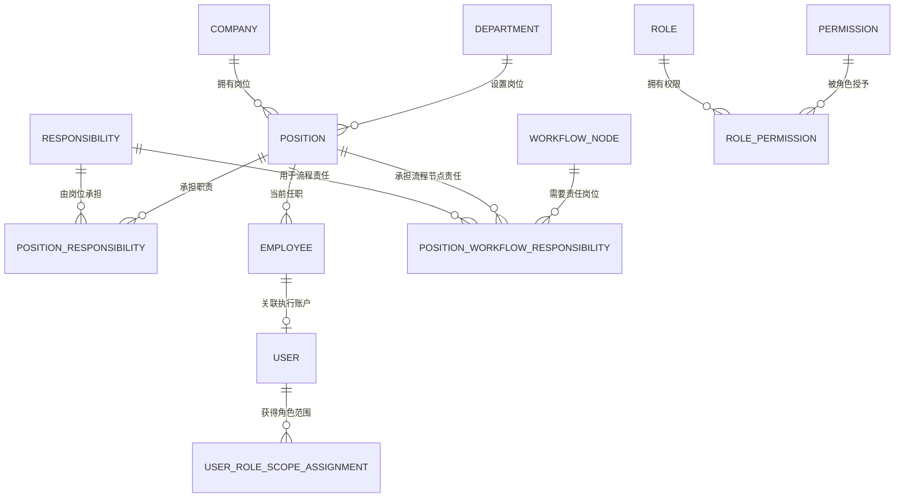
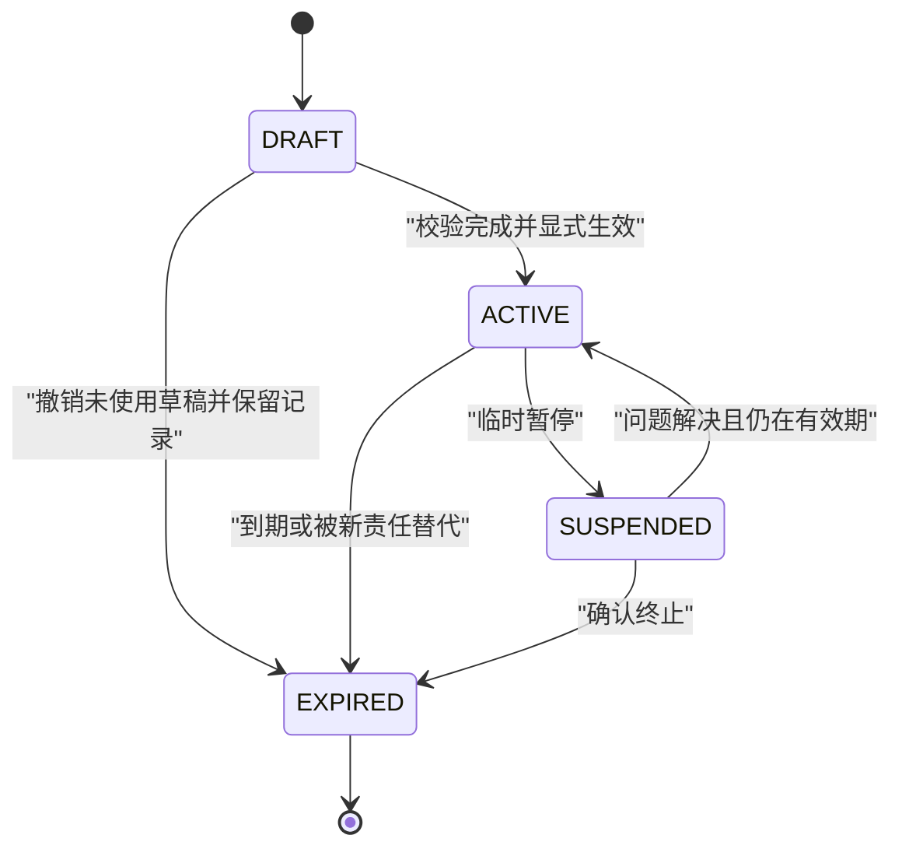

# PCE Responsibility Master Data（责任主数据）V1 设计报告

报告日期：2026-08-17  
任务类型：Architecture Design Only（仅架构设计）  
当前状态：DESIGN COMPLETE / HUMAN ARCHITECTURE REVIEW WAITING（设计完成/等待人工架构审核）

---

## 1. 设计目标

Responsibility Master Data（责任主数据）负责定义企业中稳定、正式、可维护的“谁应该负责什么”语义，是 Responsibility Resolution Engine（责任解析引擎）的事实输入，不是解析算法本身。

目标链：

```text
Business Action（业务动作）
→ Required Responsibility（所需职责）
→ Responsibility（职责/责任定义）
→ PositionResponsibility（岗位职责关系）
→ Position（岗位）
→ Employee（员工）
→ AuthorizationService（统一授权服务）
→ Permission（权限）允许/拒绝
```

本设计建立：

1. 稳定的责任目录及编码规范；
2. 可追溯的责任生命周期；
3. 岗位承担责任的正式关系；
4. 流程节点引用责任的配置关系；
5. Business Action 与责任、权限之间的严格边界；
6. 管理权限、服务端校验和审计原则；
7. Purchase Request（采购申请）首阶段数据准备路线。

本报告不授权修改代码、数据库、Migration（数据库迁移）、Workflow Runtime（流程运行引擎）、Permission、ApprovalTask（审批任务）或采购审批流程，也不创建任何正式责任数据。

---

## 2. 已读取的架构依据

### 2.1 责任解析材料

- `docs/governance/PCE责任解析引擎V1设计报告.md`
- `docs/governance/PCE责任解析引擎V1实施前架构审核与设计确认报告.md`

### 2.2 组织模型材料

- `docs/governance/PCE企业组织运作模型V1-数据驱动架构审计报告.md`
- `docs/governance/PCE企业组织运作模型V1-实施与人工验收交接报告.md`
- `docs/governance/PCE企业组织运作模型V1-员工直属主管维护闭环报告.md`

### 2.3 权限材料

- `docs/standards/PCE-BUSINESS-ACTION-PERMISSION-V1.0.md`
- `docs/governance/PCE公共组织身份权限核心V1-最终人工验收与封板报告.md`

共同约束是：企业事实必须来自正式服务端数据；Position 不等于 Role（角色）；页面、按钮、路由、用户名、岗位名称和浏览器缓存都不是权限或责任事实；最终授权只能由 AuthorizationService 裁决。

---

## 3. 核心概念边界

| 概念 | 回答的问题 | 正式事实来源 |
|---|---|---|
| Responsibility | 谁应该负责某类稳定业务责任？ | 责任主数据 |
| Position | 企业中哪个岗位承担责任？ | Position + PositionResponsibility |
| Employee | 当前谁实际任职于该岗位？ | Employee.position_ref |
| Company（公司） | 责任承担关系属于哪个法人组织？ | Position.company |
| Department（部门） | 岗位和业务对象处于哪个部门范围？ | Position.department 与服务端业务对象 |
| User（用户账户） | Employee 是否具有数字执行身份？ | Employee.user |
| Scope（数据范围） | User 可在哪个组织范围执行？ | UserRoleScopeAssignment |
| Permission | 这个人的账户是否具备执行能力？ | RolePermission（角色权限关系） |
| AuthorizationService | 当前人在当前组织范围和业务对象上是否允许执行？ | 服务端身份、权限、范围与对象事实 |
| Workflow Node（流程节点） | 当前流程需要哪类责任参与？ | 流程定义与 PositionWorkflowResponsibility（岗位流程责任关系） |

强制禁止：

```text
Position = Responsibility
Responsibility = Permission
Permission = Approver（审批人）
Employee = Position
Position.default_role = 自动授权
```

正确关系：

```text
Responsibility → Position → Employee 解决“谁应该负责”
Role → Permission → AuthorizationService 解决“能不能执行”
```

员工离职、调岗或岗位改名不改变 Responsibility 的稳定业务语义；岗位承担关系发生变化时，应修改 PositionResponsibility，而不是改写责任定义。

---

## 4. Enterprise Operation Data Driven Principle（企业运作数据驱动原则）

> 企业组织、部门、岗位、员工、职责、责任和流程归属属于动态企业主数据。代码只提供模型、规则、校验和运行能力；企业实际关系必须由管理员维护的数据产生。

允许固定：责任编码格式、状态机、校验规则、Business Action Code（业务动作编码）、Permission Code（权限编码）、Workflow Code（流程编码）和 Node Code（节点编码）。

禁止固定：

- 采购经理等真实岗位名称；
- 张三、李四等员工或用户名；
- 采购部等真实部门名称或 ID；
- `company_id=1` 等公司常量；
- 某岗位名称包含“经理”就自动生成审批责任；
- 找不到责任时自动选择管理员、直属主管或任意有权限用户。

责任事实只能由有权限管理员显式维护、填写原因并形成审计。

---

## 5. 总体数据模型

### 5.1 核心关系



### 5.2 事实所有权

| 事实 | 唯一所有者 |
|---|---|
| 责任定义及生命周期 | Responsibility |
| 岗位承担哪项责任 | PositionResponsibility |
| 流程节点由哪个责任岗位参与 | PositionWorkflowResponsibility |
| 当前岗位由谁任职 | Employee.position_ref |
| 员工直属或职能主管 | EmployeeReportingRelation（员工汇报关系） |
| 用户拥有哪些系统能力 | Role + Permission + RolePermission |
| 当前动作是否允许 | AuthorizationService |

EmployeeReportingRelation 只在动作契约明确要求直属主管或职能主管策略时使用，不能替代岗位职责关系，也不能作为责任缺失时的默认回退。

---

## 6. Responsibility（职责/责任定义）逻辑模型

### 6.1 目标字段

| 字段 | 类型/规则 | 说明 |
|---|---|---|
| `id` | 稳定内部 ID | 关系引用键，不向业务人员作为语义展示 |
| `code` | 3～80 字符，全局唯一，不可改义 | Responsibility Code（责任编码） |
| `name` | 必填，最多 120 字符 | Responsibility Name（责任名称），面向管理员显示 |
| `description` | 必填业务说明 | Description（说明），明确包含与不包含的责任边界 |
| `business_domain` | 受治理模块编码 | Business Domain（业务领域），如 `PROCUREMENT`、`SUPPLIER`、`FINANCE` |
| `status` | `DRAFT`（草稿）/ `ACTIVE`（生效）/ `SUSPENDED`（暂停）/ `EXPIRED`（失效） | Status（状态） |
| `effective_from` | 激活前必填 | Effective From（生效日期） |
| `effective_to` | 可空，且不得早于生效日期 | Effective To（失效日期） |
| `is_active` | 兼容投影，不再作为独立业务事实 | 兼容现有启停字段 |

### 6.2 当前物理模型与缺口

当前既有 `system.Responsibility` 已包含：

```text
code
name
description
category
is_active
```

设计映射：

- `category` 在 V1 中受控承载 `business_domain`，避免新增同义字段；
- 当前责任记录为 0，尚无历史类别数据需要迁移；
- 若实施前发现 `category` 已被赋予其他正式语义，必须停止并重新进行 Schema（数据结构）评审，禁止一字段双义；
- `status`、`effective_from`、`effective_to` 是四状态生命周期所需的最小未来扩展；
- 现有 `is_active` 无法区分草稿、暂停和失效，不能单独满足目标生命周期。

上述只是未来最小扩展方案，本轮不创建字段或 Migration，不新建 `ResponsibilityV2`。

### 6.3 约束

1. code 全局唯一；
2. code 首次进入 ACTIVE 后不可修改；
3. name 可澄清，但不得借改名改变责任语义；
4. ACTIVE 前必须有 business domain、description 和 effective_from；
5. effective_to 不得早于 effective_from；
6. 只有 ACTIVE 且解析时点位于有效期间内的责任可进入候选；
7. SUSPENDED、EXPIRED 和 DRAFT 均不得产生新责任候选；
8. 已被岗位、流程或历史 Evidence（解析证据）引用的责任不得物理删除；
9. V1 统一禁止硬删除责任记录，包括尚未使用的草稿；错误草稿通过状态和审计关闭。

---

## 7. Responsibility Code（责任编码）规范

### 7.1 语法

```text
<BUSINESS_OBJECT>_<RESPONSIBILITY_PURPOSE>
```

建议正则：

```text
^[A-Z][A-Z0-9]*(?:_[A-Z0-9]+)*$
```

规则：

- 仅使用大写英文字母、数字和下划线；
- 先写稳定业务对象，再写责任目的；
- 责任目的使用受治理词汇，如 `APPROVAL / REVIEW / EXECUTION / OWNERSHIP / EVALUATION`；
- 不写公司、部门、岗位、员工、用户名、日期或环境；
- 不使用 `_V1`、`_V2` 表达实现或流程版本；
- code 不因岗位调整、人员变更或流程版本变化而修改。

### 7.2 正确示例

```text
PURCHASE_REQUEST_APPROVAL（采购申请审批责任）
PURCHASE_ORDER_APPROVAL（采购订单审批责任）
SUPPLIER_REVIEW（供应商审核责任）
SUPPLIER_APPROVAL（供应商批准责任）
PAYMENT_APPROVAL（付款审批责任）
GOODS_RECEIPT_APPROVAL（收货审批责任）
QUALITY_DISPOSITION_APPROVAL（质量处置审批责任）
```

### 7.3 禁止示例

```text
PURCHASE_MANAGER_APPROVAL（采购经理审批）  # 写入了会变化的岗位
APPROVER_LISI                              # 写入了员工
DEPT_8_APPROVAL                            # 写入了部门 ID
COMPANY_1_PAYMENT                          # 写入了公司 ID
PURCHASE_APPROVAL_V2                       # 把版本写进稳定语义
```

### 7.4 版本原则

Responsibility Code 本身不版本化。Workflow Version（流程版本）、Action Contract Version（动作契约版本）和 Evidence Schema Version（证据结构版本）各自记录版本。

- 说明澄清但语义不变：保留原 code；
- 语义实质变化：创建新的语义化 code，并使旧责任到期；
- 禁止停用旧 code 后换义复用；
- 历史任务继续保留原 code 和名称快照。

---

## 8. Responsibility Lifecycle（责任生命周期）

### 8.1 状态定义

| 状态 | 中文 | 可编辑 | 可建立新关系 | 可参与解析 |
|---|---|---:|---:|---:|
| `DRAFT` | Draft（草稿） | 是 | 否 | 否 |
| `ACTIVE` | Active（生效） | 受限 | 是 | 在有效期内是 |
| `SUSPENDED` | Suspended（暂停） | 受限 | 否 | 否 |
| `EXPIRED` | Expired（失效） | 仅历史说明 | 否 | 否 |

### 8.2 状态迁移



禁止：

- `EXPIRED → ACTIVE`；
- 删除后重新创建同 code；
- 通过改 code 把旧责任变成新责任；
- 暂停时自动删除岗位或流程历史关系；
- 到期后仍作为新任务候选。

### 8.3 有效期规则

解析资格必须同时满足：

```text
status = ACTIVE
AND effective_from <= as_of
AND (effective_to IS NULL OR effective_to >= as_of)
```

组织调整时使用：

1. 给旧责任或旧承担关系设置失效日期；
2. 创建语义确实不同的新责任，或为同一责任建立新的岗位承担关系；
3. 保留旧记录和审计；
4. 不回写历史任务 Evidence。

---

## 9. Responsibility 与 Company（公司）

### 9.1 方案比较

| 方案 | 优点 | 风险 |
|---|---|---|
| 全局模板 | code 稳定、跨公司同义、避免重复目录 | 必须严格限制谁能修改全局定义 |
| 公司级责任定义 | 可表达公司独有术语 | 容易复制同义责任、破坏全局动作契约；现有模型无 Company 字段 |
| 全局定义＋公司内承担关系 | 兼顾稳定语义和公司差异，复用现有模型 | 需在岗位关系和权限范围上严格校验 |

### 9.2 V1 推荐决策

采用：

```text
Global Responsibility Catalog（全局责任目录）
+
Company-specific Position Assignment（公司内岗位承担关系）
```

即：

- `PURCHASE_REQUEST_APPROVAL` 只有一个全局定义；
- 不同公司通过各自 PositionResponsibility 决定由哪个岗位承担；
- Position 的 Company 和 Department（部门）决定企业范围；
- PositionWorkflowResponsibility 决定该公司流程节点如何使用责任；
- Responsibility 本身不增加 Company 外键；
- 不同公司的岗位名称、组织层级和员工可以不同，不影响责任编码。

若某公司确有独特且语义不同的责任，应创建全局唯一、语义清楚的新 code，但只在该公司的岗位中分配。不得使用公司 ID 或公司简称拼接 code，也不得复制一个同义责任。

### 9.3 管理范围

- 全局责任定义的创建、改义、状态和有效期维护只允许 `ALL`（全部范围）或经治理批准的组织级管理员；
- 公司管理员可以在 AuthorizationService 允许的公司/部门范围内把既有责任分配给岗位；
- 部门范围管理员不得修改全局责任语义；
- 所有 Position、Employee 和关系必须属于业务对象同一 Company，V1 跨公司解析一律拒绝。

---

## 10. PositionResponsibility（岗位职责关系）设计

### 10.1 定义

PositionResponsibility 表达“哪个岗位在什么有效期间承担哪项责任”。它不等于员工指派，也不产生权限。

### 10.2 目标字段

| 字段 | 说明 |
|---|---|
| `position_id` | Position ID（岗位），引用正式岗位 |
| `responsibility_id` | Responsibility ID（责任），引用全局责任目录 |
| `responsibility_type` | Responsibility Type（责任类型）：`PRIMARY`（主责）/ `SUPPORTING`（协助） |
| `priority` | Priority（优先级），仅用于展示、治理和冲突诊断 |
| `effective_from` | Effective Period（有效期间）开始 |
| `effective_to` | 有效期间结束，可空 |
| `active` | 关系是否启用 |

### 10.3 与当前模型映射

当前模型已有 `position`、`responsibility`、`is_primary` 和 `active`：

- `is_primary=true` 映射 `PRIMARY`；
- `is_primary=false` 映射 `SUPPORTING`；
- `priority`、`effective_from` 和 `effective_to` 是未来最小关系扩展候选；
- 本轮不新增字段；
- 当前唯一约束 `position + responsibility` 可保留，一个逻辑关系通过状态、日期与审计维护历史。

### 10.4 解析资格

V1 默认唯一责任解析只消费有效 `PRIMARY` 关系。`SUPPORTING` 表达协助或专业支持，不是主责任人，也不能在主责缺失时自动升级。

Priority 不是选人算法。即使 priority 不同，只要同一解析范围存在多个有效 PRIMARY 路径，仍返回：

```text
MULTIPLE_CANDIDATES（多个责任候选人）
```

### 10.5 校验规则

1. Responsibility 必须 ACTIVE 且在有效期；
2. Position 必须 active 且在有效期；
3. 关系有效期必须落在责任和岗位可用期间内；
4. Position 的 Company 必须与操作授权范围一致；
5. 同一岗位与责任只保留一个逻辑关系；
6. 至少一个 PRIMARY 才能满足唯一责任解析；
7. SUPPORTING 不得成为隐式审批人；
8. 禁止通过岗位名称推断责任关系。

---

## 11. 多岗位承担同一责任

数据模型允许：

```text
Position A ─┐
            ├─→ PURCHASE_REQUEST_APPROVAL
Position B ─┘
```

这可能代表不同公司、不同部门或真实配置冲突。解析时必须先按服务端 Company、Department、workflow、node、责任类型和有效期过滤。

| 过滤后结果 | 解析结果 |
|---|---|
| 唯一 Position、唯一 active Employee | `RESOLVED`（责任已解析），继续权限校验 |
| 零个有效 Position 或 Employee | `RESPONSIBILITY_UNRESOLVED`（责任未解析） |
| 多个有效 Position | `MULTIPLE_CANDIDATES` |
| 一个 Position 有多个 active Employee | `MULTIPLE_CANDIDATES` |
| 多条路径最终指向同一 Employee | `RESPONSIBILITY_CONFIGURATION_CONFLICT`（责任配置冲突） |

禁止随机选择、按 ID/姓名/创建时间排序、按 priority 自动选择、找管理员、找直属主管或找任意拥有 Permission 的人。

多人问题必须通过配置正式 Scope（数据范围）、调整有效期、明确流程节点或显式设计并行会签解决。偶然多人不能被解释为会签。

---

## 12. PositionWorkflowResponsibility（岗位流程责任关系）设计

### 12.1 定义

PositionWorkflowResponsibility 表达：某个 Workflow Node 需要某项 Responsibility，并由某个 Position 承担何种流程责任。

```text
Workflow Node
→ Responsibility
→ Position
```

它只是责任配置，不是 ApprovalTask，不代表流程已运行，不创建审批人，不推进状态，也不替代 AuthorizationService。

### 12.2 字段

| 字段 | 说明 |
|---|---|
| `workflow_code` | 稳定流程编码 |
| `node_code` | 稳定节点编码 |
| `responsibility_id` | Required Responsibility 的正式引用 |
| `position_id` | 承担该流程责任的正式岗位 |
| `ownership_type` | `OWNER`（负责）/ `APPROVER`（审批）/ `REVIEWER`（审核）/ `EXECUTOR`（执行） |
| `effective_from / effective_to` | 配置有效期间 |
| `active` | 是否启用 |

### 12.3 V1 强制规则

1. 引擎消费的正式流程关系必须有非空 Responsibility；当前物理字段允许空只作历史兼容；
2. Position 必须已有同一有效 PositionResponsibility；
3. workflow、node、ownership type 必须精确匹配，不做字符串包含；
4. 关系、Position、Responsibility 均须有效；
5. 同一 Company/Department 范围解析后仍多人即返回冲突；
6. 关系保存只改变配置，不创建 ApprovalTask；
7. 当前 Workflow Runtime 不接入该配置，本轮也不切换。

---

## 13. Responsibility 与 Business Action（业务动作）

Business Action 回答“正在执行什么动作”，Responsibility 回答“谁应该负责该动作”，二者不是同一对象。

示例契约：

```json
{
  "actionCode": "PROCUREMENT_PURCHASE_REQUEST_APPROVE",
  "moduleCode": "PROCUREMENT",
  "requiredPermission": "procurement.purchase_request.approve",
  "requiredResponsibility": "PURCHASE_REQUEST_APPROVAL",
  "workflowCode": "PROCUREMENT_PURCHASE_REQUEST",
  "nodeCode": "PURCHASE_APPROVAL",
  "responsibilityType": "APPROVER"
}
```

展示语义：

```text
Business Action：procurement.purchase_request.approve（采购申请审批）
需要 Responsibility：PURCHASE_REQUEST_APPROVAL（采购申请审批责任）
```

V1 关系规则：

- 在现有 Business Action Registry（业务动作注册中心）增加 `requiredResponsibility` 契约元数据；
- 不新增第二个 Registry（注册中心）或动作责任表；
- 一个唯一执行节点声明一个 Required Responsibility；
- 多席位会签必须由流程路线显式定义，不用多个偶然候选表达；
- 页面不得自行建立 action-to-responsibility 映射；
- Registry 声明的是稳定责任需求，不包含具体 Position 或 Employee。

---

## 14. Responsibility 与 Permission（权限）

责任不自动生成权限，有责任不等于允许执行；有权限也不等于应该负责。

正确执行链：

```text
Responsibility
→ PositionResponsibility
→ Position
→ Employee
→ Employee.user
→ UserRoleScopeAssignment（用户角色范围分配）
→ Role
→ RolePermission
→ Permission
→ AuthorizationService
→ ALLOW / DENY（允许/拒绝）
```

结果矩阵：

| 责任解析 | 权限结果 | 最终结果 |
|---|---|---|
| 无责任人 | 任意 | `RESPONSIBILITY_UNRESOLVED` |
| 多责任人 | 任意 | `MULTIPLE_CANDIDATES` |
| 唯一责任人 | DENY | `RESPONSIBILITY_FOUND_PERMISSION_DENIED`（责任存在但权限不足） |
| 唯一责任人 | ALLOW | `RESOLVED_AUTHORIZED`（责任已解析且获准） |

禁止：

- 创建责任时自动创建 Permission；
- 分配岗位责任时自动授予 Role；
- 责任人无权限时自动找另一个有权限的人；
- 把 Position.default_role 当作自动授权写入口；
- 绕过 ActionPermissionValidator（动作权限校验器）。

---

## 15. Responsibility 管理权限设计

### 15.1 复用现有权限

责任目录和岗位职责关系继续复用：

```text
system.organization.responsibility.manage
（组织责任维护权限）
```

流程责任关系继续复用：

```text
system.organization.workflow_responsibility.manage
（组织流程责任维护权限）
```

不新增 `organization.responsibility.manage` 近义权限。原因：

1. 现有权限已经正式登记并接入 AuthorizationService；
2. 新增别名会造成两个权限都能表达同一写能力；
3. 角色授权、页面状态和服务端验证会产生歧义；
4. 公共权限核心已经封板，本设计必须复用。

### 15.2 管理职责分层

| 操作 | 权限 | 范围要求 |
|---|---|---|
| 创建/修改全局 Responsibility | `system.organization.responsibility.manage` | `ALL` 或经批准的组织级范围 |
| 激活、暂停、失效 Responsibility | 同上 | 不允许仅部门范围改全局语义 |
| 保存 PositionResponsibility | 同上 | Position 必须在用户授权 Company/Department 内 |
| 保存 PositionWorkflowResponsibility | `system.organization.workflow_responsibility.manage` | Position 与流程组织范围必须匹配 |
| 查看责任事实 | 复用现有组织查看/Profile 能力 | 只显示授权范围所需事实 |

页面按钮只是体验。所有写请求必须由 OrganizationOperatingService（组织运作服务）调用 AuthorizationService 重新校验，提交明确 Reason（修改原因），成功后服务端刷新回读。

---

## 16. Audit（审计）设计

复用现有 OrganizationOperatingAuditRecord（组织运作审计记录），不新建责任审计表。

正式动作继续复用：

```text
SAVE_RESPONSIBILITY
SAVE_POSITION_RESPONSIBILITY
SAVE_WORKFLOW_RESPONSIBILITY
```

每次成功变化必须记录：

| 字段 | 内容 |
|---|---|
| Before（修改前） | 完整责任或关系快照 |
| After（修改后） | 完整责任或关系快照 |
| Operator（操作者） | 服务端当前 User |
| Reason（原因） | 必填业务原因 |
| Time（时间） | 服务端时间 |
| Target（目标） | Responsibility 或关系的稳定 ID/code |
| Organization（组织） | 操作所属 Company；全局目录变更记录操作者治理组织 |

责任快照至少包含：code、name、description、business domain、status、有效期。岗位关系快照至少包含：Position ID/code、Responsibility ID/code、类型、priority、有效期和 active。流程关系快照还必须包含 workflow、node 和 ownership type。

示例：

```text
Before：采购经理岗位承担 PURCHASE_REQUEST_APPROVAL
After：供应链经理岗位承担 PURCHASE_REQUEST_APPROVAL
Operator：admin-user-id
Reason：采购组织职责调整，经组织负责人批准
Time：服务端时间
```

正确执行应是“使旧岗位关系到期/停用，再建立新岗位关系”，形成两条可追溯审计；不得覆盖历史 Evidence，不得删除旧关系来隐藏变化。失败事务和无权限请求不产生成功审计。

---

## 17. 禁止自动生成责任数据

任何运行时、Migration、初始化脚本、AI（人工智能）或页面逻辑均不得根据以下内容自动创建 Responsibility 或岗位关系：

- 岗位名称包含“经理”“主管”“审批”；
- 部门名称包含“采购”“财务”“质量”；
- Employee 姓名、username 或历史审批文本；
- Position.default_role；
- 当前拥有某个 Permission；
- 旧流程字段写着“采购经理”。

允许系统做格式校验、重复检查、冲突检查和候选建议，但正式数据必须由管理员显式确认并保存。

---

## 18. 与 AI（人工智能）的关系

AI 可以：

- 推荐可能需要的责任定义；
- 检查 Business Action 没有所需职责；
- 发现责任没有岗位承担；
- 发现多个岗位或多个员工冲突；
- 解释权限不足和有效期问题；
- 生成等待管理员确认的配置草案。

AI 不可以：

- 自动创建或激活正式 Responsibility；
- 自动分配 PositionResponsibility；
- 自动修改 PositionWorkflowResponsibility；
- 自动指定审批人；
- 自动授予 Role、Permission 或 Scope；
- 自动把 Shadow Mode（影子模式）切换为正式执行。

AI 输出状态只能是 `ADVISORY_ONLY（仅建议）`。采用建议必须经过显式 Business Action、AuthorizationService、原因和审计。

---

## 19. 第一阶段：Purchase Request（采购申请）责任主数据设计

### 19.1 目标链

```text
采购申请审批动作
→ PURCHASE_REQUEST_APPROVAL（采购申请审批责任）
→ PositionResponsibility
→ 企业管理员选定的采购责任岗位
→ 当前 active Employee
→ AuthorizationService
→ procurement.purchase_request.approve 权限结论
```

“采购经理岗位”只是在某家企业当前可能承担该责任的示例，不写入引擎规则，也不作为编码的一部分。

### 19.2 管理员未来维护顺序

1. 创建 Draft 状态的 `PURCHASE_REQUEST_APPROVAL`；
2. 填写中文名称、边界说明、`PROCUREMENT` 业务领域和有效期；
3. 人工审核后激活；
4. 在目标 Company 内选择一个正式 Position，建立 PRIMARY 岗位职责关系；
5. 为采购申请 workflow/node 建立 APPROVER 流程责任关系；
6. 确认岗位只有一个 active Employee 且已关联 User；
7. 确认该 User 的 Role/Permission/Scope 通过 AuthorizationService；
8. 执行只读 Responsibility Resolution；
9. 进入 Shadow Mode 对照旧审批；
10. 未经后续独立授权，不切换采购审批。

### 19.3 数据验收矩阵

| 编号 | 检查 | 预期 |
|---|---|---|
| RM-01 | code 格式及全局唯一 | PASS |
| RM-02 | ACTIVE 责任具有说明、领域和有效期 | PASS |
| RM-03 | 无岗位名称/人员名称自动生成 | PASS |
| RM-04 | 只有一个有效 PRIMARY 岗位路径 | PASS |
| RM-05 | 岗位与责任属于允许的公司使用范围 | PASS |
| RM-06 | 流程关系精确匹配 workflow/node/APPROVER | PASS |
| RM-07 | 责任人与权限分离校验 | PASS |
| RM-08 | 修改、暂停和关系调整均有 Before/After 审计 | PASS |
| RM-09 | 页面刷新回读同一服务端事实 | PASS |
| RM-10 | 责任配置不创建 ApprovalTask、不推进采购状态 | PASS |

---

## 20. 第一阶段实施路线

| 阶段 | 目标 | 允许范围 | 停止条件 |
|---|---|---|---|
| R0 | 人工审核本设计 | 文档 | 架构签发 |
| R1 | 冻结责任字典与生命周期契约 | 字段、状态、编码清单 | Schema 方案单独批准 |
| R2 | 最小扩展既有 Responsibility/PositionResponsibility | 需新的代码与 Migration 指令 | 模型、校验、迁移专项通过 |
| R3 | 完善既有管理员维护闭环 | 复用权限、服务、审计、回读 | 无权限 403 与审计测试通过 |
| R4 | 管理员人工录入首项责任 | 不自动 seed | 真实数据人工确认 |
| R5 | 只读责任解析 | 不创建任务、不推进流程 | 唯一/无人/多人/无权限测试通过 |
| R6 | 采购申请 Shadow Mode | 旧逻辑唯一生效 | 差异清单与零业务写入通过 |
| R7 | Workflow 切换评审 | 仅文档与人工决策 | 新的独立实施授权 |

本报告只完成 R0 设计材料，不授权 R2～R7。尤其不修改 ApprovalTask、Workflow Runtime 或采购审批。

---

## 21. 风险与控制

| 优先级 | 风险 | 影响 | 控制 |
|---|---|---|---|
| P0 | Responsibility 当前为 0 | 无真实责任可解析 | 管理员人工维护，禁止自动初始化 |
| P0 | 现有模型只有 is_active | 无法区分四状态 | 后续最小扩展 status 与有效期，单独审批 |
| P0 | 多个 PRIMARY 岗位或员工 | 责任不唯一 | 返回 MULTIPLE_CANDIDATES，不自动选择 |
| P0 | 流程关系允许空 Responsibility | 运行映射缺少责任语义 | 引擎消费的正式关系必须非空 |
| P0 | 旧采购逻辑使用“采购经理”文本 | 无稳定 Employee 证据 | Shadow 标记不可比较，不按名称匹配 |
| P1 | 全局责任被部门用户改义 | 影响所有公司 | 全局定义只允许 ALL/治理角色维护 |
| P1 | category 被赋予双重语义 | 模块归属混乱 | 实施前确认只承载 business domain |
| P1 | priority 被用于自动选人 | 隐性硬编码 | priority 只展示和诊断 |
| P1 | SUPPORTING 被当作主审批人 | 责任边界漂移 | 默认解析只消费 PRIMARY |
| P1 | 责任自动产生权限 | 绕过权限核心 | AuthorizationService 始终最终裁决 |
| P1 | 状态或关系被物理删除 | 历史不可证明 | V1 禁止硬删除，使用状态和有效期 |
| P2 | AI 建议被自动采用 | 产生未授权企业事实 | ADVISORY_ONLY + 人工保存与审计 |

---

## 22. 设计决策摘要

| 决策 | V1 结论 |
|---|---|
| 责任目录范围 | 全局稳定责任定义 |
| 公司差异 | 由公司内 PositionResponsibility 和流程关系表达 |
| 编码 | 大写业务对象 + 责任目的，全局唯一，不版本化 |
| 生命周期 | DRAFT → ACTIVE ↔ SUSPENDED → EXPIRED；禁止硬删除和失效后重激活 |
| 岗位关系 | PRIMARY / SUPPORTING；支持多岗位存储，但多人解析必须报冲突 |
| Priority | 仅排序和诊断，不自动选人 |
| 流程关系 | 配置事实，不是任务，不推进流程 |
| 动作映射 | 在原 Business Action Registry 声明 requiredResponsibility |
| 权限 | 责任不授权；AuthorizationService 最终裁决 |
| 管理权限 | 复用现有两项组织责任维护权限 |
| 审计 | 复用 OrganizationOperatingAuditRecord |
| AI | 仅建议，不写正式事实 |
| Workflow 切换 | 本轮禁止 |

---

## 23. 保护基线

设计前后只读复核：

```text
Database SHA256 Before = 9FC2A4B19716E84EB10F397BF94736CC69FFC6D1472C6FFB1849DD3A20036619
Database SHA256 After  = 9FC2A4B19716E84EB10F397BF94736CC69FFC6D1472C6FFB1849DD3A20036619
PurchaseOrder（采购订单）Before / After = 218 / 218
SupplierMaterialPrice（供应商物料价格）Before / After = 28 / 28
Responsibility Before / After = 0 / 0
PositionResponsibility Before / After = 0 / 0
PositionWorkflowResponsibility Before / After = 0 / 0
```

本轮只读取文档、源码、数据库哈希和计数，并新增本报告。未运行 Migration、测试数据生成、责任保存、采购动作、审批动作或浏览器保存。数据库哈希和全部保护计数前后完全一致。

最终签发：

```text
PurchaseOrder（采购订单）= 218
SupplierMaterialPrice（供应商物料价格）= 28
Unauthorized Business Writes（未授权业务写入）= 0
```

---

## 24. 最终结论

Responsibility Master Data V1 的职责是定义稳定责任事实；Responsibility Resolution Engine 的职责是按当前企业状态解析这些事实。两者边界为：

```text
责任主数据负责定义
→ 责任解析引擎负责计算
→ AuthorizationService 负责最终授权
→ Workflow Runtime 未来在明确授权后消费结果
```

现有 Responsibility、PositionResponsibility 和 PositionWorkflowResponsibility 应继续作为唯一责任模型。为完整支持四状态生命周期和岗位关系有效期，未来需要最小扩展既有模型，但不得新增 V2 表；任何扩展必须另行通过 Schema、Migration、测试与人工验收指令。

最终状态：

```text
Responsibility Master Data V1 Design = PASS
Responsibility Data Created = NO
Code Changed = NO
Database Changed = NO
Migration Created = NO
Workflow Runtime Changed = NO
Permission Changed = NO
Purchase Approval Changed = NO
Business Data Changed = NO
Human Architecture Review = WAITING
```

本轮到此停止，等待人工架构审核。
