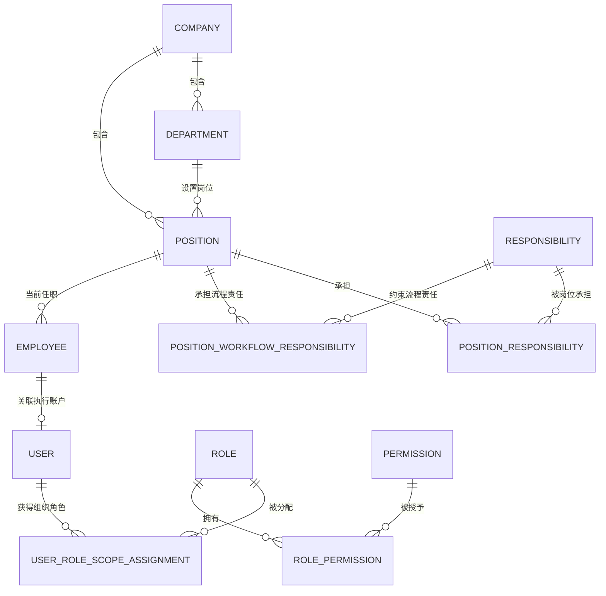
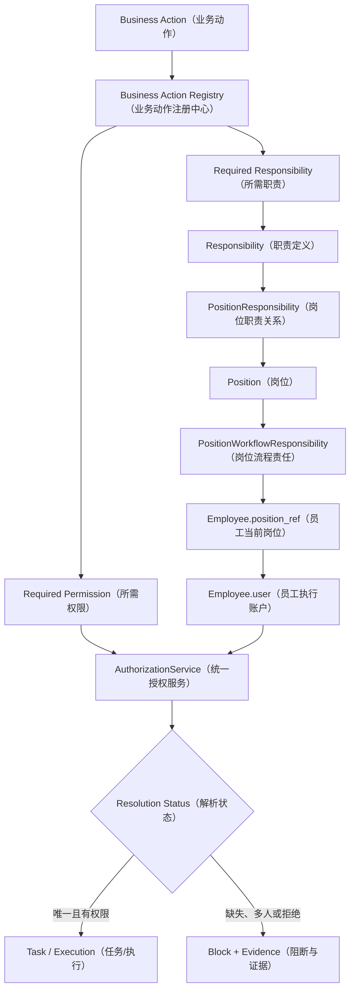
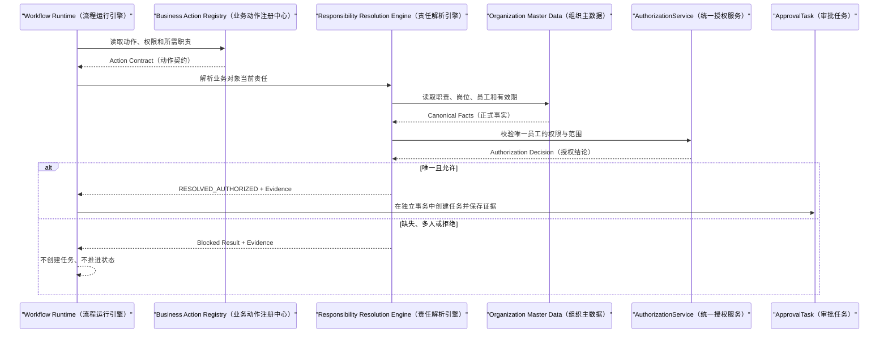

# PCE Responsibility Resolution Engine（责任解析引擎）V1 设计报告

报告日期：2026-08-17  
任务类型：NEXT-GENERATION ARCHITECTURE DESIGN（下一代架构设计）  
实施属性：ONLY DESIGN（仅设计）/ NOT IMPLEMENT（不实施）  
当前状态：DESIGN COMPLETE / HUMAN ARCHITECTURE REVIEW WAITING（设计完成/等待人工架构审核）

---

## 1. 设计目标

Responsibility Resolution Engine（责任解析引擎）回答两个连续但不可混合的问题：

1. Responsibility（职责/责任定义）回答“当前企业状态下，谁应该负责”；
2. Permission（权限）回答“该责任人能不能执行当前 Business Action（业务动作）”。

统一目标链：

```text
Business Action（业务动作）
→ Required Permission（所需权限）
→ Required Responsibility（所需职责）
→ Position（岗位）
→ Employee（员工）
→ AuthorizationService（统一授权服务）
→ Task / Execution（任务/执行）
```

本设计不是“找一个审批人”的工具，也不是第二套权限系统。它是连接 Business Action Registry（业务动作注册中心）、企业组织主数据与现有权限体系的服务端确定性解析能力。

---

## 2. Enterprise Operation Data Driven Principle（企业运作数据驱动原则）

> 企业组织、部门、岗位、员工、职责、责任和流程归属属于动态企业主数据。代码只提供模型、规则、校验和运行能力；企业实际关系必须由管理员维护的数据产生。

禁止：

```text
采购经理 = 固定岗位
审批人 = 固定员工或用户名
采购部 = 固定部门名称或 ID
公司 = company_id=1
岗位资格 = position.includes("采购")
```

正确方式：

```text
业务规则
→ 读取当前企业主数据
→ 解析当前有效责任关系
→ 验证当前责任人的权限与数据范围
→ 创建任务或允许执行
```

代码可以固定稳定的 Action Code（动作编码）、Permission Code（权限编码）、Workflow Code（流程编码）、Node Code（节点编码）、Responsibility Code（职责编码）和状态机规则，但不能固定承担这些职责的真实公司、部门、岗位或员工。

---

## 3. 已读取治理与事实依据

### 3.1 开发治理

- `docs/standards/PCE-DEVELOPMENT-STANDARD-V1.0.md`
- `docs/standards/PCE-BUSINESS-ACTION-PERMISSION-V1.0.md`
- `docs/governance/01-开发治理总纲/PCE-ERP开发治理总纲.md`
- `docs/governance/02-架构与运行边界/PCE-ERP架构与运行边界规范.md`
- `docs/governance/Runtime职责规范.md`
- `docs/governance/Schema规范.md`
- `docs/governance/真实运行验收规范.md`

### 3.2 组织模型报告

- `docs/governance/PCE企业组织运作模型V1-数据驱动架构审计报告.md`
- `docs/governance/PCE企业组织运作模型V1-实施与人工验收交接报告.md`
- `docs/governance/PCE企业组织运作模型V1-正式管理员入口统一与维护闭环整改报告.md`
- `docs/governance/PCE企业组织运作模型V1-员工汇报关系语义优化报告.md`

### 3.3 当前真实事实

```text
Responsibility = 0
PositionResponsibility = 0
PositionWorkflowResponsibility = 0
```

因此本轮只能完成契约和架构设计，不能声称责任解析已在真实企业数据上运行或验收通过。

---

## 4. 当前问题

1. ActionPermissionPolicy（动作权限策略）已经声明 `actionCode`、`requiredPermission`、角色、范围和状态，但没有声明 `requiredResponsibility`。
2. Responsibility、PositionResponsibility 和 PositionWorkflowResponsibility 已能维护和展示，但 Workflow Runtime（流程运行引擎）没有消费这些关系。
3. ApprovalTask（审批任务）仍用 `required_role_code` 表达任务资格，无法记录解析出的责任、岗位、员工和证据。
4. 采购申请提交仍可能直接写“采购经理审批/采购经理”，未走职责解析。
5. 部分前端流程 owner 和审批步骤保存在代码或 localStorage，不能作为正式责任事实。
6. Employee 与系统 User（用户账户）是一对一可选关系；没有 User 的 Employee 可以承担业务责任，但不能执行需要系统权限的数字动作。
7. 当前 Responsibility 是全局目录，没有 Company（公司）字段；其企业范围语义尚未明确。

---

## 5. 核心概念边界

| 概念 | 回答的问题 | 示例 | 事实来源 |
|---|---|---|---|
| Business Action（业务动作） | 用户正在申请执行什么？ | 审批采购申请 | Business Action Registry |
| Permission（权限） | 能不能做？ | `procurement.purchase_request.approve` | Permission Registry + RolePermission |
| Responsibility（职责/责任定义） | 谁应该负责哪类业务责任？ | 采购审批责任 | Responsibility |
| Position（岗位） | 企业哪个组织岗位承担责任？ | 采购经理岗位 | Position + PositionResponsibility |
| Employee（员工） | 当前是谁在该岗位上执行？ | 李四 | Employee.position_ref |
| Role（角色） | 系统授权集合是什么？ | 采购审批角色 | Role + RolePermission |
| AuthorizationService（统一授权服务） | 当前员工关联账户是否具有权限与范围？ | ALLOWED / PERMISSION_DENIED | 服务端授权事实 |

关键边界：

```text
Responsibility → Position → Employee 解决“谁负责”
Role → Permission → AuthorizationService 解决“能不能做”
```

Position 不等于 Role；责任存在不自动产生权限；权限存在也不自动意味着该人应该负责。

---

## 6. 与现有权限体系的关系

### 6.1 必须复用

- Business Action Registry（业务动作注册中心）：继续拥有动作编码、模块、状态、单条/批量规则和所需权限；
- Permission Registry（权限注册中心）：继续由 `system.Permission` 提供正式权限目录；
- RolePermission（角色权限关系）：继续表达 Role 获得哪些 Permission；
- UserRoleScopeAssignment（用户角色范围分配）：继续表达用户在 Company/Department 范围内的授权；
- AuthorizationService（统一授权服务）：继续产生最终权限与范围结论；
- ActionPermissionValidator（动作权限校验器）：继续校验动作注册、对象、数量、状态、流程阶段、组织范围和权限。

禁止新增：

```text
ResponsibilityPermissionV2
ApprovalPermissionV2
ManagerAuthorityTable
ResponsibilityRolePermission
```

### 6.2 调用语义

当前 AuthorizationService 的 `action_code` 参数实际接收 Permission Code。责任解析引擎必须先从 Business Action Registry 读取 `requiredPermission`，再调用：

```text
AuthorizationService.decide(
  user = resolved_employee.user,
  action_code = action.requiredPermission,
  organization_id = resolved_company.id,
  business_object = server_business_object,
  context = server_scope_context
)
```

不得把 Business Action Code 直接当成 Permission Code，除非注册契约明确二者相同。

### 6.3 双重校验

1. 任务生成前：对解析出的候选 Employee 做预测性权限校验；
2. 实际执行时：对当前登录用户重新执行 ActionPermissionValidator 和 AuthorizationService。

预测通过不等于永久授权。员工、岗位、角色、权限或范围在任务创建后变化时，执行必须按当前事实重新校验。

---

## 7. 与现有组织模型的关系

### 7.1 数据模型关系图



### 7.2 解析关系图



### 7.3 EmployeeReportingRelation（员工汇报关系）的边界

EmployeeReportingRelation 不参与默认职责解析。它只在 Business Action 明确声明“由直属主管”或“由职能主管”负责时作为专用策略输入。

禁止把“找不到责任岗位”自动降级为“找直属主管”或“找管理员”。

---

## 8. 现有模型是否足够

| 现有对象 | V1 结论 | 可复用能力 | 已知缺口 |
|---|---|---|---|
| Department（部门） | 足够 | 公司、层级、组织范围 | 无责任解析专属缺口 |
| Position（岗位） | 足够 | 公司、部门、状态、有效期、当前任职员工 | 暂不支持员工多岗位/代理任职 |
| Employee（员工） | 条件足够 | 当前正式岗位、部门、状态、关联 User | 未关联 User 时不能执行数字动作 |
| EmployeeReportingRelation（员工汇报关系） | 专用场景足够 | 直属/职能主管及有效期 | 不能替代岗位职责关系 |
| Responsibility（职责定义） | 条件足够 | 稳定职责编码和启停 | 无 Company、版本和有效期；必须先明确全局目录语义 |
| PositionResponsibility（岗位职责关系） | 基础解析足够 | 岗位与职责、主责、启停 | 无关系有效期；V1 只能按当前状态解析 |
| PositionWorkflowResponsibility（岗位流程责任） | V1 足够 | 流程、节点、责任类型、岗位、职责、有效期 | 当前允许 responsibility 为空；进入引擎的正式映射必须非空 |
| Business Action Registry（业务动作注册中心） | 需扩展契约，不需新表 | action、permission、状态、范围 | 缺 requiredResponsibility、workflow/node 和责任类型字段 |
| Permission Registry（权限注册中心） | 足够 | Permission、RolePermission | 不负责“谁应该负责” |
| AuthorizationService（统一授权服务） | 足够 | 用户、权限、Company/Department Scope | 输入必须是 Employee 关联的 User |
| ApprovalRouteAuthority（审批路线权威） | 可复用 | `steps` JSON 可逐步声明 Required Responsibility | 现存步骤可能仍是 required role |
| ApprovalTask（审批任务） | 只读迁移期可兼容；完整执行不足 | 状态、实例、步骤、审批数量 | 缺 responsibility、position、employee、resolution evidence |

### 8.1 不新增模型结论

```text
V1 Read-only Resolution（V1只读解析）= 现有模型足够
V1 Permission Pre-check（V1权限预检）= 现有模型足够
Persistent Assigned Task（持久化指派任务）= 现有 ApprovalTask 字段不足
New V2 Table（新增V2表）= 禁止
```

后续实施若进入任务持久化，应优先最小扩展既有 ApprovalTask，而不是新增平行表。建议字段仅作为后续方案候选，未经专项审批不得实施：

- `required_responsibility_id`：所需职责；
- `resolved_position_id`：解析岗位；
- `assigned_employee_id`：指派员工；
- `assigned_user_id`：执行账户；
- `resolution_evidence`：解析证据 JSON；
- `resolution_hash`：证据指纹；
- `resolved_at`：解析时间。

不得把 Responsibility Code 写入 `required_role_code`，也不得把 Employee ID 塞入角色字段；这种复用会破坏历史语义。

---

## 9. Business Action Registry（业务动作注册中心）扩展设计

在现有动作契约上增加元数据，不新增第二个 Registry：

| 字段 | 说明 | 必填规则 |
|---|---|---|
| `requiredResponsibility` | Required Responsibility Code（所需职责编码） | 会产生责任任务的动作必填 |
| `responsibilityType` | Responsibility Type（责任类型） | `OWNER/APPROVER/REVIEWER/EXECUTOR` |
| `workflowCode` | Workflow Code（流程编码） | 流程动作必填 |
| `nodeCode` | Node Code（节点编码） | 流程动作必填 |
| `resolutionMode` | Resolution Mode（解析模式） | V1 固定 `UNIQUE_EMPLOYEE` |
| `managerRelationType` | Manager Relation Type（主管关系类型） | 仅主管责任策略使用；默认空 |

示意契约：

```json
{
  "actionCode": "PROCUREMENT_PURCHASE_REQUEST_APPROVE",
  "moduleCode": "purchase-request",
  "requiredPermission": "procurement.purchase_request.approve",
  "requiredResponsibility": "PROCUREMENT_APPROVAL",
  "workflowCode": "PROCUREMENT_PURCHASE_REQUEST",
  "nodeCode": "PURCHASE_APPROVAL",
  "responsibilityType": "APPROVER",
  "resolutionMode": "UNIQUE_EMPLOYEE",
  "organizationScope": "DEPARTMENT",
  "serverValidator": "workflow_runtime.ActionPermissionValidator"
}
```

`requiredResponsibility` 是业务规则，不是企业实际岗位。企业管理员通过 PositionResponsibility 和 PositionWorkflowResponsibility 决定哪个岗位承担该职责。

---

## 10. ResponsibilityResolutionInput（责任解析输入）

### 10.1 输入字段

| 字段 | 中文说明 | 来源 | 信任规则 |
|---|---|---|---|
| `business_action` | 业务动作编码 | Action 请求 | 必须在服务端 Registry 重新读取 |
| `workflow_code` | 流程编码 | Workflow Instance / Registry | 不信任页面自由文本 |
| `node_code` | 节点编码 | 当前流程节点 | 必须与当前实例步骤一致 |
| `responsibility_type` | 责任类型 | Registry / Route | 必须为受治理枚举 |
| `company` | 公司 ID | 服务端业务对象 | 客户端只可传提示，不可决定 |
| `department` | 部门 ID | 服务端业务对象/组织上下文 | 必须属于 Company |
| `scope` | 数据范围 | AuthorizationService 上下文 | `SELF/DEPARTMENT/ORGANIZATION/ALL` |
| `business_object_type` | 业务对象类型 | 服务端对象 Provider | 必填 |
| `business_object_id` | 业务对象 ID | Action 请求 | 服务端重新读取 |
| `as_of` | 解析时点 | 服务端时间/业务有效时点 | 默认服务端当前时间 |
| `requester_employee_id` | 发起员工 ID | 正式业务对象 | 用于职责分离，不用于默认选人 |

### 10.2 输入权威性

页面只能提交 `business_action` 和业务对象 ID 等意图。Company、Department、当前状态、流程节点、Required Permission 和 Required Responsibility 必须由服务端重新读取。

若请求输入与服务端事实冲突，返回 `RESOLUTION_CONTEXT_MISMATCH`，不得选择任一版本继续。

---

## 11. 责任解析算法

### 11.1 固定顺序

1. **动作注册检查**：读取 Business Action Registry；未注册则阻断。
2. **业务对象检查**：服务端读取业务对象、Company、Department、当前状态和流程实例。
3. **需求声明检查**：取得 Required Permission、Required Responsibility、Workflow Code、Node Code 和 Responsibility Type。
4. **职责目录检查**：按稳定 code 读取 active Responsibility；不存在或停用则未解析。
5. **岗位职责检查**：读取 active PositionResponsibility，要求责任一致、岗位 active、岗位有效期覆盖 `as_of`、岗位属于 Company。
6. **流程责任检查**：流程场景继续要求 PositionWorkflowResponsibility 同时匹配岗位、职责、workflow、node、ownership type、active 和有效期。
7. **部门范围检查**：按服务端业务对象和 Scope 限定 Position.department；不能用部门名称推断。
8. **员工检查**：读取 `Employee.position_ref` 等于候选 Position 且员工 status 为 active；员工正式部门和岗位公司必须一致。
9. **唯一性检查**：V1 只允许一个有效责任路径和一个最终 Employee；不得按最小 ID、姓名、资历或管理员身份自动选人。
10. **执行身份检查**：Employee 必须关联 active User；否则责任可识别但不可执行。
11. **权限预检**：使用 Required Permission 调用 AuthorizationService，检查 Role、Permission、Company 和 Department Scope。
12. **职责分离检查**：流程需要时调用现有 SegregationOfDutiesProvider（职责分离提供者），检查申请人与审批人分离等规则。
13. **结果形成**：返回单一 ResponsibilityResolutionResult 和完整 Evidence；解析引擎本身不创建任务、不推进状态。

### 11.2 候选选择原则

- 权限不能用于从多个责任候选人中“挑一个有权限的人”；这会把“谁负责”和“能不能做”混为一体；
- 多个责任候选先返回冲突，要求管理员修复责任配置；
- 不能因为正式责任人没有权限就改找管理员、上级主管或其他有权限用户；
- 同一 Employee 通过多条冲突责任路径被解析时返回 `RESPONSIBILITY_CONFIGURATION_CONFLICT`，不能静默去重；
- 并行会签不属于 V1 唯一责任解析。未来由 Approval Route 明确声明多席位和最少批准数，不能把偶然多人配置解释为会签。

---

## 12. ResponsibilityResolutionResult（责任解析结果）

### 12.1 输出字段

| 字段 | 说明 |
|---|---|
| `resolution_id` | 本次解析的临时唯一标识；不是业务任务 ID |
| `resolution_status` | 解析状态 |
| `business_action` | 当前业务动作 |
| `required_permission` | 当前动作要求的权限 |
| `workflow_code` | 来源流程代码 |
| `node_code` | 来源节点代码 |
| `responsibility_type` | 责任类型 |
| `responsibility` | 责任定义 ID、code、名称 |
| `position` | 承担岗位 ID、code、名称 |
| `employee` | 最终 Employee ID、员工编号、姓名 |
| `user` | 关联执行 User ID；不返回敏感账户信息 |
| `company` | 所属 Company ID、code、名称 |
| `department` | 所属 Department ID、code、名称 |
| `permission_decision` | AuthorizationService 的允许/拒绝结果 |
| `evidence` | 责任来源、关系 ID、有效期、Scope 和权限证据 |
| `candidate_count` | 候选责任路径数量 |
| `resolved_at` | 服务端解析时间 |
| `resolution_hash` | 规范化证据摘要指纹 |
| `write_count` | 只读解析固定为 0 |

### 12.2 成功示例

```json
{
  "resolution_status": "RESOLVED_AUTHORIZED",
  "business_action": "PROCUREMENT_PURCHASE_REQUEST_APPROVE",
  "required_permission": "procurement.purchase_request.approve",
  "workflow_code": "PROCUREMENT_PURCHASE_REQUEST",
  "node_code": "PURCHASE_APPROVAL",
  "responsibility_type": "APPROVER",
  "responsibility": {
    "id": 18,
    "code": "PROCUREMENT_APPROVAL",
    "name": "采购审批责任"
  },
  "position": {
    "id": 35,
    "code": "POS-PROCUREMENT-MANAGER",
    "name": "采购经理"
  },
  "employee": {
    "id": 66,
    "employee_no": "EMP006",
    "name": "李四"
  },
  "company": { "id": 2, "code": "PCE-CN", "name": "示例公司" },
  "department": { "id": 9, "code": "PROC", "name": "采购部" },
  "permission_decision": {
    "allowed": true,
    "decision_code": "ALLOWED"
  },
  "candidate_count": 1,
  "write_count": 0
}
```

示例中的名称和 ID 仅说明输出格式，不得写入代码、初始化脚本或正式数据。

---

## 13. Resolution Evidence（解析证据）设计

系统不能只返回“李四”。每次结果至少包含：

| 证据组 | 必须字段 |
|---|---|
| Action Evidence（动作证据） | actionCode、moduleCode、requiredPermission、registryVersion |
| Responsibility Evidence（职责证据） | Responsibility ID/code/name、active |
| Position Mapping Evidence（岗位映射证据） | PositionResponsibility ID、isPrimary、active |
| Workflow Mapping Evidence（流程映射证据） | PositionWorkflowResponsibility ID、workflowCode、nodeCode、ownershipType、effectiveFrom/To |
| Position Evidence（岗位证据） | Position ID/code/name、Company ID、Department ID、effectiveFrom/To、active |
| Employee Evidence（员工证据） | Employee ID/no/name、positionRef ID、departmentRef ID、status、User ID |
| Authorization Evidence（授权证据） | contractVersion、authoritySource、roleCodes、permissionCodes、scope、decisionCode |
| Object Evidence（业务对象证据） | objectType、objectId、Company ID、Department ID、server status |

示例：

```text
Employee（员工）：李四 / EMP006
Responsibility（职责）：采购审批责任 / PROCUREMENT_APPROVAL
Position（岗位）：采购经理 / POS-PROCUREMENT-MANAGER
Department（部门）：采购部 / PROC
来源关系：PositionResponsibility #21
流程关系：PositionWorkflowResponsibility #34
有效期：2026-01-01 ～ 2027-01-01
权限：procurement.purchase_request.approve / ALLOWED
授权来源：system.UserRoleScopeAssignment + RolePermission
```

`resolution_hash` 由规范化后的 ID、code、有效期、权限结论和解析时点产生，用于检测事实变化；Hash 不替代原始 Evidence。

---

## 14. 异常策略

| 状态码 | 含义 | HTTP/调用建议 | 后续动作 |
|---|---|---|---|
| `RESPONSIBILITY_UNRESOLVED` | 没有有效职责、岗位、流程映射或员工 | 409 / 阻断 | 管理员维护责任关系 |
| `MULTIPLE_RESPONSIBILITY_CANDIDATES` | 存在多个有效责任候选 | 409 / 阻断 | 人工修复配置；禁止自动挑选 |
| `RESPONSIBILITY_FOUND_PERMISSION_DENIED` | 唯一责任人存在但权限或 Scope 不足 | 403 / 阻断 | 修复 RolePermission 或用户范围 |
| `RESPONSIBILITY_FOUND_NO_EXECUTION_IDENTITY` | Employee 未关联 active User | 409 / 阻断 | 建立员工与账户关系 |
| `RESPONSIBILITY_CONFIGURATION_CONFLICT` | 同一人或岗位存在多条冲突路径 | 409 / 阻断 | 清理重复或重叠有效配置 |
| `RESPONSIBILITY_CONTEXT_MISMATCH` | Company、Department、流程节点与服务端对象不一致 | 409 / 阻断 | 使用服务端事实重建上下文 |
| `BUSINESS_ACTION_NOT_REGISTERED` | 动作未注册 | 400 / 阻断 | 治理登记动作 |
| `RESPONSIBILITY_DEFINITION_INACTIVE` | 职责定义已停用 | 409 / 阻断 | 恢复或更换正式职责定义 |

强制禁止：

- 自动找管理员；
- 自动找直属主管；
- 自动找拥有权限的任意用户；
- 按岗位名、部门名、用户名或 ID 排序选第一个；
- 返回空结果后继续创建任务；
- 用旧 `required_role_code` 静默兜底。

---

## 15. Workflow Runtime（流程运行引擎）融合方案

### 15.1 当前与目标

当前：

```text
Workflow Node
→ required_role_code
→ User Role
→ ApprovalTask
```

目标：

```text
Workflow Node
→ Required Responsibility
→ Responsibility Resolution Engine
→ Position
→ Employee / User
→ AuthorizationService
→ ApprovalTask
```

### 15.2 渐进迁移

#### Phase 0：Contract Only（仅契约）

- 冻结本设计；
- 在 Business Action Registry 和 Approval Route 的设计规范中增加 Required Responsibility；
- 不修改 Runtime、不创建任务、不迁移数据。

#### Phase 1：Read-only Shadow Resolution（只读影子解析）

- 对选定采购申请动作调用只读解析；
- 返回结果、证据和错误，但不改变旧任务生成；
- 旧 `required_role_code` 与新解析并排对比；
- 差异只报告，不自动修复。

#### Phase 2：Responsibility Required Gate（责任必需门禁）

- 新流程配置必须声明 Required Responsibility；
- 无责任、多人、无权限全部阻断任务创建；
- 旧流程仍在明确 Legacy 标志下运行，禁止新增旧式配置。

#### Phase 3：Task Assignment Migration（任务指派迁移）

- 经专项审批后最小扩展既有 ApprovalTask；
- 保存责任、岗位、Employee、User、Evidence 和 Hash；
- `required_role_code` 只保留历史兼容，不再作为新任务的责任来源。

#### Phase 4：Legacy Retirement（旧角色路由退役）

- 按流程版本核对存量任务；
- 关闭新任务的 required role 路由；
- 历史字段只读保留，禁止篡改历史审批证据。

### 15.3 任务创建时序



---

## 16. Permission（权限）融合设计

### 16.1 职责与权限不可互相补偿

| 责任结果 | 权限结果 | 最终结果 |
|---|---|---|
| 无责任人 | 任意 | `RESPONSIBILITY_UNRESOLVED` |
| 多责任人 | 任意 | `MULTIPLE_RESPONSIBILITY_CANDIDATES` |
| 唯一责任人 | 拒绝 | `RESPONSIBILITY_FOUND_PERMISSION_DENIED` |
| 唯一责任人 | 允许 | `RESOLVED_AUTHORIZED` |

“有权限”不能补偿“无责任”；“有责任”不能补偿“无权限”。

### 16.2 执行身份

最终数字执行链必须为：

```text
Employee
→ Employee.user
→ UserRoleScopeAssignment
→ Role
→ RolePermission
→ Permission
→ AuthorizationService
```

Position.default_role 只能作为管理员配置参考或岗位授权建议，不能自动给 Employee 授权。岗位变动也不能隐式写 RolePermission。

### 16.3 实际执行复核

实际提交审批时必须验证：

- 当前登录 User 与任务 assigned_user 一致；
- User 仍关联同一 Employee；
- Employee 仍 active；
- 责任映射是否仍有效，或任务是否按创建时快照冻结；
- Required Permission 和 Scope 仍由 AuthorizationService 允许；
- Business Object 状态和版本仍由 ActionPermissionValidator 允许；
- Segregation of Duties（职责分离）仍满足。

“按创建时责任冻结”还是“执行时动态重解析”必须由流程专项明确。V1 建议：任务指派使用创建时证据冻结，实际权限使用执行时事实重检；组织变化不静默改派现有任务。

---

## 17. 第一阶段：Purchase Request Approval（采购申请审批）

### 17.1 目标链

```text
Purchase Request（采购申请）
→ PROCUREMENT_PURCHASE_REQUEST_APPROVE
→ procurement.purchase_request.approve
→ PROCUREMENT_APPROVAL（采购审批责任）
→ PositionResponsibility
→ PositionWorkflowResponsibility
→ 采购经理岗位（由数据决定，不由代码决定）
→ 当前 active Employee
→ AuthorizationService
→ ApprovalTask
```

### 17.2 前置数据

管理员必须先维护：

1. Responsibility：`PROCUREMENT_APPROVAL / 采购审批责任`；
2. PositionResponsibility：某正式 Position 承担该责任；
3. PositionWorkflowResponsibility：该 Position 在采购申请流程审批节点为 APPROVER；
4. Employee：有且仅有一个 active Employee 在该岗位；
5. Employee.user：关联 active User；
6. RolePermission：该 User 的 Role 拥有采购申请审批权限；
7. UserRoleScopeAssignment：授权范围覆盖采购申请 Company/Department。

职责名称和岗位名称可以由企业管理员调整；引擎只依赖稳定 ID/code 和正式关系。

### 17.3 提交流程

1. 用户提交采购申请；
2. 服务端读取采购申请 Company、申请 Department、采购 Department、状态和流程版本；
3. Business Action Registry 返回动作、权限和所需职责；
4. 引擎解析唯一 Employee；
5. AuthorizationService 对该 Employee 的 User 做权限预检；
6. 成功时 Workflow Runtime 才可创建审批任务；
7. 失败时采购申请不得写“采购经理”占位，不得推进为虚假待审批状态；
8. 实际审批动作再次执行权限、状态、对象版本和职责分离校验。

### 17.4 首阶段验收矩阵

| 编号 | 场景 | 预期 |
|---|---|---|
| PR-R01 | 唯一职责、岗位、员工且权限通过 | `RESOLVED_AUTHORIZED` |
| PR-R02 | 无 Responsibility | `RESPONSIBILITY_UNRESOLVED` |
| PR-R03 | 有职责但无岗位映射 | `RESPONSIBILITY_UNRESOLVED` |
| PR-R04 | 岗位没有 active Employee | `RESPONSIBILITY_UNRESOLVED` |
| PR-R05 | 岗位存在两个 active Employee | `MULTIPLE_RESPONSIBILITY_CANDIDATES` |
| PR-R06 | Employee 未关联 User | `RESPONSIBILITY_FOUND_NO_EXECUTION_IDENTITY` |
| PR-R07 | 唯一 Employee 无权限 | `RESPONSIBILITY_FOUND_PERMISSION_DENIED` |
| PR-R08 | 跨公司岗位/员工 | `RESPONSIBILITY_CONTEXT_MISMATCH` |
| PR-R09 | 关系已过有效期 | 不进入候选，最终 unresolved |
| PR-R10 | 申请人与审批人违反职责分离 | 阻断任务或执行 |

---

## 18. 后续扩展场景

| 场景 | Required Responsibility 示例 | Responsibility Type | 组织范围 |
|---|---|---|---|
| Supplier Review（供应商审核） | `SUPPLIER_REVIEW` | REVIEWER/APPROVER | Company + 采购组织 |
| Purchase Order Approval（采购订单审批） | `PURCHASE_ORDER_APPROVAL` | APPROVER | Company + Department |
| Goods Receipt Approval（收货审批） | `GOODS_RECEIPT_APPROVAL` | APPROVER | 仓库/收货组织 |
| Quality Approval（质量审批） | `QUALITY_DISPOSITION_APPROVAL` | APPROVER | 质量组织/检验对象 |
| Finance Approval（财务审批） | `FINANCE_PAYMENT_APPROVAL` | APPROVER | Company + 财务范围 |
| Performance Evaluation（绩效评价） | `PERFORMANCE_EVALUATION` | REVIEWER | Employee/Department/Reporting Relation |

### 18.1 Supplier Management（供应商管理）

供应商审核优先使用职责和岗位关系；供应商负责人若未来需要长期分配到具体 Employee，必须先证明 PositionResponsibility/业务对象归属无法表达，再单独提出模型评审。不得用 supplier owner 字符串、buyer_name 或固定采购员代替。

### 18.2 Performance Evaluation（绩效评价）

绩效评价可能使用两种显式策略：

- 岗位职责策略：由 PositionResponsibility 解析专业评审人；
- 汇报关系策略：动作契约明确 `managerRelationType=DIRECT/FUNCTIONAL` 后读取 EmployeeReportingRelation。

两种策略不能在引擎内部隐式切换。

---

## 19. AI Boundary（人工智能边界）

AI 可以：

- 推荐可能缺失的 Responsibility 配置；
- 发现没有岗位承担职责；
- 发现多个岗位/员工冲突；
- 解释权限拒绝原因；
- 生成待管理员确认的配置建议。

AI 禁止：

- 自动决定谁审批；
- 自动选择多个候选中的一个；
- 自动授予 Role 或 Permission；
- 自动建立 PositionResponsibility、PositionWorkflowResponsibility 或 EmployeeReportingRelation；
- 自动修改任务责任人；
- 用概率推荐替代正式企业关系。

所有 AI 输出状态固定为 `ADVISORY_ONLY（仅建议）`，必须经管理员显式 Action、权限、原因和审计后才能改变主数据。

---

## 20. 非功能设计

### 20.1 一致性

- 单次解析使用同一数据库一致性视图；
- Company、Department、Position、Employee 和关系的读取不得来自不同缓存版本；
- 不允许 localStorage、前端数组或上一页缓存补齐候选人。

### 20.2 幂等与可重放

相同业务对象版本、动作、流程节点、解析时点和组织事实应产生相同 `resolution_hash`。事实变化后 Hash 必须变化。

### 20.3 性能

- 使用服务端 QuerySet 的 `select_related/prefetch_related`；
- V1 默认不建立跨请求责任缓存；
- 如未来缓存，键必须包含 Company、Department、workflow、node、responsibility、as_of 和组织事实版本，并具备明确失效机制。

### 20.4 安全

- 结果只显示业务所需员工信息；
- 不返回身份证、电话等无关敏感字段；
- 解析 API 必须受查看权限保护；
- 权限 Evidence 可返回 code 和结论，不向普通用户泄露不必要的全量授权结构。

---

## 21. 实施路线建议

| 阶段 | 目标 | 允许范围 | 停止条件 |
|---|---|---|---|
| D0 | 人工审核本设计 | 文档 | 架构决策签发 |
| D1 | 责任目录语义与动作契约冻结 | Registry/Schema 设计 | Responsibility 公司语义明确 |
| D2 | 只读解析 Provider/Service | 不写任务、不改流程状态 | PR-R01～R10 隔离测试通过 |
| D3 | 影子运行 | 与旧 required role 对照 | 差异清单完成、零业务写入 |
| D4 | 采购申请责任门禁 | 新任务必须解析成功 | 用户人工验收通过 |
| D5 | 最小扩展既有 ApprovalTask | 不新增 V2 表 | 任务、证据、权限同对象闭环 |
| D6 | 逐模块迁移 | 供应商/采购订单/收货/质量/财务 | 每模块独立验收 |
| D7 | 旧角色路由退役 | 历史只读兼容 | 无新任务写 required role |

每个实施阶段必须重新授权；本设计报告不授权任何代码、Schema、模型或数据库变更。

---

## 22. 关键架构决策待人工审核

1. Responsibility 是 PCE 全局受治理语义目录，还是每个 Company 独立维护的企业主数据？V1 建议“全局稳定定义 + Company 岗位分配”，否则现有模型缺 Company。
2. 同岗位多 Employee 是否一律视为冲突，还是允许显式 Pool/会签？V1 建议唯一 Employee，后续另行设计并行策略。
3. 任务创建后组织关系变化时，是冻结原指派还是重新解析？V1 建议指派证据冻结、实际权限动态复核，改派必须显式 Action。
4. 非流程 Business Action 是否也必须通过 PositionWorkflowResponsibility？V1 建议无流程动作只用 PositionResponsibility；有流程动作两者都必须匹配。
5. Employee 无 User 时是否允许线下责任任务？本引擎面向系统执行，V1 建议阻断数字任务并返回无执行身份。
6. ApprovalTask 的最小字段扩展是否接受？若不接受，则只能停留在只读解析，无法形成持久任务证据闭环。

---

## 23. 风险

| 风险 | 影响 | 控制 |
|---|---|---|
| Responsibility 当前为 0 条 | 无真实职责可解析 | 先由管理员维护，不自动初始化 |
| Responsibility 无 Company | 多公司语义可能冲突 | 人工确认全局目录策略 |
| PositionResponsibility 无有效期 | 不能重放历史责任 | V1 只解析当前状态；历史能力另行设计 |
| Employee 单岗位 | 无法表达兼岗 | V1 不推断；需要时单独建模评审 |
| 多人同岗位 | 责任候选不唯一 | 默认阻断，不自动挑选 |
| Employee 未关联 User | 无法做权限判断 | 返回专用错误并补账户关系 |
| required role 与 required responsibility 并存 | 双轨结果冲突 | 影子对照、版本化迁移、禁止静默兜底 |
| Registry 前后端不一致 | 页面与服务端责任声明不同 | 服务端 Registry 权威，前端只消费投影 |
| 组织关系运行中变化 | 任务漂移 | 任务证据冻结，改派走显式 Action |
| 将权限用于选人 | 混淆责任与授权 | 先唯一责任，再单人权限校验 |
| AI 自动配置 | 非人工企业事实写入 | ADVISORY_ONLY + 管理员确认 |

---

## 24. 设计验收与治理状态

本轮是纯文档设计，没有页面或可运行入口变更，因此 Browser Human Acceptance（浏览器人工验收）为 N/A；该 N/A 不能用于未来实现签发 READY。

```text
Governance Files Loaded = PASS
Existing Capability Scan = PASS
Data Driven Principle = DEFINED
Permission System Reuse = PASS
Second Permission System Proposed = NO
Second Responsibility Model Proposed = NO
Responsibility Resolution Contract = DESIGNED
Evidence Contract = DESIGNED
Exception Strategy = DESIGNED
Workflow Migration Route = DESIGNED
Purchase Request Pilot = DESIGNED
AI Boundary = ADVISORY_ONLY
Business Code Changed = NO
Database Changed = NO
Browser Human Acceptance = N/A（纯文档设计）
Build = N/A（未修改代码）
Ready Gate = N/A（设计等待人工审核，不签发实现 READY）
Human Architecture Review = WAITING
```

---

## 25. 数据保护结果

设计前后只读复核：

```text
Database SHA256 Before = 9FC2A4B19716E84EB10F397BF94736CC69FFC6D1472C6FFB1849DD3A20036619
Database SHA256 After  = 9FC2A4B19716E84EB10F397BF94736CC69FFC6D1472C6FFB1849DD3A20036619
PurchaseOrder Before / After = 218 / 218
SupplierMaterialPrice Before / After = 28 / 28
Responsibility Before / After = 0 / 0
PositionResponsibility Before / After = 0 / 0
PositionWorkflowResponsibility Before / After = 0 / 0
```

本轮未运行迁移、测试数据生成、Workflow（工作流）动作、采购动作或浏览器保存。设计前后数据库哈希及保护计数完全一致，据此签发：

```text
Unauthorized Business Writes = 0
PurchaseOrder Added = 0
SupplierMaterialPrice Added = 0
```

---

## 26. 最终结论

PCE Responsibility Resolution Engine（责任解析引擎）V1 应被定位为服务端、只读、确定性、证据化的责任解析能力：

```text
Business Action 声明 Required Permission 与 Required Responsibility
→ 企业主数据决定 Position 与 Employee
→ AuthorizationService 决定该 Employee 能否执行
→ Workflow Runtime 只在唯一且允许时创建任务
```

V1 可以在不新增模型的前提下完成只读责任解析和权限预检；完整任务指派需要经后续专项批准，最小扩展既有 ApprovalTask，禁止新增 V2 表或语义冒用 `required_role_code`。

最终状态：

```text
Responsibility Resolution Engine V1 Design = PASS
Implementation = NOT STARTED
Workflow Runtime Changed = NO
Permission Changed = NO
Business Data Changed = NO
Human Architecture Review = WAITING
```

本轮到此停止。先由人工审核“责任如何解析”，再授权任何业务流程自动运行。
